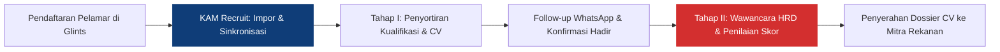
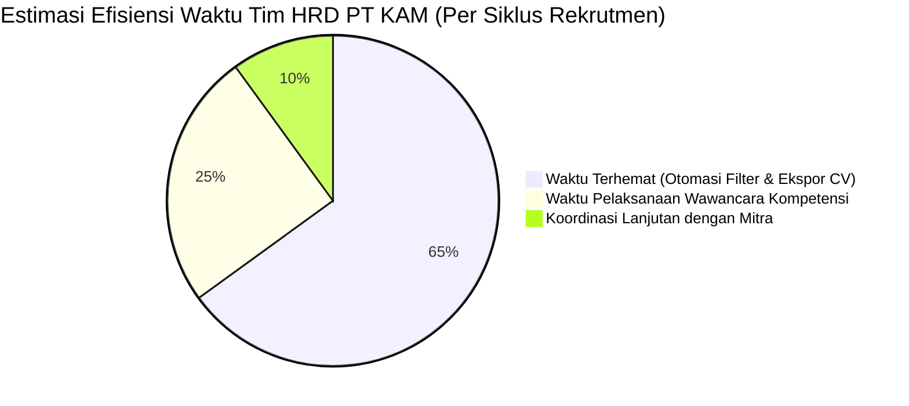

# BUSINESS REQUIREMENTS DOCUMENT (BRD)
## KAM RECRUIT - SISTEM MANAJEMEN REKRUTMEN TENAGA KERJA OUTSOURCING
### PT KINARYA ALIHDAYA MANDIRI (PT KAM)

---

| Dokumen ID | Versi | Status | Tanggal Terbit | Pemilik Dokumen | Penulis |
| :--- | :--- | :--- | :--- | :--- | :--- |
| **BRD-KAM-01** | **1.0.0** | Disetujui (Approved) | 30 Oktober 2026 | Divisi HRD & Operasional PT KAM | Tim Kerja Praktik UDINUS |

---

## 1. Eksekutif & Konteks Organisasi

### 1.1 Profil Perusahaan Mitra
**PT Kinarya Alihdaya Mandiri (PT KAM)** merupakan perusahaan nasional yang bergerak di bidang penyediaan jasa tenaga kerja alihdaya (*manpower outsourcing / labor supply*), manajemen fasilitas, dan operasional bisnis. Dalam menjalankan proses bisnis intinya, PT KAM bermitra dengan berbagai korporasi terkemuka (antara lain PT Telkom Akses, PT Indonusa Telemedia / Transvision, PT Logistik Prima, dan mitra industri lainnya) untuk memenuhi kebutuhan tenaga kerja pada berbagai posisi operasional, seperti *Customer Service Representative*, *Teknisi Jaringan Fiber Optic (FTTH)*, dan *Admin Operasional Logistik*.

### 1.2 Ringkasan Eksekutif Proyek
Proyek **KAM Recruit** diinisiasi untuk merancang dan membangun sistem manajemen rekrutmen terpadu berbasis web yang mengotomatisasi dan mengintegrasikan siklus seleksi pelamar pasca-pendaftaran di portal eksternal (Glints) hingga penyerahan berkas *Curriculum Vitae* (CV) kandidat terpilih kepada perusahaan mitra pengguna (*user* pihak ketiga). Proyek ini menghilangkan *bottleneck* manual pada tim HRD recruiter PT KAM yang selama ini mengandalkan pembaruan lembar kerja *spreadsheet* tunggal.

---

## 2. Latar Belakang & Pernyataan Masalah (*Problem Statement*)

### 2.1 Kondisi Operasional Berjalan (*As-Is*)
Saat ini, proses penarikan kandidat (*talent sourcing*) dilakukan melalui iklan lowongan di portal publik Glints. Namun, operasional internal pasca-pelamar mendaftar menghadapi kendala kritis sebagai berikut:
1. **Volume Pelamar Masif vs. Screening Manual**: Ratusan berkas pelamar masuk setiap minggu per lowongan. Tim HRD harus memeriksa CV, domisili, usia, dan latar belakang pendidikan secara manual satu demi satu.
2. **Kerapuhan Spreadsheet Tunggal (*Single Master Spreadsheet Dilemma*)**: HRD mengelola seluruh rekapitulasi pada satu file Excel yang diperbarui (*overwrite*) secara berulang lintas tahapan (sebelum wawancara dan sesudah wawancara). Hal ini menimbulkan risiko tinggi:
   - Terhapusnya riwayat data kualifikasi awal (*data loss/overwriting*).
   - Tidak adanya jejak audit (*audit trail*) siapa staf yang mengubah status kandidat dan kapan perubahan dilakukan.
   - Konflik akses *file locking* saat beberapa recruiter membuka berkas secara bersamaan.
3. **Drop Rate Kandidat Tinggi & Tidak Terdokumentasi**: Fakta lapangan menunjukkan dari ~50 pelamar terpilih yang dihubungi melalui pesan WhatsApp/telepon untuk jadwal wawancara, hanya ~20 pelamar (40%) yang merespons bersedia hadir, sementara ~30 pelamar (60%) tidak merespons, menolak, atau tidak hadir (*no-show*). Pola dan alasan kegagalan ini tidak terdata dalam metrik analitik bisnis.
4. **Keterlambatan Penyerahan Berkas ke Mitra**: Saat perusahaan mitra meminta paket CV kandidat yang lolos seleksi HRD, staf rekrutmen membutuhkan waktu 1–2 hari kerja untuk mengumpulkan ulang berkas PDF, merapikan format, dan mencocokkan rekapitulasi hasil wawancara.

---

## 3. Sasaran & Target Bisnis (*Business Goals & Objectives*)

Berdasarkan kerangka SMART (*Specific, Measurable, Achievable, Relevant, Time-bound*), sasaran bisnis sistem **KAM Recruit** adalah:

| No | Sasaran Bisnis (*Business Goal*) | Indikator Metrik (KPI) | Kondisi Awal (*Baseline*) | Target Sistem Baru |
| :---: | :--- | :--- | :--- | :--- |
| **BG-01** | Percepatan proses sortir administratif pelamar Glints | *Screening Turnaround Time* | 3–4 hari kerja per 100 pelamar | **< 2 jam** (Otomasi filter parameter) |
| **BG-02** | Eliminasi insiden data tertimpa atau hilang | *Data Overwriting Incidents* | Rata-rata 2–3 insiden per kuartal | **0 Insiden** (Database relational + log audit) |
| **BG-03** | Transparansi rasio kehadiran wawancara (*Response Rate*) | *Candidate Response Tracking* | Tidak tercatat sistematis (estimasi ~40%) | **100% Pelacakan Real-time** (Status Bersedia/Drop/No-Show) |
| **BG-04** | Percepatan penyusunan bundel berkas CV ke mitra | *Time to Client Dossier Submission* | 24–48 jam kerja | **< 15 menit** (Satu klik ekspor paket CV + rekap skor) |
| **BG-05** | Standarisasi keputusan wawancara HRD internal | *Standardized Decision Compliance* | Catatan manual subyektif di lembar cetak | **Keputusan Dropdown Terstandar** (Lolos Seleksi HRD / Tidak Lolos + Catatan) |

---

## 4. Ruang Lingkup Proyek (*Project Scope*)

### 4.1 Dalam Lingkup (*In-Scope*)
1. Pengelolaan repositori bank pelamar yang diimpor pasca-pendaftaran di Glints.
2. Penyaringan administratif otomatis berdasarkan parameter: Usia batas maksimum, Jenjang pendidikan minimal, Domisili penempatan, serta verifikasi Pengalaman Kerja dan Sertifikasi Profesi.
3. Pelacakan komunikasi penjadwalan wawancara via WhatsApp (Status: Bersedia, Batal/Menolak, Tidak Merespons).
4. Pengelolaan rekapitulasi seleksi bertahap:
   - **Rekapitulasi Tahap I**: Pelamar yang lolos sortir kualifikasi administrasi.
   - **Rekapitulasi Tahap II**: Kandidat yang telah mengikuti wawancara HRD dan memperoleh status *Lolos Seleksi HRD*.
5. Pratinjau *Dossier Curriculum Vitae (CV)* lengkap dengan riwayat pengalaman dan rincian sertifikat kompetensi (termasuk tombol cetak dokumen A4 dan salin ringkasan profil).
6. Ekspor berkas CV dan lembar rekapitulasi keputusan wawancara untuk diserahkan ke mitra pihak ketiga (*user*).
7. Hak akses operasional berbasis peran: *HRD Recruiter Staff*, *HRD Manager / Administrator*, dan *Pimpinan Manajemen*.

### 4.2 Di Luar Lingkup (*Out-of-Scope*)
1. Pendaftaran mandiri publik oleh pelamar (tetap menggunakan formulir lowongan resmi di Glints).
2. Sistem seleksi tahap lanjutan pihak ketiga (seperti tes teknis internal klien, wawancara *user* klien, dan *medical check-up* yang diadakan langsung oleh korporasi mitra).
3. Penggajian (*payroll*), absensi karyawan aktif, dan manajemen kontrak kerja setelah tenaga kerja ditempatkan (*post-placement HRIS*).

---

## 5. Analisis Pemangku Kepentingan (*Stakeholder Analysis*)

| Pemangku Kepentingan | Peran dalam Bisnis | Kebutuhan Utama pada Sistem | Tingkat Pengaruh / Kepentingan |
| :--- | :--- | :--- | :---: |
| **Pimpinan / Direktur PT KAM** | Pengambil keputusan strategis | Memantau ketercapaian kuota pemenuhan tenaga kerja (*fulfillment rate*), kecepatan rekrutmen, dan laporan performa mitra. | Tinggi / Tinggi |
| **HRD Recruiter Staff** | Operator harian seleksi | Filter otomatis pelamar Glints, template pesan undangan wawancara cepat, form penilaian wawancara digital, dan ekspor CV instan. | Tinggi / Tinggi |
| **Perusahaan Mitra (Klien)** | Penerima tenaga kerja alihdaya | Menerima berkas CV kandidat terverifikasi yang memenuhi standar kualifikasi secara cepat dan transparan. | Sedang / Tinggi |
| **Pelamar Kerja** | Subjek pencari kerja | Menerima kepastian status seleksi dan jadwal wawancara yang jelas tanpa miskomunikasi. | Rendah / Sedang |

---

## 6. Analisis Kelayakan & Manfaat Finansial (*Cost-Benefit Analysis*)

* **Efisiensi Tenaga Kerja**: Menghemat sekitar 20 jam kerja per staf recruiter setiap bulan dari tugas repetitif menyalin data Excel dan menyusun lampiran email CV secara manual.
* **Perlindungan Reputasi Mitra**: Mencegah lolosnya kandidat yang tidak memenuhi syarat usia/domisili ke hadapan pihak ketiga, menjaga *Service Level Agreement* (SLA) PT KAM di hadapan korporasi mitra (Telkom Akses, Transvision, dll.).
* **Kesiapan Audit**: Memenuhi kepatuhan ISO dan audit ketenagakerjaan berkat riwayat perubahan data (*immutable audit log*).

---

## 7. Batasan & Asumsi Bisnis (*Business Assumptions & Dependencies*)
1. **Asumsi Data**: Pelamar telah mengunggah data identitas, riwayat kerja, dan dokumen pendukung pada portal Glints dengan format file PDF/DOCX yang sah.
2. **Konektivitas**: Sistem membutuhkan koneksi internet stabil untuk sinkronisasi data pelamar dan integrasi tautan pesan WhatsApp Web.
3. **Kepatuhan Privasi Data**: Data pribadi pelamar (nomor telepon, alamat, riwayat pendidikan) dijaga kerahasiaannya dan hanya dapat diakses oleh personel HRD berwenang sesuai Undang-Undang Perlindungan Data Pribadi (UU PDP No. 27 Tahun 2022).

