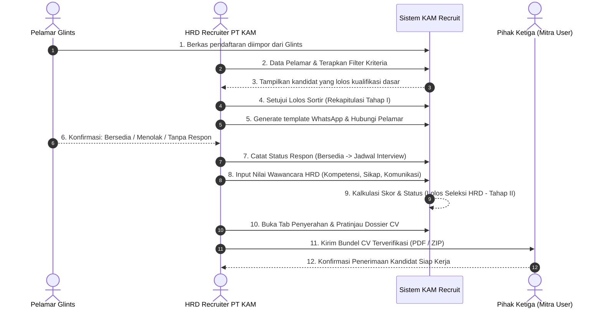
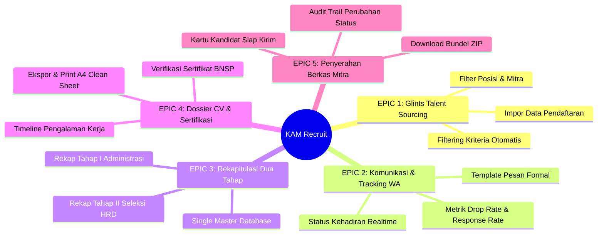

# PRODUCT REQUIREMENTS DOCUMENT (PRD)
## KAM RECRUIT - SISTEM MANAJEMEN REKRUTMEN TENAGA KERJA OUTSOURCING
### PT KINARYA ALIHDAYA MANDIRI (PT KAM)

---

| Dokumen ID | Versi | Status | Tanggal Terbit | Target Rilis | Product Manager / Lead |
| :--- | :--- | :--- | :--- | :--- | :--- |
| **PRD-KAM-02** | **1.0.0** | Final (Ready for Dev) | 30 Oktober 2026 | Q4 2026 | Tim Pengembang Kerja Praktik |

---

## 1. Visi Produk & Sasaran Pengguna

### 1.1 Visi Produk
Mewujudkan **KAM Recruit** sebagai sistem manajemen operasional rekrutmen tenaga kerja alihdaya (*Recruitment Management System*) terkemuka yang ringkas, transparan, dan berkecepatan tinggi bagi PT Kinarya Alihdaya Mandiri; menjembatani repositori pelamar dari portal Glints menjadi paket berkas kandidat (*verified dossier*) berkualitas tinggi yang siap diserahkan kepada korporasi mitra.

### 1.2 Persona Pengguna (*User Personas*)

#### Persona 1: Iing Ariesta Sari (26 Tahun) - HRD Recruiter Staff PT KAM
* **Tanggung Jawab**: Menyaring puluhan berkas pelamar harian, menghubungi kandidat via WhatsApp, menjadwalkan wawancara, dan mencatat nilai interview.
* **Titik Sakit (*Pain Points*)**: Pusing membuka ratusan file PDF Glints satu demi satu, spreadsheet manual sering ter-overwrite atau lag saat dibuka bersama rekan kerja, kesulitan melacak kandidat yang tidak membalas pesan WA.
* **Kebutuhan**: Filter kualifikasi cepat (usia, domisili, pendidikan), template pesan WA instan, dan pratinjau CV terintegrasi dengan riwayat pengalaman dan sertifikat.

#### Persona 2: Bambang Tri Atmojo (42 Tahun) - Manajer Operasional & HRD PT KAM
* **Tanggung Jawab**: Memastikan kuota pesanan tenaga kerja dari mitra terpenuhi tepat waktu sesuai *Service Level Agreement* (SLA).
* **Titik Sakit (*Pain Points*)**: Sulit memantau berapa pelamar yang benar-benar siap dikirim ke mitra karena status seleksi tersebar di catatan pribadi recruiter, tidak ada metrik rasio kehadiran (*response rate*).
* **Kebutuhan**: *Dashboard executive* dengan metrik *funnel* real-time (Total Masuk -> Lolos Sortir -> Konfirmasi Hadir -> Lolos HRD), serta sistem rekapitulasi 1 master database anti-rusak.

#### Persona 3: Doni Setiawan (38 Tahun) - Unit Manager / User di PT Telkom Akses (Mitra Rekanan)
* **Tanggung Jawab**: Menerima paket berkas kandidat dari PT KAM untuk ditempatkan sebagai teknisi jaringan fiber atau staf customer service.
* **Titik Sakit (*Pain Points*)**: Format CV yang diterima sering tidak seragam, informasi pengalaman dan sertifikat kompetensi (BNSP/K3) tidak jelas tercantum.
* **Kebutuhan**: Berkas CV terstandarisasi, rapi, dan mencantumkan kredensial lisensi resmi yang siap ditindaklanjuti.

---

## 2. Alur Pengguna (*User Flow Diagrams*)

### 2.1 Alur Siklus Rekrutmen Lengkap (*End-to-End User Flow*)



---

## 3. Fitur Utama & Epik Produk (*Epics & Feature Breakdown*)



---

## 4. Cerita Pengguna & Kriteria Keberterimaan (*User Stories & Acceptance Criteria*)

### Epic 1: Pengelolaan Bank Pelamar & Penyortiran Kualifikasi
#### US-01: Penyaringan Kualifikasi Administratif Cepat
> **Sebagai** HRD Recruiter PT KAM,  
> **Saya ingin** memfilter pelamar berdasarkan kriteria posisi, batas usia maksimal, pendidikan minimal, dan domisili penempatan,  
> **Sehingga** saya dapat menemukan kandidat yang relevan dalam hitungan detik tanpa membaca satu demi satu dokumen secara manual.

**Kriteria Keberterimaan (*Acceptance Criteria* - Gherkin):**
```gherkin
Scenario: Recruiter menerapkan filter kriteria pada lowongan Customer Service
  Given HRD berada pada halaman "Bank Pelamar Glints"
  When HRD memilih posisi "Customer Service Rep" dan status "Lolos Sortir"
  Then tabel kandidat secara otomatis menampilkan hanya pelamar yang memenuhi kriteria
  And jumlah counter pelamar tertera sesuai dengan jumlah baris yang tampil
  And lencana status "Lolos Sortir (I)" tampil dengan warna biru korporat (#0F3D78)
```

---

### Epic 2: Pelacakan Komunikasi WhatsApp & Konfirmasi Wawancara
#### US-02: Broadcast Undangan Wawancara & Pencatatan Respons
> **Sebagai** HRD Recruiter PT KAM,  
> **Saya ingin** memilih template pesan formal WhatsApp tanpa emoji dan mencatat apakah pelamar bersedia, menolak, atau tidak merespons,  
> **Sehingga** *drop rate* (~60% pelamar yang batal) dapat terpantau dan tidak mengacaukan jadwal wawancara harian.

**Kriteria Keberterimaan (*Acceptance Criteria*):**
```gherkin
Scenario: Recruiter memperbarui respon pelamar yang tidak membalas pesan WhatsApp
  Given pelamar Budi telah dikirimi pesan undangan wawancara
  When recruiter memilih opsi status "Tidak Merespons" pada baris kandidat
  Then sistem memperbarui status kehadiran menjadi "Tidak Merespons"
  And metrik pada KPI card "Konfirmasi Hadir Interview" ter-update secara real-time
  And status kandidat tidak diikutsertakan ke dalam antrean wawancara aktif
```

---

### Epic 3: Rekapitulasi Seleksi Dua Tahap Terintegrasi
#### US-03: Rekapitulasi Tahap I & Tahap II pada 1 Master File Aman
> **Sebagai** HRD Recruiter dan Manajer Operasional,  
> **Saya ingin** memisahkan tab pandangan Rekapitulasi Tahap I (Administrasi) dan Tahap II (Wawancara HRD) dalam 1 basis data terpusat,  
> **Sehingga** data kualifikasi awal tidak pernah tertimpa (*overwritten*) saat nilai wawancara dimasukkan.

**Kriteria Keberterimaan (*Acceptance Criteria*):**
```gherkin
Scenario: Recruiter menginput keputusan wawancara HRD pada kandidat yang lolos sortir
  Given kandidat Dimas berada pada status "Lolos Sortir" dan "Bersedia Wawancara"
  When HRD membuka modal penilaian wawancara dan menginput skor 90 beserta catatan kualifikasi
  Then keputusan wawancara tersimpan pada baris database kandidat yang sama
  And riwayat status kualifikasi awal (Tahap I) tetap utuh
  And status HRD otomatis berubah menjadi "Lolos Seleksi HRD"
  And kartu kandidat otomatis muncul di Tab Penyerahan Berkas Mitra
```

---

### Epic 4: Pratinjau Dossier CV Lengkap dengan Pengalaman & Sertifikat
#### US-04: Tampilan CV Eksekutif dengan Rincian Pengalaman & Lisensi BNSP
> **Sebagai** HRD PT KAM dan User Perusahaan Mitra,  
> **Saya ingin** melihat pratinjau lembar CV kandidat yang menyajikan riwayat pengalaman kerja (jabatan, instansi, tugas) dan sertifikat resmi (BNSP, Kemnaker, no. registrasi),  
> **Sehingga** keabsahan kompetensi kandidat terverifikasi dengan jelas sebelum diserahkan ke mitra.

**Kriteria Keberterimaan (*Acceptance Criteria*):**
```gherkin
Scenario: Membuka pratinjau CV kandidat berlisensi
  Given pengguna mengklik tombol "Lihat CV" pada kandidat "Budi Pratama"
  When modal pratinjau CV terbuka
  Then sistem menampilkan avatar inisial, data pribadi, dan nomor "GLINTS-ID"
  And sistem menampilkan kartu pengalaman kerja dengan rincian tugas terstruktur
  And sistem menampilkan kartu sertifikat resmi dengan badge "✓ Glints Verified" dan nomor registrasi
  And tersedia tombol "Cetak / Ekspor PDF" yang mencetak dokumen dalam format A4 bersih tanpa elemen antarmuka
```

---

### Epic 5: Penyerahan Berkas ke Mitra Rekanan (Pihak Ketiga)
#### US-05: Penyerahan Paket Kandidat Terpilih & Ekspor Bundel
> **Sebagai** HRD Recruiter,  
> **Saya ingin** melihat seluruh kandidat yang berstatus *Lolos Seleksi HRD* pada grid kartu mitra dan mengunduh bundel berkas dalam 1 klik,  
> **Sehingga** proses serah terima kandidat ke pihak ketiga berlangsung kurang dari 15 menit.

**Kriteria Keberterimaan (*Acceptance Criteria*):**
```gherkin
Scenario: Mengunduh bundel berkas kandidat siap kirim
  Given terdapat 16 kandidat yang lolos seleksi HRD pada tab Penyerahan
  When pengguna menekan tombol "Unduh Bundel CV (ZIP)"
  Then sistem mengompres seluruh dokumen CV pelamar terpilih beserta lembar rekapitulasi hasil kelulusan
  And notifikasi toast sukses "Menyiapkan bundel 16 berkas CV terverifikasi..." tampil
```

---

## 5. Matriks Prioritas Fitur (*MoSCoW Prioritization*)

| Kategori Prioritas | Fitur / Kemampuan | Justifikasi Bisnis |
| :--- | :--- | :--- |
| **Must Have (Wajib - v1.0)** | - Impor & repositori data pelamar Glints<br>- Filter parameter kualifikasi dasar<br>- Rekapitulasi Tahap I & Tahap II (1 database)<br>- Input keputusan wawancara HRD<br>- Modal CV Dossier (Pengalaman & Sertifikat)<br>- Print stylesheet CV A4 bebas elemen UI | Kebutuhan paling vital untuk menghentikan penggunaan spreadsheet manual yang rawan rusak. |
| **Should Have (Penting - v1.0)** | - Template WhatsApp formal otomatis<br>- Metrik pelacakan respons kandidat (40% vs 60%)<br>- Grid kartu kandidat siap serah ke mitra<br>- Salin ringkasan profil kandidat ke clipboard | Meningkatkan efisiensi kerja recruiter harian dan standarisasi pesan. |
| **Could Have (Tambahan - v1.1)** | - Integrasi WhatsApp Business Cloud API langsung<br>- Ekspor Excel rekapitulasi (.xlsx otomatis)<br>- Notifikasi email otomatis ke klien mitra | Memberikan kenyamanan tambahan jika sumber daya tersedia. |
| **Won't Have (Fase Ini)** | - Portal login pelamar mandiri (tetap Glints)<br>- Video interview terintegrasi (tetap Google Meet/tatap muka)<br>- Penggajian & absensi penempatan | Berada di luar batas masalah operasional kerja praktik PT KAM. |

