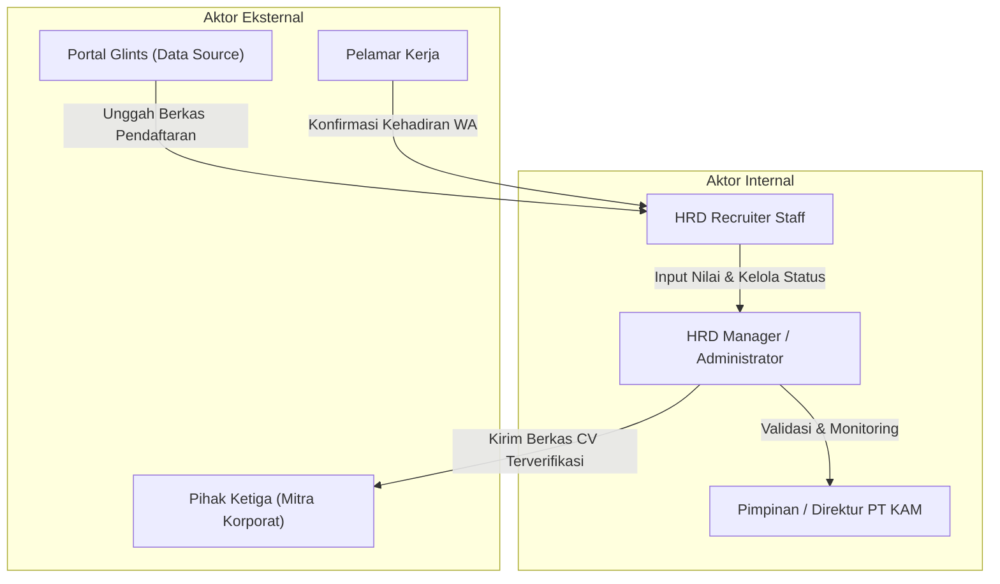
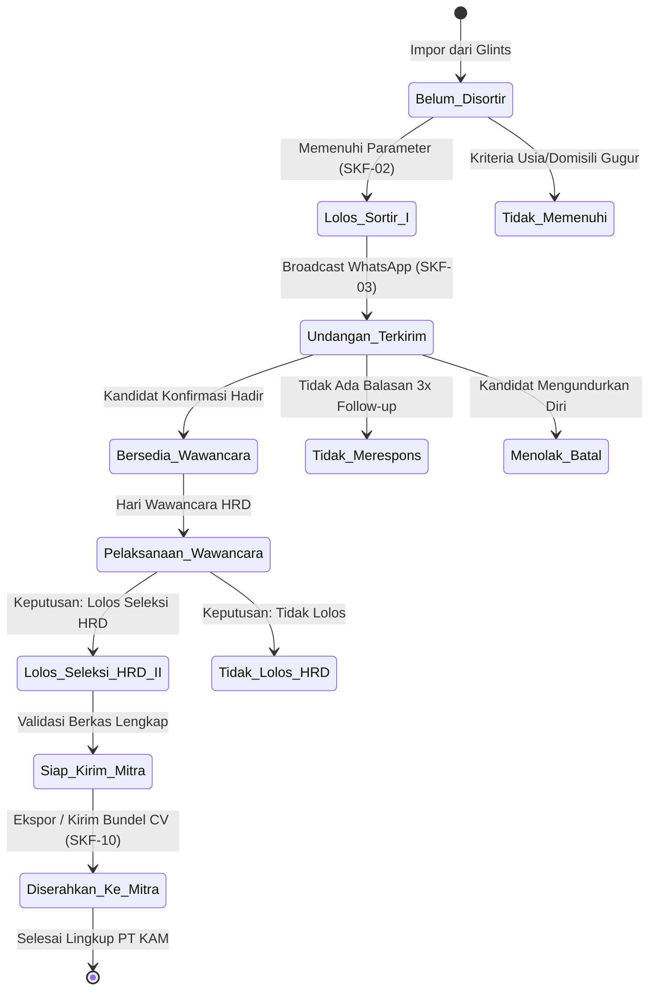

# FUNCTIONAL REQUIREMENTS DOCUMENT (FRD)
## KAM RECRUIT - SISTEM MANAJEMEN REKRUTMEN TENAGA KERJA OUTSOURCING
### PT KINARYA ALIHDAYA MANDIRI (PT KAM)

---

| Dokumen ID | Versi | Status | Tanggal Terbit | Klasifikasi | Penyusun |
| :--- | :--- | :--- | :--- | :--- | :--- |
| **FRD-KAM-03** | **1.0.0** | Final Disetujui | 30 Oktober 2026 | Dokumen Teknis Rekayasa Perangkat Lunak | Tim Pengembang Kerja Praktik |

---

## 1. Pendahuluan

Dokumen Kebutuhan Fungsional (*Functional Requirements Document* - FRD) ini mendefinisikan secara spesifik setiap input, pemrosesan logika bisnis, validasi, dan output yang harus dieksekusi oleh sistem **KAM Recruit**. FRD ini menjadi acuan utama perancangan teknis arsitektur, basis data, *endpoint API*, serta pengujian perangkat lunak.

---

## 2. Aktor Sistem & Matriks Hak Akses

| Kode Aktor | Nama Aktor | Definisi Peran & Hak Akses Fungsional |
| :--- | :--- | :--- |
| **ACT-01** | **HRD Recruiter Staff** | Mengimpor berkas dari Glints, menerapkan filter sortir administratif, memicu pesan WhatsApp, memperbarui respons kehadiran, menginput rubrik nilai wawancara HRD, dan mencetak CV. |
| **ACT-02** | **HRD Manager / Administrator** | Seluruh hak akses ACT-01 ditambah: Menambah kriteria lowongan mitra, menyetujui penyerahan berkas ke mitra (*final handover approval*), mengunduh bundel ZIP, dan mengelola akun pengguna sistem. |
| **ACT-03** | **Pimpinan PT KAM** | Akses baca (*read-only*) terhadap dashboard analitik eksekutif, rekapitulasi kuota mitra, dan laporan pemenuhan tenaga kerja. |
| **ACT-04** | **Pihak Ketiga (Mitra User)** | Menerima paket berkas CV kandidat terpilih (PDF) dan lembar rekapitulasi nilai akhir yang diekspor dari sistem. |

---

## 3. Rincian Kebutuhan Fungsional (*Specific Functional Requirements*)

### 3.1 Modul 1: Manajemen Repositori & Impor Pelamar Glints
#### SKF-01: Impor Data Pelamar Pasca-Pendaftaran Glints
* **Deskripsi**: Sistem mampu mengimpor dan memetakan data pelamar yang bersumber dari portal lowongan Glints ke dalam basis data terpusat KAM Recruit.
* **Input**: File arsip CSV/Excel atau data pendaftaran Glints (Nama, Kontak, Email, Pendidikan, Kampus, Domisili, Usia, Berkas CV PDF).
* **Proses**: Sistem memvalidasi kelengkapan data, memeriksa duplikasi NIK/Email (anti-duplikasi), dan menyimpan status awal sebagai `Belum Disortir`.
* **Output**: Data tersimpan di database dan muncul di tabel Bank Pelamar Glints.
* **Aturan Bisnis (BR-01)**: Jika email atau nomor telepon sudah terdaftar pada lowongan yang sama dalam 3 bulan terakhir, sistem menandai sebagai berkas duplikat.

#### SKF-02: Penyaringan Kualifikasi Administratif Otomatis & Manual
* **Deskripsi**: Sistem menyediakan mekanisme filter multi-parameter untuk menyaring pelamar yang memenuhi standar dasar lowongan mitra.
* **Input**: Parameter filter (Posisi lowongan, Mitra perusahaan, Batas usia maksimal, Pendidikan minimal, Domisili penempatan).
* **Proses**: *Query* database mencocokkan data kandidat secara real-time terhadap kriteria lowongan aktif.
* **Output**: Tampilan daftar kandidat yang lolos kualifikasi administratif dengan lencana `Lolos Sortir (I)`.

---

### 3.2 Modul 2: Pelacakan Komunikasi WhatsApp & Konfirmasi Wawancara
#### SKF-03: Pembuat Template Pesan Resmi WhatsApp (Tanpa Emoji)
* **Deskripsi**: Sistem mengenerate tautan pesan konfirmasi wawancara resmi (*API WhatsApp*) dengan format bahasa Indonesia baku tanpa penggunaan emoji (*corporate standard*).
* **Input**: ID Pelamar, Posisi, Hari/Tanggal Wawancara, Waktu, Lokasi Kantor PT KAM / Tautan Wawancara.
* **Proses**: Sistem menggabungkan variabel data ke dalam template resmi PT KAM yang terstandarisasi.
* **Output**: Pesan terformat siap kirim yang membuka WhatsApp Web / WhatsApp Desktop recruiter.
* **Aturan Bisnis (BR-02)**: Dilarang menyertakan karakter emoji non-standar untuk menjaga citra profesional korporat alihdaya.

#### SKF-04: Pencatatan Respons Kehadiran Pelamar (*Drop Rate Tracker*)
* **Deskripsi**: Recruiter dapat memperbarui status respon kandidat terhadap undangan wawancara menjadi salah satu dari 3 kondisi.
* **Input**: Pilihan status (`Bersedia Hadir`, `Menolak / Batal`, `Tidak Merespons`).
* **Proses**: Sistem mengunci status kandidat dan mencatat waktu pembaruan (*timestamp*).
* **Output**: Metrik analitik pada KPI Card (*e.g., 20 Bersedia vs 30 Drop/No-Show*) ter-update secara otomatis.
* **Aturan Bisnis (BR-03)**: Pelamar dengan status `Tidak Merespons` setelah 3x upaya follow-up (minimal jeda 1x24 jam) otomatis dialihkan ke status `Arsip Drop`.

---

### 3.3 Modul 3: Penilaian Wawancara HRD & Rekapitulasi Bertahap
#### SKF-05: Formulir Digital Keputusan Wawancara HRD
* **Deskripsi**: Sistem menyediakan antarmuka form keputusan wawancara tatap muka/daring yang langsung memilih status kelulusan tanpa formula angka bobot.
* **Input**: Pilihan dropdown hasil wawancara (`Lolos Seleksi HRD` atau `Tidak Lolos`) serta Catatan Evaluator HRD Recruiter.
* **Proses**: Recruiter menetapkan langsung keputusan kualifikasi kandidat; sistem memperbarui status kandidat menjadi `Lolos Seleksi HRD` atau `Tidak Lolos` dan mencatatnya ke log audit.
* **Output**: Status kelulusan HRD dan catatan evaluasi tersimpan permanen pada profil master kandidat.

#### SKF-06: Manajemen Rekapitulasi Dua Tahap Terintegrasi
* **Deskripsi**: Sistem mengelola 2 tampilan fase seleksi terpisah tanpa memecah master file database:
  1. **Rekapitulasi Tahap I**: Pelamar yang memenuhi sortir kualifikasi administrasi.
  2. **Rekapitulasi Tahap II**: Pelamar yang telah menyelesaikan wawancara HRD dan memperoleh keputusan Lolos Seleksi HRD.
* **Proses**: Penggunaan *database views* atau status *flagging* (`stage_1_passed = true`, `stage_2_passed = true`) menjamin data kualifikasi awal tidak pernah tertimpa (*pencegahan penimpaan data*).
* **Output**: Tampilan tab Rekapitulasi Tahap I dan Tahap II yang selalu sinkron dan konsisten.

---

### 3.4 Modul 4: Pratinjau Dossier CV, Pengalaman, dan Sertifikasi
#### SKF-07: Pratinjau Lembar CV Dossier Eksekutif
* **Deskripsi**: Sistem menyajikan modal tampilan dokumen CV pelamar berstandar Apple HIG yang terstruktur lengkap.
* **Komponen yang Ditampilkan**:
  - Profil Pribadi, Kontak Terhubung, dan Nomor *Glints Applicant ID*.
  - Riwayat Pengalaman Kerja: Posisi, Nama Perusahaan, Durasi (Tahun/Bulan), Lokasi, dan Poin Tugas Tanggung Jawab.
  - Sertifikasi Resmi: Nama Lisensi, Lembaga Penerbit (BNSP, Kemnaker, ETS, dll.), Tahun Terbit, Nomor Registrasi Kredensial, dan Lencana `✓ Glints Verified`.
  - Tag Keahlian Teknis & Interpersonal.
  - Akses Dokumen PDF Asli Glints.

#### SKF-08: Fitur Ekspor Cetak Bersih (*Print Stylesheet A4*)
* **Deskripsi**: Sistem menyediakan fungsi cetak (`window.print()`) yang secara otomatis menyembunyikan bilah navigasi, tombol antarmuka, dan latar belakang gelap, menghasilkan lembar dokumen CV format A4 siap arsip.
* **Output**: Tampilan cetak A4 atau file PDF tersimpan rapi tanpa artefak antarmuka web.

---

### 3.5 Modul 5: Penyerahan Berkas ke Mitra Rekanan (Pihak Ketiga)
#### SKF-09: Dashboard Penyerahan Kandidat Terpilih
* **Deskripsi**: Sistem menampilkan katalog kartu kandidat yang telah memperoleh status *Lolos Seleksi HRD* (Tahap II) yang siap diserahkan kepada pihak ketiga.
* **Komponen Kartu**: Nama pelamar, posisi, mitra rekanan, skor HRD, *chip* pengalaman kerja utama, *chip* sertifikasi terverifikasi, dan catatan HRD.

#### SKF-10: Pembuatan Bundel Berkas Kandidat (*Batch Export ZIP*)
* **Deskripsi**: Sistem mampu mengompres seluruh dokumen CV pelamar terpilih untuk lowongan tertentu beserta lembar rekapitulasi hasil wawancara dalam format ZIP siap kirim ke mitra.
* **Output**: File `Bundel_CV_Mitra_[NamaMitra]_[Tanggal].zip`.

---

## 4. Mesin Status Pelamar (*Candidate State Machine*)

---

## 5. Matriks Ketertelusuran Kebutuhan (*Traceability Matrix*)

| Kebutuhan Bisnis (BRD) | Kebutuhan Produk (PRD) | Kebutuhan Fungsional (FRD) | Modul Sistem |
| :--- | :--- | :--- | :--- |
| **BG-01** (Percepatan Screening) | **US-01** (Filter Kualifikasi Cepat) | **SKF-01, SKF-02** | Bank Pelamar Glints |
| **BG-02** (Eliminasi Data Tertimpa) | **US-03** (1 Master File Terintegrasi) | **SKF-05, SKF-06** | Rekapitulasi Tahap I & II |
| **BG-03** (Transparansi Response Rate) | **US-02** (Tracking Respon WA) | **SKF-03, SKF-04** | Pelacakan Komunikasi WA |
| **BG-04** (Percepatan Pengiriman CV) | **US-05** (Ekspor Bundel Mitra) | **SKF-09, SKF-10** | Penyerahan Berkas Mitra |
| **BG-05** (Standarisasi Penilaian HRD) | **US-04** (Dossier CV & Lisensi BNSP) | **SKF-07, SKF-08** | Pratinjau Dossier CV |