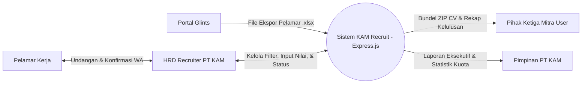
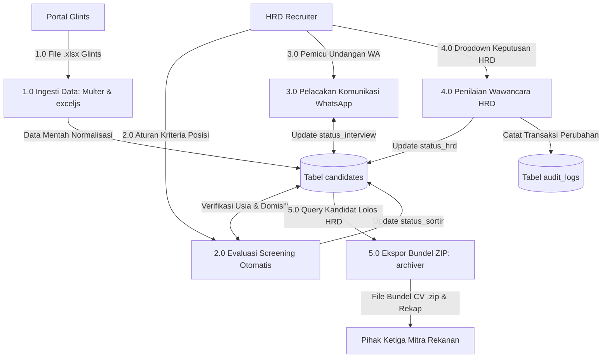
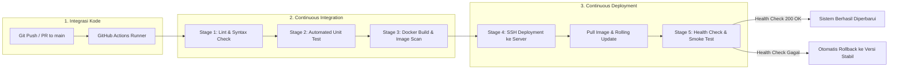
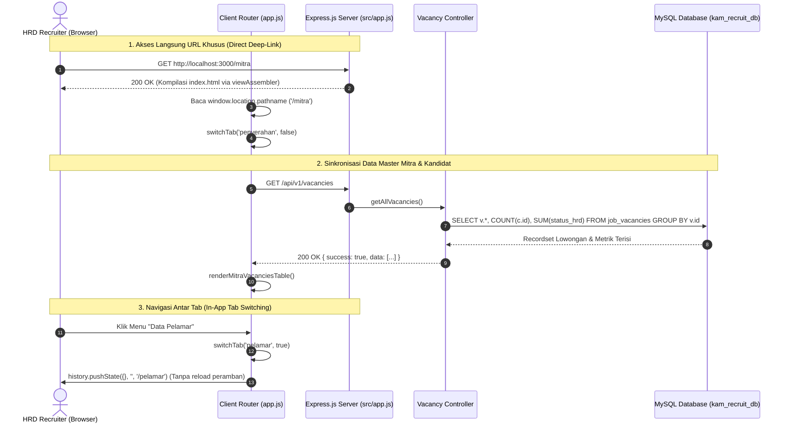

# SYSTEM ARCHITECTURE & INFRASTRUCTURE DOCUMENT
## KAM RECRUIT - SISTEM MANAJEMEN REKRUTMEN TENAGA KERJA OUTSOURCING
### PT KINARYA ALIHDAYA MANDIRI (PT KAM)

---

| Dokumen ID | Versi | Status | Tanggal Rilis | Klasifikasi | Arsitek Sistem |
| :--- | :--- | :--- | :--- | :--- | :--- |
| **ARC-KAM-04** | **2.1.0** | Final Disetujui | 31 Oktober 2026 | Dokumen Arsitektur Perangkat Lunak | Tim Pengembang Kerja Praktik |

---

## 1. Arsitektur Sistem Tingkat Tinggi (*High-Level Architecture*)

Sistem **KAM Recruit** dirancang menggunakan arsitektur berlapis (*Layered Client-Server Architecture*) yang memisahkan lapisan presentasi antarmuka klien, gerbang proksi, server aplikasi backend berbasis **Node.js (Express.js)**, dan penyimpanan data terpusat (*Separation of Concerns*).

```mermaid
graph TB
    subgraph Klien / Antarmuka Pengguna
        Recruiter["HRD Recruiter (Web Browser)"]
        Manager["HRD Manager (Web Browser)"]
        Direktur["Pimpinan PT KAM (Web Browser)"]
        UIUX["index.html (UI/UX Reference & Frontend SPA Client)"]
    end

    subgraph Gerbang Akses & Keamanan
        Nginx["Reverse Proxy Nginx (SSL/TLS 1.3 Termination, Gzip/Brotli, Rate Limiting)"]
    end

    subgraph Lapisan Aplikasi Backend (Express.js Core Engine)
        Router["Express REST API Router (/api/v1)"]
        UploadHandler["Multer File Upload Middleware (Excel & PDF)"]
        GlintsParser["Glints Excel Parser (exceljs - 28 Kolom)"]
        ScreeningEngine["Modul Screening & Kualifikasi Otomatis (Tahap I)"]
        WAModule["Modul Komunikasi & Tracking WhatsApp"]
        AssessmentEngine["Modul Keputusan Wawancara HRD (Tahap II - Dropdown)"]
        DossierGen["Generator Dossier CV & Archiver Bundel ZIP"]
        AuditLogger["Layanan Audit Trail & Activity Logger"]
    end

    subgraph Lapisan Penyimpanan Data
        DB[(Master Database Relasional: MySQL 8.0 InnoDB)]
        FileStorage[(Penyimpanan Berkas Docker Volume: /app/uploads/)]
        Cache[(Redis Cache: Session & Rate Limiting)]
    end

    subgraph Integrasi Eksternal
        Glints["Portal Glints (File Ekspor .xlsx / .csv)"]
        WAWeb["WhatsApp Desktop / Web API Protocol"]
        Mitra["Pihak Ketiga Mitra User (Email Formal / Bundel ZIP)"]
    end

    Recruiter -->|HTTPS :443| Nginx
    Manager -->|HTTPS :443| Nginx
    Direktur -->|HTTPS :443| Nginx
    UIUX -.->|Acuan Desain & Client Assets| Nginx

    Nginx -->|Reverse Proxy :3000| Router
    Router --> UploadHandler
    UploadHandler --> GlintsParser
    GlintsParser --> ScreeningEngine
    Router --> ScreeningEngine
    Router --> WAModule
    Router --> AssessmentEngine
    Router --> DossierGen
    Router --> AuditLogger

    ScreeningEngine --> DB
    AssessmentEngine --> DB
    AuditLogger --> DB
    DossierGen --> FileStorage
    UploadHandler --> FileStorage
    Router --> Cache

    Glints -.->|Ekspor Pendaftaran| UploadHandler
    WAModule -.->|URI Protocol| WAWeb
    DossierGen -.->|Ekspor Bundel ZIP| Mitra
```

---

## 2. Pilihan Tumpukan Teknologi (*Technology Stack*)

Sistem dibangun menggunakan susunan teknologi modern berbasis *Full-Stack JavaScript* yang terstandarisasi, hemat sumber daya (*zero unnecessary bloat*), dan terisolasi dalam kontainer Docker:

| Lapisan (*Layer*) | Teknologi Pilihan | Peran & Alasan Pemilihan |
| :--- | :--- | :--- |
| **Frontend / Antarmuka Klien** | HTML5, Tailwind CSS, Vanilla JavaScript | **Peran `index.html`**: Berkas `index.html` pada direktori `Laporan/` berfungsi sebagai **Acuan Referensi Desain Interaktif UI/UX (*Living UI/UX Design Reference*)** berstandar Apple Human Interface Guidelines (HIG). Pada lingkungan produksi, antarmuka ini disajikan secara statis oleh Express (`express.static('public')`) dan mengonsumsi REST API backend menggunakan `fetch()`. Desain dilengkapi fitur *clean A4 print preview* (@media print) bebas elemen UI untuk mencetak CV Dossier kandidat. |
| **Backend / REST API** | **Node.js (LTS v20/v22) + Express.js** | Menjadi mesin server utama (*Application Server*) yang menangani logika rekrutmen: routing API, validasi data, manipulasi stream file biner, dan autentikasi. |
| **Paket Modul Backend** | • `express`: Framework RESTful API minimalis & cepat<br>• `multer`: Middleware multipart file upload (Excel Glints & PDF CV)<br>• `exceljs`: Parser tangguh file `.xlsx`/`.csv` Glints 28 kolom<br>• `archiver`: Pembuat arsip bundel `.zip` CV mitra secara streaming<br>• `mysql2`: Driver koneksi database dengan *Connection Pool* dan transaksi ACID<br>• `helmet` & `cors`: Pengamanan header HTTP dan kontrol lintas domain<br>• `dotenv`: Manajemen konfigurasi variabel lingkungan |
| **Basis Data Relasional** | **MySQL 8.0 (Engine InnoDB)** | Menjamin integritas transaksi data secara ACID (mencegah *race condition* dan penimpaan nilai wawancara), mendukung tipe data `JSON` untuk daftar riwayat kerja dan sertifikat, serta performa tinggi dengan indeks teroptimasi. |
| **Penyimpanan Berkas** | Docker Volume Storage (`/app/uploads/`) | Menyimpan berkas fisik (CV PDF pelamar dan file Excel Glints) secara terisolasi dari database biner, diakses cepat melalui hash *UUID v4*. |
| **Web Server & Reverse Proxy** | Nginx Reverse Proxy (Alpine) | Menangani terminasi SSL/TLS 1.3, kompresi aset (Brotli/Gzip), proteksi *Rate Limiting*, dan *static file caching*. |
| **Kontainerisasi Lingkungan** | **Docker & Docker Compose** | Membungkus Express.js, Nginx, MySQL, dan Redis dalam lingkungan terisolasi yang identik antara komputer pengembang (*development*) dan server produksi PT KAM. |
| **Otomasi CI/CD** | **GitHub Actions / GitLab CI** | Otomasi pengujian kode (*linting & unit testing*), pembuatan image Docker (*build & security scan*), serta penyebaran otomatis (*automated continuous deployment*) ke server PT KAM. |

---

## 3. Komponen Inti Sistem (*Core Components*)

```mermaid
flowchart TD
    subgraph Ingestion & Screening Component
        A1[Multer Upload Handler] --> A2[Glints Excel Parser: exceljs]
        A2 --> A3[Evaluator Kriteria Lowongan Otomatis]
        A3 --> A4[Pencocok Usia & Domisili Mitra]
        A4 --> A5[Penetapan Status: Lolos Sortir I / Tidak Memenuhi]
    end

    subgraph Communication Component
        B1[Generator Template Pesan Formal Non-Emoji] --> B2[Handler Tautan WA wa.me]
        B2 --> B3[Pencatat Respons: Bersedia / Batal / Tidak Merespons]
    end

    subgraph Scoring & Recapitulation Component
        C1[Formulir Keputusan Wawancara HRD] --> C2[Penetapan Keputusan Dropdown: Lolos / Tidak Lolos]
        C2 --> C3[Pembaruan Status: Lolos Seleksi HRD / Tidak Lolos]
        C3 --> C4[Pencatatan Riwayat Perubahan ke Audit Log]
    end

    subgraph Dossier & Export Component
        D1[Renderer Lembar CV Eksekutif Apple HIG] --> D2[Engine Print Stylesheet A4]
        D2 --> D3[Pengompres Bundel ZIP: archiver stream]
        D3 --> D4[Paket Penyerahan Berkas Mitra Pihak Ketiga]
    end
```



### 3.1 Mesin Penyortir Kualifikasi (*Screening Engine*)
* **Input**: File Excel Glints (`.xlsx` / `.csv`) diunggah melalui endpoint Express `POST /api/v1/applicants/import`.
* **Proses Parsing**: Pustaka `exceljs` membaca 28 kolom data pelamar dan menerapkan aturan *Flexible Nullable Design* (kolom opsional seperti gaji, keahlian, dan organisasi pelamar tidak akan menyebabkan kegagalan impor jika kosong).
* **Evaluasi Aturan Bisnis**: Membandingkan usia, domisili, dan jenjang pendidikan pelamar terhadap kriteria posisi mitra. Jika usia > batas maksimal posisi mitra, sistem secara otomatis memberi status `Tidak Memenuhi Syarat` beserta catatan rincinya.

### 3.2 Modul Rekapitulasi Terpadu (*Integrated Recapitulation Engine*)
* Menggunakan prinsip **Satu Master Database Terpusat**:
  Tabel database `candidates` menyimpan status tahapan secara berkelanjutan tanpa duplikasi data.
* Kolom `status_sortir` (Tahap I) dan `status_hrd` (Tahap II) tersimpan dalam satu baris rekaman (*record*) yang sama, namun diproyeksikan ke antarmuka pengguna dalam tab terpisah melalui kueri bersyarat Express REST API.
* Menghilangkan 100% risiko salah edit baris atau penimpaan file yang umum terjadi pada spreadsheet manual.

### 3.3 Generator Dossier CV & Ekspor Mitra (*Dossier & Bundler Service*)
* Membaca data pelamar lengkap dengan relasi tabel pengalaman kerja (`candidate_experiences`) dan sertifikat lisensi (`candidate_certificates`).
* Merender pratinjau lembar CV formal dengan tata letak bersudut lembut (*squircle*) berstandar Apple HIG (mengacu pada desain [index.html](file:///d:/A11.2025.16609/SEMESTER%203/KERJA%20PRAKTEK/Laporan/index.html)).
* Menggunakan pustaka Node.js **`archiver`** pada endpoint Express `GET /api/v1/handover/bundle-zip` untuk membuat berkas `.zip` secara *streaming* tanpa membebani memori RAM server, berisi seluruh dokumen CV PDF kandidat yang lolos Tahap II untuk diserahkan ke pihak ketiga.

---

## 4. Diagram Aliran Data (*Data Flow Diagram - DFD*)

### 4.1 DFD Level 0 (Diagram Konteks)



### 4.2 DFD Level 1 (Dekomposisi Fungsional Express API)



---

## 5. Arsitektur Kontainerisasi Docker (*Docker Architecture*)

Sistem dikemas ke dalam arsitektur multi-kontainer menggunakan **Docker Compose** untuk memastikan isolasi proses, keamanan jaringan lokal, dan kemudahan deployment:

```mermaid
graph TD
    subgraph Host Server (Ubuntu 22.04 LTS)
        subgraph Jaringan Terisolasi Docker: kam-network
            NginxContainer["Nginx Reverse Proxy Container (:80, :443)"]
            AppContainer["Express.js App Container (:3000)"]
            DBContainer["MySQL 8.0 Database Container (:3306)"]
            RedisContainer["Redis Cache Container (:6379)"]
        end

        subgraph Persistent Docker Volumes
            VolCV[Volume: kam_cv_storage -> /app/uploads/cv]
            VolExcel[Volume: kam_excel_storage -> /app/uploads/excels]
            VolDB[Volume: kam_db_data -> /var/lib/mysql]
        end
    end

    User[Pengguna Web Browser] -->|HTTPS :443| NginxContainer
    NginxContainer -->|Reverse Proxy HTTP :3000| AppContainer
    AppContainer -->|Internal TCP :3306| DBContainer
    AppContainer -->|Internal TCP :6379| RedisContainer
    AppContainer --> VolCV
    AppContainer --> VolExcel
    DBContainer --> VolDB
```

### 5.1 Strategi Multi-Stage Dockerfile Express.js
Aplikasi Express.js dikompilasi menggunakan strategi *multi-stage build* untuk menghasilkan image produksi berukuran sangat kecil (< 120 MB) dan bebas dari ketergantungan pengembangan (*development dependencies*):
* **Stage 1 (Builder)**: Mengunduh dependencies dan mempersiapkan bundle aset.
* **Stage 2 (Runner)**: Menggunakan base image `node:20-alpine` minimalis, mengeksekusi aplikasi di bawah pengguna non-root (`USER node`) untuk perlindungan keamanan maksimal.

---

## 6. Pipeline CI/CD (*Continuous Integration & Continuous Deployment*)

Otomasi integrasi dan pengiriman perangkat lunak diatur melalui alur **GitHub Actions Workflow** yang terbagi dalam 5 tahap (*stages*):



### Rincian Tahapan Pipeline CI/CD:

1. **Stage 1: Validasi Sintaks & Standar Kode (*Linting*)**:
   - Menjalankan `npm run lint` (ESLint) untuk memastikan kode Express.js mematuhi standar kebersihan kode dan tidak terdapat variabel tak terdefinisi.
2. **Stage 2: Pengujian Otomatis (*Automated Testing*)**:
   - Menjalankan `npm test` menggunakan framework **Jest** dan **Supertest** untuk memverifikasi endpoint kritis:
     - Endpoint import parser Glints (`POST /api/v1/applicants/import`).
     - Endpoint pembaruan status dropdown HRD (`PUT /api/v1/candidates/:id/interview`).
     - Endpoint streaming download bundel ZIP (`GET /api/v1/handover/bundle-zip`).
3. **Stage 3: Pengepakan Kontainer & Pemindaian Keamanan (*Docker Build & Security Scan*)**:
   - Membangun image Docker produksi.
   - Memindai image dari celah keamanan kerentanan (*CVE Vulnerabilities*) menggunakan **Trivy Vulnerability Scanner**.
4. **Stage 4: Penyebaran Otomatis (*Automated Continuous Deployment*)**:
   - Menghubungi server produksi PT KAM secara terenkripsi via SSH menggunakan *GitHub Encrypted Secrets*.
   - Mengeksekusi pembaruan kontainer tanpa *downtime* (*zero-downtime rolling update*):
     ```bash
     docker compose pull app
     docker compose up -d --no-deps app
     ```
5. **Stage 5: Pemeriksaan Kesehatan Pasca-Rilis (*Post-Deployment Health Check*)**:
   - Melakukan *smoke test* otomatis ke endpoint `GET /api/v1/health`.
   - Jika endpoint merespons status `200 OK`, deployment dinyatakan berhasil. Jika terjadi kegagalan atau timeout dalam 30 detik, sistem otomatis melakukan *rollback* ke kontainer versi sebelumnya.

---

## 7. Topologi Jaringan & Spesifikasi Server (*Infrastructure Topology*)

```mermaid
graph LR
    subgraph Internet Public
        UserBrowser[Web Browser Pengguna]
    end

    subgraph Perimeter Keamanan (DMZ)
        Firewall[Web Application Firewall - UFW]
        Proxy[Nginx Proxy Server :443 HTTPS TLS 1.3]
    end

    subgraph Jaringan Privat Internal Docker
        AppServer[Express.js App Server :3000]
        DBServer[(Master MySQL Server :3306)]
        StorageNode[(Docker Volume Storage /app/uploads/)]
    end

    UserBrowser -->|HTTPS TLS 1.3| Firewall
    Firewall --> Proxy
    Proxy -->|Reverse Proxy HTTP Internal| AppServer
    AppServer -->|TCP Connection Pool| DBServer
    AppServer -->|Local File IO Read/Write| StorageNode
```

### 7.1 Spesifikasi Server yang Direkomendasikan
* **Processor (CPU)**: 4 vCPU (2.4 GHz atau lebih tinggi).
* **Memory (RAM)**: 8 GB DDR4.
* **Storage**: 100 GB SSD NVMe (dengan konfigurasi RAID 1 / Automated Daily Snapshot).
* **Operating System**: Ubuntu Server 22.04 LTS (Jammy Jellyfish).
* **Network**: 100 Mbps Dedicated Bandwidth.
* **Backup**: Backup database MySQL otomatis harian (`mysqldump`) terjadwal via Cron Job pukul 01.00 WIB.

## 6. Arsitektur Komponen Antarmuka Klien (Component-Based View Architecture)

Mulai versi 2.3.0, lapisan presentasi antarmuka klien mengadopsi prinsip dekomposisi modular berstandar industri:

```
kam-recruit/public/
├── components/                  # Modul Tampilan HTML Mandiri (Passive View)
│   ├── header.html              # Top bar, logo PT KAM, status sinkronisasi, profil
│   ├── sidebar.html             # Menu navigasi desktop & kuota mitra rekanan
│   ├── tab-dashboard.html       # Dashboard utama, 4 KPI, grafik bulanan, tabel lowongan
│   ├── tab-pelamar.html         # Toolbar pencarian & Master Data Pelamar Glints
│   ├── tab-interview.html       # Pelacakan jadwal wawancara & gateway WhatsApp
│   ├── tab-rekapitulasi.html    # Rekapitulasi Tahap I & Tahap II + ekspor berkas
│   ├── tab-penyerahan.html      # Master Mitra & Tabel Penyerahan CV pihak ketiga terstruktur
│   ├── modals.html              # Dialog modal (Dossier, Scoring, Import, Lowongan, Jadwal, Konfirmasi Sortir)
│   ├── toast.html               # Notifikasi interaktif
│   └── mobile-nav.html          # Floating bottom dock bar khusus ponsel
├── js/                          # Modul Logika JavaScript Terisolasi (Presenters)
│   ├── app.js                   # State terpusat, tab routing, utility helpers
│   ├── dashboard.js             # Metrik KPI real-time & grafik batang bulanan
│   ├── pelamar.js               # Filter dinamis, pencarian, bulk sortir
│   ├── interview.js             # Status wawancara, WA templates & preview
│   ├── rekapitulasi.js          # Switcher fase seleksi & ekspor CSV
│   ├── penyerahan.js            # Serah terima CV & ZIP bundling
│   └── modals.js                # Penilaian HRD, dossier view, berkas import
├── index.template.html          # Shell layout induk bersih (~140 baris)
└── index.html                   # Berkas hasil kompilasi assembly otomatis
```

## 7. Arsitektur Pola MVC Murni & Lapisan Model (*Pure MVC & Data Access Model Layer*)

Mulai versi 2.11.0, arsitektur backend Express telah direfaktor secara menyeluruh menjadi pola **Model-View-Controller (MVC) Murni** dengan pemisahan tanggung jawab (*Separation of Concerns*):

```
kam-recruit/src/
├── models/                      # Lapisan Model Data Access (M)
│   ├── Candidate.js             # Kueri tabel candidates, pengalaman, & sertifikat
│   ├── Vacancy.js               # Kueri tabel job_vacancies & kuota mitra
│   ├── Assessment.js            # Kueri keputusan wawancara HRD (interview_assessments)
│   ├── AuditLog.js              # Kueri pencatatan jejak audit (audit_logs)
│   └── index.js                 # Unified model exports
├── controllers/                 # Lapisan Controller Alur HTTP (C)
│   ├── applicantController.js   # Orkestrasi impor & detail pelamar (Bebas Raw SQL)
│   ├── vacancyController.js     # Orkestrasi permintaan mitra & kuota (Bebas Raw SQL)
│   ├── interviewController.js   # Orkestrasi keputusan wawancara HRD (Bebas Raw SQL)
│   ├── recapController.js       # Orkestrasi ekspor rekapitulasi (Bebas Raw SQL)
│   ├── handoverController.js    # Orkestrasi serah terima berkas (Bebas Raw SQL)
│   ├── dashboardController.js   # Orkestrasi agregasi metrik KPI (Bebas Raw SQL)
│   └── communicationController.js # Orkestrasi gateway WhatsApp (Bebas Raw SQL)
└── routes/                      # Lapisan Perutean REST API
```

### Karakteristik Pemisahan MVC:
1. **Model (M)**: Bertanggung jawab 100% atas interaksi basis data MySQL (`SELECT`, `INSERT`, `UPDATE`, `DELETE`). Kueri terisolasi dalam *Class Methods* yang bersih, mendukung transaksi ACID, dan mudah digunakan kembali (*reusable*).
2. **Controller (C)**: Bertanggung jawab menerima request HTTP (`req`), memvalidasi input, mendelegasikan tugas ke Model/Service terkait, dan mengembalikan response JSON standar (`res.json()`). Tidak ada lagi string kueri SQL mentah di dalam Controller.
3. **View (V)**: Menggunakan pola *Passive View* dan *Dummy Component* pada direktori `public/components/` dan `public/js/`.

## 8. Arsitektur Perutean Khusus & Sinkronisasi Keadaan (*Dedicated Routing & State Architecture*)

Untuk menghadirkan pengalaman pengguna enterprise yang profesional (*native-like experience*) tanpa mengorbankan performa *Single Page Application*, sistem mengombinasikan *Server-Side Entry Point Routing* dan *Client-Side HTML5 History Router*:



### 8.1 Karakteristik Utama Arsitektur Perutean:
1. **Dukungan Tautan Langsung (*Deep Linking*)**: Pengguna dapat membagikan atau memuat ulang (*refresh*) URL spesifik seperti `/pelamar`, `/interview`, atau `/mitra` tanpa dialihkan kembali ke halaman awal dashboard.
2. **Dukungan Tombol Peramban (*Browser History Compatibility*)**: Integrasi event listener `window.addEventListener('popstate')` mendeteksi klik tombol *Back* dan *Forward* pada peramban web untuk beralih antar-tab antarmuka secara instan.
3. **Penyatuan Modul Master Mitra & Penyerahan CV**:
   - Memindahkan data kuota lowongan keluar dari sidebar agar bilah navigasi berfokus secara eksklusif pada menu perpindahan rute.
   - Mengintegrasikan manajemen lowongan (*Master Vacancies CRUD*) ke dalam `tab-penyerahan.html` dengan sub-tab segmented control (*Permintaan Mitra Aktif* dan *Kirim CV ke Mitra*).
4. **Agregasi Statistik Rekrutmen Real-time Murni**:
   - Menghapus ketergantungan pada tabel seed fiktif. Seluruh grafik tren bulanan Jan–Des dan rasio kelulusan dihitung secara matematis menggunakan fungsi agregasi SQL (`COUNT(*)`, `SUM(CASE WHEN status_hrd = 'Lolos Seleksi HRD' THEN 1 ELSE 0 END)`) langsung dari tabel fakta riil `candidates`.
