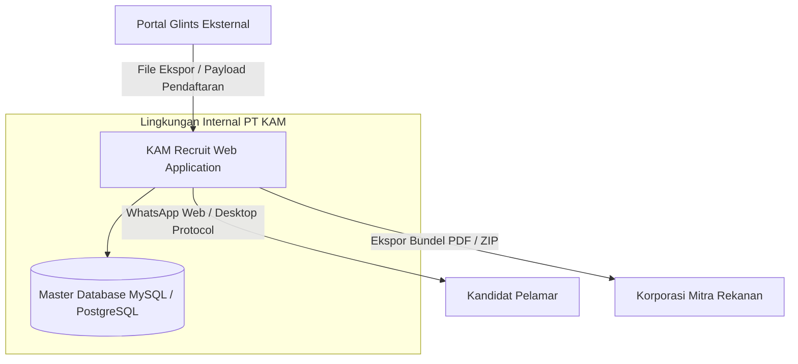
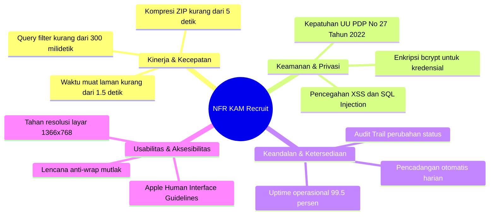

# SOFTWARE REQUIREMENTS SPECIFICATION (SRS)
## KAM RECRUIT - SISTEM MANAJEMEN REKRUTMEN TENAGA KERJA OUTSOURCING
### PT KINARYA ALIHDAYA MANDIRI (PT KAM)
*Standar Dokumen: IEEE Std 830-1998 (Recommended Practice for Software Requirements Specifications)*

---

| Dokumen ID | Versi | Status | Tanggal Berlaku | Penulis | Reviewer |
| :--- | :--- | :--- | :--- | :--- | :--- |
| **SRS-KAM-04** | **1.0.0** | Disetujui (Approved) | 30 Oktober 2026 | Tim Kerja Praktik UDINUS | Tim Teknis & HRD PT KAM |

---

## 1. Pendahuluan

### 1.1 Tujuan Dokumen
Tujuan dari dokumen *Software Requirements Specification* (SRS) ini adalah untuk mendokumentasikan spesifikasi teknis lengkap dari perangkat lunak **KAM Recruit** yang dikembangkan untuk PT Kinarya Alihdaya Mandiri. Dokumen ini menjadi pedoman bagi pengembang perangkat lunak, *tester* penjamin mutu (*Quality Assurance*), dan penguji akademik Universitas Dian Nuswantoro dalam mengevaluasi kesesuaian implementasi sistem.

### 1.2 Ruang Lingkup Sistem
Aplikasi **KAM Recruit** adalah sistem manajemen rekrutmen berbasis web (*Web-based Recruitment Management System*) yang berfokus pada otomatisasi proses bisnis penyortiran pelamar Glints, pelacakan respon konfirmasi wawancara via WhatsApp, pengelolaan keputusan wawancara langsung melalui dropdown (Lolos Seleksi HRD / Tidak Lolos) HRD internal, pemeliharaan rekapitulasi dua tahap pada basis data tunggal yang aman, serta penyusunan berkas *Curriculum Vitae (CV)* pelamar terverifikasi untuk diserahkan ke pihak ketiga (mitra pengguna tenaga kerja alihdaya).

### 1.3 Definisi, Akronim, dan Singkatan
* **PT KAM**: PT Kinarya Alihdaya Mandiri.
* **Glints**: Portal eksternal penarikan kandidat (*talent recruitment portal*).
* **CV Dossier**: Dokumen bundel profil pelamar yang memuat identitas, riwayat pekerjaan, dan sertifikat kompetensi terverifikasi.
* **FTTH**: *Fiber to the Home* (bidang penempatan teknisi jaringan mitra).
* **BNSP**: Badan Nasional Sertifikasi Profesi.
* **NFR**: *Non-Functional Requirements* (Kebutuhan Non-Fungsional).
* **Apple HIG**: *Apple Human Interface Guidelines* (standar desain antarmuka bersih, bersudut halus/squircle, dan tipografi hierarkis).
* **UU PDP**: Undang-Undang Perlindungan Data Pribadi Republik Indonesia No. 27 Tahun 2022.

---

## 2. Gambaran Umum Sistem (*Overall Description*)

### 2.1 Perspektif Produk
Sistem **KAM Recruit** merupakan sistem aplikasi web mandiri (*self-contained internal web system*) yang dipasang pada lingkungan server intranet/cloud PT KAM. Sistem bertindak sebagai jembatan operasional (*operational bridge*) yang menghubungkan data mentah pendaftar Glints dengan kebutuhan berkas kandidat siap kerja oleh korporasi mitra.

### 2.2 Karakteristik Pengguna
1. **Recruiter Staff**: Pengguna tingkat operasional dengan kemahiran komputer menengah; membutuhkan alur kerja cepat, pintasan aksi (*one-click actions*), dan template pesan otomatis.
2. **HRD Manager**: Pengguna tingkat manajerial yang memerlukan visibilitas penuh atas status kandidat pada setiap lowongan dan hak persetujuan (*approval*).
3. **Pimpinan PT KAM**: Pengguna tingkat eksekutif yang membutuhkan tampilan ringkas metrik kuota dan kinerja penyerahan kandidat.

### 2.3 Batasan Umum Perancangan
1. Sistem dibangun berbasis web responsif desktop (*desktop-first*) dengan prioritas resolusi monitor kerja 1366×768 (standar laptop kantor) hingga 1920×1080 (Full HD).
2. Kode warna antarmuka wajib mengacu pada identitas jenama PT KAM: *Corporate Blue* (`#0F3D78`) dan *Corporate Red* (`#D32F2F`).
3. Gaya antarmuka mengikuti prinsip *Apple Human Interface Guidelines* (kartu berlatar putih bersih, bayangan difus lembut, tanpa garis ornamen *AI-slop* berlebihan).
4. Tidak ada karakter emoji pada template pesan resmi korporat.

---

## 3. Kebutuhan Antarmuka Eksternal (*External Interface Requirements*)

### 3.1 Antarmuka Pengguna (*User Interface*)
* **Dashboard Funnel**: Memvisualisasikan konversi pelamar (Total Pelamar -> Lolos Sortir Tahap I -> Hadir Interview -> Lolos HRD Tahap II).
* **Tabel Interaktif Bank Pelamar**: Menampilkan data kandidat dengan kolom sortir, pencarian teks, dan filter parameter dinamis.
* **Modal CV Dossier**: Menampilkan riwayat pengalaman kerja (jabatan, perusahaan, tahun, rincian tugas) dan sertifikat resmi (nama sertifikat, penerbit BNSP/Kemnaker, no. reg) secara proporsional.
* **Print Stylesheet (@media print)**: Menghasilkan lembar CV cetak bersih pada kertas A4 tanpa bilah sisi (*sidebar*) dan tombol antarmuka.

### 3.2 Antarmuka Perangkat Lunak
* **Sistem Operasi Server**: Linux Ubuntu Server 22.04 LTS / Windows Server 2022.
* **Runtime / Backend**: Node.js v18+ LTS / PHP 8.2+ / Python 3.10+.
* **Basis Data**: MySQL 8.0 / PostgreSQL 15 (Engine InnoDB dengan dukungan transaksi ACID).
* **Peramban Klien**: Google Chrome (v100+), Microsoft Edge (v100+), Mozilla Firefox (v100+), Apple Safari (v15+).

### 3.3 Antarmuka Komunikasi
* Protokol komunikasi klien-ke-server menggunakan **HTTPS** dengan sertifikat TLS 1.3 terenkripsi.
* Pemanggilan data asinkronus menggunakan arsitektur RESTful JSON (*Fetch API*).
* Integrasi komunikasi kandidat menggunakan skema URI WhatsApp resmi: `https://api.whatsapp.com/send?phone=...&text=...`.

---

## 4. Kebutuhan Non-Fungsional (*Non-Functional Requirements - NFR*)

### 4.1 Kinerja (*Performance Requirements*)
* **NFR-PERF-01**: Waktu muat awal halaman (*Initial Page Load*) tidak boleh melebihi **1.5 detik** pada koneksi internet pita lebar standar (10 Mbps).
* **NFR-PERF-02**: Eksekusi filter data pelamar pada tabel harus merespons dalam waktu kurang dari **300 milidetik** untuk dataset hingga 10.000 pelamar.
* **NFR-PERF-03**: Proses kompresi bundel berkas CV kandidat menjadi file ZIP (hingga 25 berkas PDF) tidak boleh melebihi **5 detik**.

### 4.2 Keamanan & Perlindungan Data (*Security & Privacy Requirements*)
* **NFR-SEC-01**: Seluruh kata sandi akun pengguna wajib di-hash menggunakan algoritma **bcrypt** (*work factor* minimal 10).
* **NFR-SEC-02**: Kepatuhan terhadap UU Perlindungan Data Pribadi (UU PDP): Data sensitif pelamar (kontak, alamat, CV) hanya boleh diakses oleh akun dengan peran recruiter/manajer yang terotentikasi.
* **NFR-SEC-03**: Seluruh *input* pengguna wajib disanitasi menggunakan mekanisme *parameterized queries* untuk mencegah serangan *SQL Injection*, serta *output escaping* untuk mencegah *Cross-Site Scripting (XSS)*.
* **NFR-SEC-04**: Sesi pengguna (*session*) harus kedaluwarsa secara otomatis setelah 60 menit tidak ada aktivitas (*idle timeout*).

### 4.3 Keandalan & Integritas (*Reliability & Availability Requirements*)
* **NFR-REL-01**: Tingkat ketersediaan sistem (*System Availability*) minimal **99.5%** pada jam kerja operasional PT KAM (Senin – Jumat, pukul 08.00 – 17.00 WIB).
* **NFR-REL-02**: Integritas 1 Master Database: Setiap perubahan status seleksi kandidat (dari Tahap I hingga Tahap II) harus dicatat dalam tabel *audit log* dengan atribut `user_id`, `candidate_id`, `old_status`, `new_status`, dan `timestamp`.

### 4.4 Portabilitas & Ketahanan Tampilan (*Portability & UI Robustness*)
* **NFR-POR-01**: Antarmuka harus mempertahankan keterbacaan penuh tanpa elemen pecah (*zero-breaking layout*) pada resolusi layar mulai dari 1024×768 hingga 2560×1440.
* **NFR-POR-02**: Setiap elemen badge status dan teks numerik wajib dilindungi aturan `whitespace-nowrap shrink-0` untuk menjamin tidak ada pembengkokan teks menjadi 2–3 baris (*anti-wrapping protection*).

---

## 5. Batasan & Aturan Arsitektur (*Architectural Constraints*)
1. Arsitektur perangkat lunak harus memisahkan logika presentasi antarmuka, logika bisnis seleksi, dan lapisan akses basis data (*Separation of Concerns*).
2. Sistem tidak boleh menyimpan berkas CV PDF langsung di dalam kolom basis data (*BLOB anti-pattern*), melainkan menyimpannya pada direktori penyimpanan terisolasi (*filesystem storage*) dengan referensi nama file di database.

