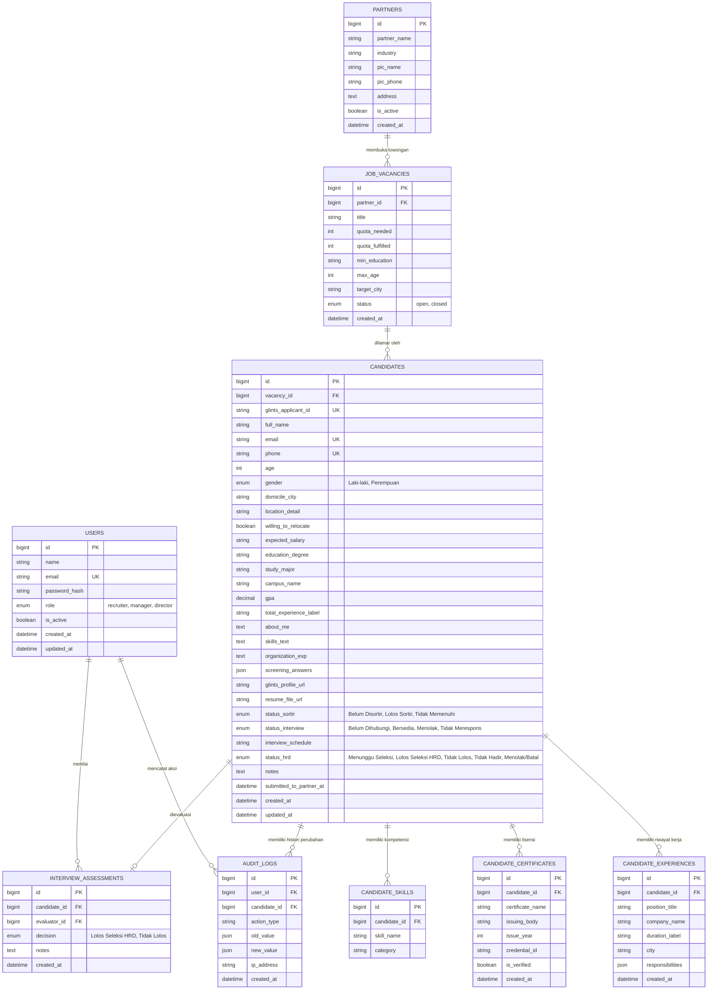

# DATABASE DESIGN & DATA DICTIONARY
## KAM RECRUIT - SISTEM MANAJEMEN REKRUTMEN TENAGA KERJA OUTSOURCING
### PT KINARYA ALIHDAYA MANDIRI (PT KAM)

---

| Dokumen ID | Versi | Status | Tanggal Rilis | RDBMS Target | Database Engineer |
| :--- | :--- | :--- | :--- | :--- | :--- |
| **DBD-KAM-05** | **1.0.0** | Final Disetujui | 30 Oktober 2026 | MySQL 8.0+ / PostgreSQL 15+ | Tim Pengembang Kerja Praktik |

---

## 1. Diagram Relasi Entitas (*Entity Relationship Diagram - ERD*)



---

## 2. Kamus Data (*Data Dictionary*)

### 2.1 Tabel `candidates` (Entitas Utama Master Data)
Menyimpan data lengkap pendaftar dari portal Glints lintas tahapan seleksi (Tahap I Administrasi hingga Tahap II Wawancara HRD). Skema dirancang tangguh (*resilient*) dengan kolom opsional (*NULLABLE*) agar mampu menampung pelamar dengan profil sangat detail (seperti data riil *Imam Kuswoyo* dengan 12 tahun pengalaman) maupun pelamar lulusan baru (*fresh graduate*) yang datanya ringkas.

| Nama Kolom | Tipe Data | Batasan (*Constraints*) | Nilai Default | Keterangan / Deskripsi |
| :--- | :--- | :--- | :--- | :--- |
| `id` | BIGINT | PRIMARY KEY, AUTO_INCREMENT | - | Pengidentifikasi unik kandidat |
| `vacancy_id` | BIGINT | FOREIGN KEY (`job_vacancies.id`) | - | ID relasi lowongan posisi mitra |
| `glints_applicant_id` | VARCHAR(64) | UNIQUE, NOT NULL | - | ID registrasi resmi pelamar dari portal Glints (UUID) |
| `full_name` | VARCHAR(150) | NOT NULL | - | Nama lengkap pelamar sesuai KTP |
| `email` | VARCHAR(100) | NOT NULL, INDEX | - | Alamat email aktif pelamar |
| `phone` | VARCHAR(30) | NOT NULL, INDEX | - | Nomor WhatsApp / kontak aktif pelamar |
| `age` | INT | NOT NULL | - | Usia pelamar saat mendaftar (tahun) |
| `gender` | ENUM | NULLABLE | NULL | Jenis kelamin: `Laki-laki`, `Perempuan` (opsional) |
| `domicile_city` | VARCHAR(100) | NOT NULL | - | Kota domisili tempat tinggal pelamar |
| `location_detail` | VARCHAR(255) | NULLABLE | NULL | Detail jarak & alamat pelamar dari lokasi kerja |
| `willing_to_relocate` | BOOLEAN | DEFAULT FALSE | FALSE | Kesediaan relokasi & bepergian |
| `expected_salary` | VARCHAR(50) | NULLABLE | NULL | Ekspektasi gaji pelamar (misal: "Rp 3.000.000") |
| `education_degree` | VARCHAR(20) | NOT NULL | - | Jenjang pendidikan: SMA/SMK, D3, S1, S2 |
| `study_major` | VARCHAR(150) | NULLABLE | NULL | Jurusan / bidang studi (misal: Rekayasa Elektronika) |
| `campus_name` | VARCHAR(150) | NOT NULL | - | Nama universitas / sekolah asal pelamar |
| `gpa` | DECIMAL(4,2) | NULLABLE | NULL | Indeks Prestasi Kumulatif / Nilai Ijazah (opsional) |
| `total_experience_label`| VARCHAR(50) | NULLABLE | NULL | Total durasi pengalaman (misal: "12 tahun 8 bulan") |
| `about_me` | TEXT | NULLABLE | NULL | Ringkasan profil pribadi "Tentang Saya" di Glints |
| `skills_text` | TEXT | NULLABLE | NULL | Kumpulan tag keahlian yang dicantumkan pelamar |
| `organization_exp` | TEXT | NULLABLE | NULL | Riwayat pengalaman organisasi & kerelawanan |
| `screening_answers` | JSON | NULLABLE | NULL | Jawaban kuesioner skrining khusus Glints |
| `glints_profile_url` | VARCHAR(500) | NULLABLE | NULL | Tautan langsung ke halaman profil Glints Employer |
| `resume_file_url` | VARCHAR(255) | NOT NULL | - | Jalur path penyimpanan berkas PDF CV asli |
| `status_sortir` | ENUM | NOT NULL | 'Belum Disortir' | Tahap I: `Belum Disortir`, `Lolos Sortir`, `Tidak Memenuhi` |
| `status_interview` | ENUM | NOT NULL | 'Belum Dihubungi' | Respon WA: `Belum Dihubungi`, `Bersedia`, `Menolak`, `Tidak Merespons` |
| `interview_schedule` | VARCHAR(100) | NULLABLE | NULL | Waktu & tanggal jadwal wawancara |
| `status_hrd` | ENUM | NOT NULL | 'Menunggu Seleksi' | Tahap II: `Menunggu Seleksi`, `Lolos Seleksi HRD`, `Tidak Lolos`, `Tidak Hadir`, `Menolak/Batal` |
| `notes` | TEXT | NULLABLE | NULL | Catatan kualifikasi dan observasi recruiter |
| `submitted_to_partner_at`| DATETIME | NULLABLE | NULL | Waktu berkas CV diserahkan ke pihak ketiga mitra |
| `created_at` | DATETIME | NOT NULL | CURRENT_TIMESTAMP | Waktu pertama kali diimpor dari Glints |
| `updated_at` | DATETIME | NOT NULL | CURRENT_TIMESTAMP ON UPDATE | Waktu pembaruan data terakhir |

---

### 2.2 Tabel `candidate_experiences` (Riwayat Pengalaman Kerja)
Menyimpan pengalaman kerja atau magang kandidat yang tertera pada berkas CV terverifikasi.

| Nama Kolom | Tipe Data | Batasan (*Constraints*) | Keterangan / Deskripsi |
| :--- | :--- | :--- | :--- |
| `id` | BIGINT | PRIMARY KEY, AUTO_INCREMENT | ID unik riwayat pengalaman |
| `candidate_id` | BIGINT | FOREIGN KEY (`candidates.id`) ON DELETE CASCADE | ID relasi ke tabel kandidat |
| `position_title` | VARCHAR(150) | NOT NULL | Jabatan / posisi kerja (misal: *Customer Service Specialist*) |
| `company_name` | VARCHAR(150) | NOT NULL | Nama instansi atau perusahaan pemberi kerja terdahulu |
| `duration_label` | VARCHAR(100) | NOT NULL | Rentang waktu dan durasi (misal: *2024 - 2026 (2 Thn)*) |
| `city` | VARCHAR(100) | NOT NULL | Lokasi penempatan kerja terdahulu |
| `responsibilities` | JSON | NOT NULL | Array JSON poin-poin rincian tugas dan pencapaian terukur |
| `created_at` | DATETIME | NOT NULL | Waktu pencatatan riwayat |

---

### 2.3 Tabel `candidate_certificates` (Sertifikasi & Lisensi Resmi)
Menyimpan sertifikasi profesi resmi yang dimiliki kandidat (BNSP, Kemnaker, Microsoft, dsb.).

| Nama Kolom | Tipe Data | Batasan (*Constraints*) | Keterangan / Deskripsi |
| :--- | :--- | :--- | :--- |
| `id` | BIGINT | PRIMARY KEY, AUTO_INCREMENT | ID unik sertifikat |
| `candidate_id` | BIGINT | FOREIGN KEY (`candidates.id`) ON DELETE CASCADE | ID relasi ke tabel kandidat |
| `certificate_name` | VARCHAR(200) | NOT NULL | Nama sertifikat (misal: *Sertifikasi Profesi Customer Care Officer*) |
| `issuing_body` | VARCHAR(150) | NOT NULL | Lembaga resmi penerbit (misal: *BNSP / LSP Telekomunikasi*) |
| `issue_year` | INT | NOT NULL | Tahun penerbitan sertifikat |
| `credential_id` | VARCHAR(100) | NOT NULL | Nomor registrasi lisensi / kredensial resmi |
| `is_verified` | BOOLEAN | DEFAULT TRUE | Status keabsahan verifikasi pada sistem Glints |
| `created_at` | DATETIME | NOT NULL | Waktu pencatatan sertifikat |

---

### 2.4 Tabel `audit_logs` (Rekam Jejak Kepatuhan & Perubahan Data)
Menjamin integritas master file dengan mencatat setiap mutasi status kandidat.

| Nama Kolom | Tipe Data | Batasan (*Constraints*) | Keterangan / Deskripsi |
| :--- | :--- | :--- | :--- |
| `id` | BIGINT | PRIMARY KEY, AUTO_INCREMENT | ID unik log audit |
| `user_id` | BIGINT | FOREIGN KEY (`users.id`) | Pengguna (recruiter/manager) yang melakukan perubahan |
| `candidate_id` | BIGINT | FOREIGN KEY (`candidates.id`) | Pelamar yang datanya diubah |
| `action_type` | VARCHAR(50) | NOT NULL | Jenis aksi: `FILTER_APPROVE`, `UPDATE_WA_STATUS`, `SCORE_INPUT`, `SUBMIT_PARTNER` |
| `old_value` | JSON | NULLABLE | Data sebelum perubahan |
| `new_value` | JSON | NOT NULL | Data sesudah perubahan |
| `ip_address` | VARCHAR(45) | NOT NULL | Alamat IP jaringan recruiter |
| `created_at` | DATETIME | NOT NULL | Waktu mutasi data terjadi |

---

## 3. Strategi Pengindeksan (*Database Indexing Strategy*)

Untuk menjamin waktu kueri filtering tetap berada di bawah **300 milidetik** pada tabel berisi puluhan ribu baris data, indeks majemuk (*composite index*) berikut diterapkan:

```sql
-- Indeks pencarian cepat pada Tab Bank Pelamar (Posisi + Status Sortir)
CREATE INDEX idx_candidate_vacancy_sortir ON candidates(vacancy_id, status_sortir);

-- Indeks penyaringan Rekapitulasi Tahap I (Kandidat Lolos Sortir)
CREATE INDEX idx_candidate_stage1 ON candidates(status_sortir, domicile_city, age);

-- Indeks penyaringan Rekapitulasi Tahap II & Tab Penyerahan Mitra (Kandidat Lolos HRD)
CREATE INDEX idx_candidate_stage2 ON candidates(status_hrd, status_hrd, updated_at DESC);

-- Indeks unik pelacak duplikasi pelamar dari Glints
CREATE UNIQUE INDEX idx_candidate_glints_uniq ON candidates(glints_applicant_id);
```

---

## 4. Integritas Data & Aturan Relasional (*Data Integrity Constraints*)
1. **Cascade Delete Protection**: Jika data lowongan dihapus, data pelamar tidak boleh terhapus secara fisik, melainkan diarsipkan melalui *Soft Delete* (`deleted_at IS NOT NULL`).
2. **ACID Transaction Enforcing**: Proses pembaruan nilai wawancara HRD dan perubahan status ke `Lolos Seleksi HRD` wajib dibungkus dalam blok `BEGIN TRANSACTION ... COMMIT` untuk memastikan pencatatan audit log tidak pernah gagal secara terpisah.


---

## 5. Penanganan Variasi Data Pelamar Glints (*Flexible Nullable Design*)

Dalam praktiknya, data yang diisi oleh pelamar di Glints sangat beragam (*heterogeneous data*):
1. **Pelamar Sangat Berpengalaman (Senior/Spesialis)**:
   - Mengisi riwayat pekerjaan belasan tahun (seperti data riil *Imam Kuswoyo*, 44 tahun, 12 tahun pengalaman, SMK Elektronika, riwayat organisasi lengkap).
   - Memiliki ekspektasi gaji, preferensi minat kerja ganda, dan jawaban skrining lengkap.
2. **Pelamar Lulusan Baru (*Fresh Graduate*)**:
   - Kolom riwayat pekerjaan sering kali kosong atau hanya berupa magang singkat.
   - Kolom organisasi dan ekspektasi gaji sering tidak diisi (*blank*).
3. **Pelamar Minimalis**:
   - Hanya mengunggah CV PDF dan mengisi data identitas wajib (nama, email, telepon, pendidikan terakhir).

### Aturan Ketahanan Skema (*Schema Resilience Rules*):
* Seluruh kolom non-esensial (`expected_salary`, `study_major`, `gpa`, `total_experience_label`, `about_me`, `skills_text`, `organization_exp`, `screening_answers`) didefinisikan sebagai **`NULLABLE`**.
* Sistem parser impor Glints tidak akan mengalami *crash* saat menemukan sel Excel yang kosong, melainkan secara otomatis mengisinya dengan nilai `NULL` atau string kosong (`""`).
* Hanya 6 atribut kunci yang berstatus **`NOT NULL`** sebagai syarat dasar sistem rekrutmen: `glints_applicant_id`, `full_name`, `email`, `phone`, `education_degree`, dan `domicile_city`.

---

## 6. Pemetaan Model Akses Data (Data Access Model Mapping)

Sejak implementasi arsitektur MVC Murni (v2.11.0), seluruh tabel basis data MySQL dipetakan ke dalam kelas Model mandiri pada direktori src/models/:

| Tabel Database MySQL | Kelas Model Terkait | Berkas Model | Fungsi & Tanggung Jawab Utama |
| :--- | :--- | :--- | :--- |
| candidates | Candidate | src/models/Candidate.js | Mengelola data master pelamar, penyaringan filter, upsert Glints, dan rekapitulasi dua tahap. |
| candidate_experiences | Candidate (Relasi) | src/models/Candidate.js | Mengelola riwayat pekerjaan kandidat (relasi 1-to-many eager loading). |
| candidate_certificates | Candidate (Relasi) | src/models/Candidate.js | Mengelola lisensi dan sertifikat kompetensi pelamar (relasi 1-to-many eager loading). |
| job_vacancies | Vacancy | src/models/Vacancy.js | Mengelola permintaan mitra, kriteria kualifikasi, kuota pemenuhan, dan status lowongan. |
| interview_assessments | Assessment | src/models/Assessment.js | Mengelola keputusan kualitatif wawancara HRD (ADR-007). |
| udit_logs | AuditLog | src/models/AuditLog.js | Mengelola jejak audit mutasi status dan aktivitas penyerahan ke mitra. |

### Keunggulan Pemetaan Model:
1. **Kueri Terpusat**: Seluruh sintaks SQL terkonsentrasi di dalam metode kelas Model, mencegah duplikasi kueri di berbagai file Controller.
2. **Dukungan Transaksi ACID**: Operasi perbankan data yang melibatkan multi-tabel (seperti penilaian wawancara yang menulis ke candidates, interview_assessments, dan udit_logs) dapat menerima objek transaksi koneksi (conn) aktif secara aman.
