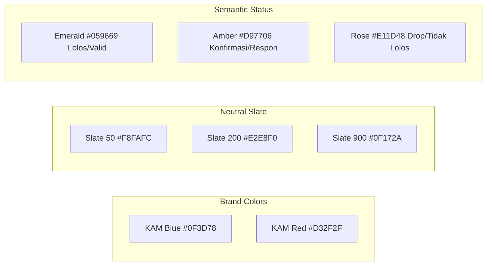

# UI/UX DESIGN SYSTEM & GUIDELINES
## KAM RECRUIT - SISTEM MANAJEMEN REKRUTMEN TENAGA KERJA OUTSOURCING
### PT KINARYA ALIHDAYA MANDIRI (PT KAM)

---

| Dokumen ID | Versi | Status | Tanggal Rilis | Desain Filosofi | Tim Desain UI/UX |
| :--- | :--- | :--- | :--- | :--- | :--- |
| **DSN-KAM-06** | **2.0.0** | Final Disetujui | 30 Oktober 2026 | Apple Human Interface Guidelines (HIG) | Tim Pengembang Kerja Praktik |

---

## 1. Filosofi Desain & Standar Industri

Antarmuka **KAM Recruit** dibangun dengan mengadopsi standar **Apple Human Interface Guidelines (HIG)** yang disesuaikan untuk lingkungan aplikasi produktivitas enterprise (*B2B Recruitment Software*). Prinsip dasarnya meliputi:
1. **Kejelasan (*Clarity*)**: Informasi status seleksi, keputusan wawancara, dan data pelamar disajikan dengan hierarki visual yang tegas dan mudah dipindai (*scannable*).
2. **Kerapian Kartu (*Inset Grouped & Squircle Cards*)**: Seluruh kontainer data menggunakan sudut melengkung halus (*rounded-2xl* atau *rounded-3xl*), berlatar belakang putih bersih (`#FFFFFF`), berbingkai tipis (*hairline border* `border-slate-200/80`), dan dilengkapi bayangan difus lembut (*soft ambient shadow* `shadow-[0_1px_3px_rgba(0,0,0,0.03)]`).
3. **Penolakan Klise Desain AI (*Anti-AI-Slop Principle*)**:
   - Dilarang menyematkan garis aksen samping tebal yang generik (seperti `w-1.5 h-full absolute left-0 top-0`).
   - Dilarang menggunakan gradasi warna norak yang mengaburkan keterbacaan data.
   - Dilarang menggunakan *dark background* gelap pada kartu kerja operasional utama (kartu utama wajib putih bersih).
4. **Ketahanan Tata Letak Anti-Pecah (*Anti-Wrapping Layout Rule*)**:
   - Seluruh lencana status (*badge/pill*) wajib memiliki kelas `whitespace-nowrap shrink-0` agar tidak pernah terlipat menjadi 2–3 baris teks pada resolusi layar berapa pun.
   - Label teks pendamping wajib memiliki `min-w-0 flex-1 truncate` agar memendek rapi dengan tanda elipsis (`...`) jika ruang sempit.

---

## 2. Palet Warna Jenama & Semantik (*Color Palette*)



| Kode Token | Nilai Hex | Peran & Penggunaan pada Antarmuka |
| :--- | :--- | :--- |
| **`kam-blue`** | `#0F3D78` | Warna primer jenama: Header sistem, tombol aksi utama (*Primary CTA*), lencana status seleksi Tahap I, ikon representatif. |
| **`kam-red`** | `#D32F2F` | Warna aksen jenama: Aksi penyerahan ke mitra, status seleksi Tahap II (Lolos HRD), tombol kritis, penanda batas akhir operasional. |
| **`bg-slate-50`** | `#F8FAFC` | Latar belakang kanvas aplikasi (*Background canvas*). |
| **`bg-white`** | `#FFFFFF` | Latar permukaan kartu, tabel, dan lembar dokumen CV (*Card & Modal Surface*). |
| **`border-slate-200`**| `#E2E8F0` | Garis batas struktural antar modul (*Hairline Border*). |
| **`text-slate-900`** | `#0F172A` | Teks judul utama dan nilai numerik besar (*Primary Heading & Digits*). |
| **`text-slate-500`** | `#64748B` | Teks keterangan, subjudul, dan label atribut (*Secondary Text*). |
| **`status-emerald`** | `#059669` | Penanda keberhasilan: Lolos seleksi, berkas Glints terverifikasi, lisensi BNSP valid. |
| **`status-amber`** | `#D97706` | Penanda proses: Menunggu respon WA, antrean jadwal wawancara, respon rate pelamar. |

---

## 3. Sistem Tipografi (*Typography System*)

Sistem menggunakan jenis huruf **Plus Jakarta Sans** (Google Fonts) yang dipadukan dengan *system sans-serif fallback* (`-apple-system, BlinkMacSystemFont, "Segoe UI", Roboto`).

| Tingkatan Teks | Ukuran Font / Line-Height | Bobot (*Weight*) | Contoh Penggunaan |
| :--- | :--- | :--- | :--- |
| **Display KPI** | `30px (text-3xl) / 36px` | Extrabold (800) | Angka total kandidat (128, 50, 20, 16) |
| **Header 1** | `20px (text-xl) / 28px` | Bold (700) | Judul modul (Bank Pelamar Glints, Penyerahan Berkas) |
| **Header 2** | `16px (text-base) / 24px` | Bold (700) | Judul kartu pelamar, nama kandidat di modal CV |
| **Sub-header** | `14px (text-sm) / 20px` | Semibold (600) | Label tombol aksi, nama posisi lowongan |
| **Body Text** | `12px (text-xs) / 18px` | Regular (400) / Medium (500) | Rincian kualifikasi, tugas pengalaman kerja, isi tabel |
| **Caption / Badge** | `10px (text-[10px]) / 14px` | Bold (700) / Extrabold (800) | Lencana status seleksi, tanggal pendaftaran, no. lisensi |

---

## 4. Rancang Bangun Komponen Antarmuka (*Component Breakdown*)

### 4.1 Kartu Metrik KPI Funnel (Tahan Resolusi)
* **Struktur**: 4 kartu metrik di atas halaman dengan grid responsif `grid-cols-1 sm:grid-cols-2 xl:grid-cols-4 gap-4`.
  - Pada layar laptop kantor (1024px–1279px), kartu otomatis tertata 2×2 yang lapang (~340px per kartu).
  - Pada layar monitor lebar (≥ 1280px), kartu tertata 4 kolom sejajar tanpa ada teks yang terhimpit.
* **Footer Kartu**: Baris bawah kartu memiliki flex container `flex items-center justify-between text-xs` yang menghubungkan label kiri (`min-w-0 flex-1 truncate`) dan badge kanan (`whitespace-nowrap shrink-0`).

```
+-------------------------------------------------------+
| TOTAL LAMARAN (GLINTS)                         [ICON] |
| 128 Kandidat                                          |
| ----------------------------------------------------- |
| 3 Lowongan Mitra Aktif ...             [+12 Hari Ini] |
+-------------------------------------------------------+
```

### 4.2 Modal Pratinjau Dossier CV Eksekutif
* **Ukuran**: `max-w-4xl max-h-[92vh]` (lebar proporsional menyerupai lembar dokumen A4).
* **Anatomi Lembar CV**:
  1. **Header Bar**: Inisial avatar pelamar, nama lengkap, posisi yang dilamar, status seleksi, tombol **Cetak / Ekspor PDF**, dan tombol **Salin Profil**.
  2. **Banner Glints Verified**: Lencana keabsahan berkas terintegrasi portal Glints dengan kode `GLINTS-ID`.
  3. **Data Pribadi & Kontak**: Grid 4 kolom (WhatsApp, Email, Pendidikan & IPK, Domisili & Usia).
  4. **Ringkasan Profil**: Kotak latar netral berisi narasi kualifikasi eksekutif pelamar.
  5. **Riwayat Pengalaman Kerja**: Kartu riwayat pekerjaan dengan *badge* instansi, periode, lokasi, dan daftar poin tugas operasional.
  6. **Sertifikat & Lisensi Resmi**: Grid 2 kolom kartu sertifikasi berlisensi resmi (BNSP, Kemnaker, Microsoft) dengan lencana `✓ Glints Verified`.
  7. **Kompetensi & Keterampilan**: Kumpulan *pill tags* kemampuan teknis.
  8. **Akses Berkas Asli**: Akses unduh berkas pendaftaran PDF asli.

---


### 4.3 Modul Master Mitra & Penyerahan Berkas CV (*Dual Sub-View Architecture*)
* **Filosofi Integrasi**: Menggabungkan manajemen data master permintaan mitra (*Job Vacancies CRUD*) dengan katalog berkas CV kandidat yang telah lolos wawancara HRD ke dalam satu layar kerja terpadu.
* **Segmented Control Sub-Nav (Apple HIG)**:
  - Tombol 1: `📋 Permintaan Mitra Aktif (N Posisi)` (Aktif secara default)
  - Tombol 2: `👥 Kirim CV ke Mitra (N Orang)`
* **Anatomi Sub-View 1: Permintaan Mitra Aktif (CRUD)**:
  1. **4 Mini KPI Cards**: Total Lowongan Terdaftar, Target Kuota Mitra, Kandidat Lolos Seleksi, dan Rasio Pemenuhan Kuota (%).
  2. **Toolbar Saring & Cari**: Input pencarian posisi/mitra real-time dan dropdown filter status (`Semua`, `Dibuka`, `Ditutup`, `Arsip`).
  3. **Tabel Responsif & Progres Kuota**: Kolom tabel memuat posisi, nama mitra pihak ke-3, kualifikasi umur/pendidikan, bar progres kuota terisi (`x / y Org`), kapsul status interaktif, dan tombol aksi (*Edit Modal*, *Toggle Status*, *Hapus*).
  4. **Modal Dialog Tambah / Edit Lowongan (`#modal-vacancy`)**: Form modal terstandarisasi untuk mendata kebutuhan posisi, mitra rekanan, kuota, kualifikasi minimum, dan status pembukaan.
  5. **Modal Konfirmasi Hapus Aman (`#modal-delete-vacancy`)**: Dialog konfirmasi dengan proteksi integritas data relasi pelamar.
* **Anatomi Sub-View 2: Kirim CV ke Mitra (Kandidat Lolos HRD)**:
  1. **Tata Letak 1 Kolom Vertikal**: Seluruh kartu kandidat terpilih disusun memanjang ke bawah secara vertikal (`space-y-4`) untuk memaksimalkan keterbacaan data kualifikasi, riwayat kerja, dan sertifikasi BNSP tanpa risiko terhimpit.
  2. **Aksi Cepat**: Tombol *Lihat CV Lengkap*, *Kirim ke Mitra*, dan tombol ekspor massal *Unduh Bundel CV (ZIP)*.

---

## 5. Tata Letak Rangka Kawat (*Wireframe Structure*)

```
+=======================================================================================+
| [KAM] KAM RECRUIT                                         10:45 WIB  [HRD Recruiter v] |
+=======================================================================================+
| [NAV] Dashboard | Bank Pelamar | Komunikasi WA | Rekapitulasi (I & II) | Penyerahan   |
+---------------------------------------------------------------------------------------+
|  +---------------+  +---------------+  +---------------+  +---------------+           |
|  | TOTAL LAMARAN |  | LOLOS SORTIR  |  | KONFIRMASI WA |  | SIAP KE MITRA |           |
|  | 128 Kandidat  |  | 50 Orang      |  | 20 / 50 Hadir |  | 16 Kandidat   |           |
|  | [+12 Hari Ini]|  | [39% Lolos]   |  | [40% Respons] |  | [Siap Kirim]  |           |
|  +---------------+  +---------------+  +---------------+  +---------------+           |
+---------------------------------------------------------------------------------------+
|  [Search Pelamar...] [Filter Posisi v] [Filter Status v]             [+ Impor Glints] |
|                                                                                       |
|  [x] NAMA PELAMAR      POSISI DILAMAR    KUALIFIKASI     PENGALAMAN & SERTIFIKAT AKSI |
|  [ ] Budi Pratama      Customer Service  S1 Undip (3.52) 2 Thn (BNSP CCO Valid) [Lihat]|
|  [ ] Dimas Anggara     Teknisi FTTH      SMK N 7 (Kudus) 2 Thn (BNSP TIFO & K3) [Lihat]|
|  [ ] Fajar Nugraha     Admin Logistik    S1 Udinus (3.6) 2 Thn (BNSP CSCA Valid)[Lihat]|
+=======================================================================================+
```

---

## 6. Aturan Aksesibilitas & Responsivitas (*Responsive Breakpoints*)

1. **Breakpoint Grid Sistem**:
   - `sm:` (640px): Tampilan tabel scrollable horizontal, kartu vertikal, header subtitle adaptif.
   - `md:` (768px): Banner aksi berubah dari tumpuk vertikal menjadi sejajar horizontal.
   - `lg:` (1024px): Transisi dari mobile floating navigation ke sidebar navigasi desktop tetap (*static desktop aside*).
   - `xl:` (1280px): Kartu KPI beralih menjadi 4 kolom penuh lapang.
2. **Navigasi Melayang Mobile (*Floating Mobile Navigation*)**:
   - **Floating Mobile Bottom Navigation Bar (`#mobile-bottom-nav`)**: Pada layar mobile (`< 1024px`), antarmuka menghadirkan bilah navigasi melayang di bawah layar ponsel (`fixed bottom-0 inset-x-0 z-40 bg-white/95 backdrop-blur-md`) dengan 5 tab sentuhan jempol instan (Dashboard, Pelamar, Jadwal WA, Rekap, Mitra).
   - **Floating Slide-Over Drawer Overlay (`#sidebar-nav`)**: Tombol menu hamburger pada header membuka menu samping sebagai *floating off-canvas drawer* berlatar belakang gelap buram (*backdrop blur overlay*) tanpa mendorong susunan dokumen konten (*no layout shift*).
   - **Safe Area Bottom Spacing**: Konten utama `<main>` dilengkapi bantalan bawah `pb-24 lg:pb-6` untuk menjamin seluruh data, tabel, dan tombol aksi bebas dari tumpang tindih bilah navigasi melayang.
3. **Aksesibilitas Modal Dialog (Apple HIG Compliant)**:
   - Seluruh modal dialog (`#modal-candidate`, `#modal-scoring`, `#modal-import`) mendukung penutupan fleksibel melalui klik pada area latar gelap (*backdrop click*) dan tombol `Escape` keyboard.
4. **Kebersihan Salinan Teks (*UX Copy Cleanliness*)**:
   - Menghapus teks teknis internal dan jargon redundan seperti `(Anti-Overwriting)`, `(User)`, dan tag catatan developer, menyajikan terminologi bisnis profesional yang bersih bagi pengguna operasional.
5. **Kepatuhan Cetak (*Print Stylesheet Rule*)**:
   - Selector `@media print` mengisolasi `#modal-candidate` menjadi `position: fixed; width: 100vw; background: white;` dan menyembunyikan semua tombol antarmuka `.no-print`. Dokumen tercetak bersih di kertas A4 tanpa *header/footer* browser yang mengganggu.

6. **Resolusi Ketahanan Tata Letak Desktop (*Desktop Anti-Crush Architecture*)**:
   - **Tab 3 (Jadwal & Follow-up WA)**: Menghindari pemadatan teks horizontal dengan memisahkan blok identitas pelamar (baris atas), kotak metadata jadwal & kontak (baris tengah), dan 4 tombol aksi operasional (baris bawah). Nama pelamar dan posisi tidak pernah terpotong (*no ellipsis truncation*).
   - **Tab 5 (Kirim CV ke Mitra)**: Mengadopsi breakpoint responsif `xl:grid-cols-3` (2 kolom lapang pada layar 1024-1279px, 3 kolom pada layar >=1280px). Menggabungkan lencana seleksi menjadi satu kapsul solid `Tahap II • Lolos HRD`, mengisolasi label `Kualifikasi:` dari teks institusi panjang menggunakan `break-words`, dan mengonversi seluruh ikon berbasis font emoji ke vektor SVG presisi tinggi.

7. **Komponen Visualisasi Tren Rekrutmen Bulanan (*Monthly Recruitment Bar Chart*)**:
   - **Tata Letak Kartu Grouped**: Kartu berbingkai halus memuat grafik batang ganda (*dual bar chart*) untuk 12 bulan kalender (Januari hingga Desember).
   - **Skema Warna Fungsional**:
     - *Batang Kandidat Masuk*: Biru korporat PT KAM (`#1E3A8A` / `bg-blue-900`).
     - *Batang Diterima / Lolos*: Hijau zamrud (`#059669` / `bg-emerald-600`).
   - **Ketahanan Responsif**: Berjalan murni menggunakan HTML5/Tailwind CSS dengan bar proporsional, bebas ketergantungan CDN eksternal, dan mendukung mode tabel (*Data Table Switcher*) untuk aksesibilitas data.
