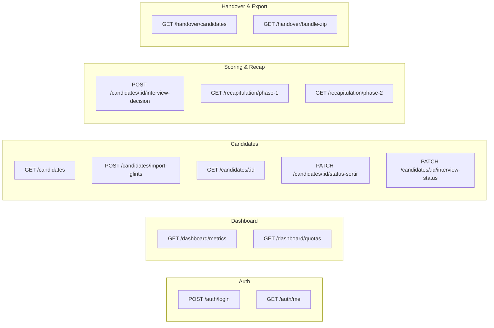
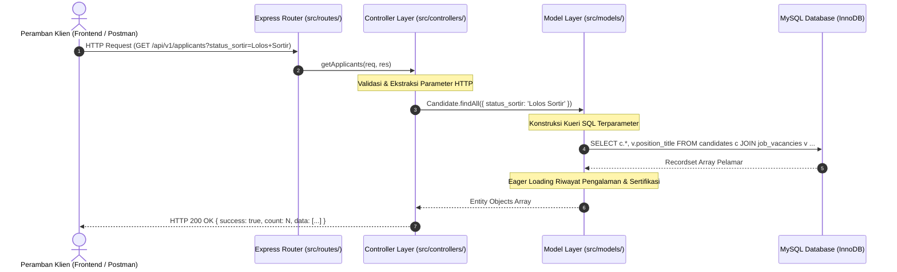

# API ROUTING & ENDPOINT SPECIFICATION
## KAM RECRUIT - SISTEM MANAJEMEN REKRUTMEN TENAGA KERJA OUTSOURCING
### PT KINARYA ALIHDAYA MANDIRI (PT KAM)

---

| Dokumen ID | Versi | Status | Protokol | Format Data | Arsitek API |
| :--- | :--- | :--- | :--- | :--- | :--- |
| **API-KAM-07** | **2.0.0** | Final Disetujui | HTTPS / RESTful | JSON (application/json) | Tim Pengembang Kerja Praktik |

---

## 1. Konvensi Dasar & Standar Arsitektur API

### 1.1 Base URL
* Lingkungan Produksi: `https://recruit.kinarya.co.id/api/v1`
* Lingkungan Pengembangan: `http://localhost:3000/api/v1`

### 1.2 Skema Otentikasi
Seluruh pemanggilan *endpoint* privat (selain login) wajib menyertakan token otentikasi pada *HTTP Request Header*:
```http
Authorization: Bearer <jwt_access_token>
Accept: application/json
Content-Type: application/json
```

### 1.3 Format Respons Baku (*Standard Envelope Format*)
#### Respons Berhasil (*Success Response* - HTTP 200/201):
```json
{
  "success": true,
  "message": "Data kandidat berhasil diperbarui",
  "data": { ... },
  "meta": {
    "timestamp": "2026-10-30T10:45:00Z",
    "version": "v1.0"
  }
}
```

#### Respons Gagal (*Error Response* - HTTP 400/401/404/422/500):
```json
{
  "success": false,
  "error_code": "VALIDATION_FAILED",
  "message": "Parameter batas usia kandidat melebihi ketentuan kriteria mitra",
  "errors": [
    {
      "field": "age",
      "message": "Usia kandidat (29) melebihi batas maksimal kriteria (27) untuk posisi Customer Service"
    }
  ]
}
```

---

## 2. Katalog Rute API Lengkap (*API Route Directory*)



---

## 3. Rincian Spesifikasi Endpoint (*Endpoint Details*)

### 3.1 Modul Otentikasi & Akun
#### 1. `POST /auth/login`
* **Deskripsi**: Masuk ke dalam sistem operasional KAM Recruit.
* **Request Body**:
```json
{
  "email": "recruiter@kinarya.co.id",
  "password": "PasswordAman123!"
}
```
* **Response (HTTP 200)**:
```json
{
  "success": true,
  "message": "Login berhasil",
  "data": {
    "token": "eyJhbGciOiJIUzI1NiIsIn...",
    "user": {
      "id": 1,
      "name": "Iing Ariesta Sari",
      "role": "recruiter",
      "email": "recruiter@kinarya.co.id"
    }
  }
}
```

---

### 3.2 Modul Dashboard & Metrik KPI
#### 2. `GET /dashboard/metrics`
* **Deskripsi**: Mengambil data ringkasan funnel rekrutmen untuk kartu KPI atas.
* **Response (HTTP 200)**:
```json
{
  "success": true,
  "data": {
    "total_glints_applicants": 128,
    "today_new_applicants": 12,
    "stage_1_passed_count": 50,
    "stage_1_ratio": 39.06,
    "interview_confirmed_count": 20,
    "interview_no_show_count": 30,
    "response_rate": 40.0,
    "stage_2_passed_count": 16,
    "ready_to_partner_count": 16
  }
}
```

---

### 3.3 Modul Pengelolaan Bank Pelamar Glints
#### 3. `GET /candidates`
* **Deskripsi**: Menampilkan daftar pelamar terdata dengan parameter filter dinamis.
* **Query Parameters**:
  - `search` (string, opsional): Cari berdasarkan nama atau email.
  - `posisi` (string, opsional): Filter posisi (e.g., `Customer Service Rep`).
  - `mitra` (string, opsional): Filter mitra rekanan (e.g., `PT Telkom Akses`).
  - `status_sortir` (string, opsional): `Belum Disortir`, `Lolos Sortir`, `Tidak Memenuhi`.
  - `page` (int, default 1), `limit` (int, default 10).
* **Response (HTTP 200)**:
```json
{
  "success": true,
  "data": [
    {
      "id": 1,
      "nama": "Budi Pratama",
      "email": "budi.pratama@gmail.com",
      "phone": "+62 812-9843-1120",
      "posisi": "Customer Service Rep",
      "mitra": "PT Telkom Akses",
      "pendidikan": "S1",
      "kampus": "Undip (IPK 3.52)",
      "usia": 23,
      "domisili": "Semarang",
      "tgl_daftar": "28 Okt 2026",
      "status_sortir": "Lolos Sortir",
      "status_interview": "Bersedia",
      "status_hrd": "Lolos Seleksi HRD",
      "top_experience": "Customer Service Specialist (2 Thn)",
      "total_certificates": 3
    }
  ],
  "meta": {
    "current_page": 1,
    "total_records": 128,
    "total_pages": 13
  }
}
```

#### 4. `GET /candidates/:id`
* **Deskripsi**: Mengambil data dossier lengkap pelamar (termasuk riwayat pengalaman dan sertifikat) untuk ditampilkan pada modal CV.
* **Response (HTTP 200)**:
```json
{
  "success": true,
  "data": {
    "id": 1,
    "glints_id": "GLINTS-ID-10001",
    "nama": "Budi Pratama",
    "kontak": {
      "phone": "+62 812-9843-1120",
      "email": "budi.pratama@gmail.com",
      "domisili": "Semarang",
      "usia": 23
    },
    "pendidikan": {
      "jenjang": "S1",
      "institusi": "Universitas Diponegoro",
      "ipk": 3.52
    },
    "ringkasan": "Profesional customer service berdedikasi dengan rekam jejak 2 tahun...",
    "pengalaman": [
      {
        "posisi": "Customer Service Specialist",
        "perusahaan": "PT Solusi Transaksi Digital",
        "periode": "2024 - 2026 (2 Thn)",
        "lokasi": "Semarang",
        "tugas": [
          "Menangani rata-rata 75+ interaksi pelanggan per hari.",
          "Mencapai First Contact Resolution (FCR) 92% dan CSAT 94.5%."
        ]
      }
    ],
    "sertifikat": [
      {
        "nama": "Sertifikasi Profesi Customer Care Officer (CCO)",
        "penerbit": "Badan Nasional Sertifikasi Profesi (BNSP)",
        "tahun": 2025,
        "no_reg": "BNSP-CCO-5891-2025",
        "status": "Terverifikasi Glints"
      }
    ],
    "keahlian": ["Omnichannel Support", "Zendesk CRM", "Service Excellence"],
    "status": {
      "sortir": "Lolos Sortir",
      "interview": "Bersedia",
      "
      "hrd": "Lolos Seleksi HRD"
    }
  }
}
```

---

### 3.4 Modul Komunikasi WhatsApp & Konfirmasi
#### 5. `PATCH /candidates/:id/interview-status`
* **Deskripsi**: Memperbarui respon pelamar terhadap undangan wawancara WhatsApp.
* **Request Body**:
```json
{
  "status_interview": "Bersedia",
  "jadwal_interview": "Kamis, 5 Nov 2026 (09.00 WIB)"
}
```
* **Response (HTTP 200)**:
```json
{
  "success": true,
  "message": "Status konfirmasi wawancara berhasil dicatat",
  "data": {
    "id": 1,
    "status_interview": "Bersedia",
    "jadwal_interview": "Kamis, 5 Nov 2026 (09.00 WIB)"
  }
}
```

#### 5b. `PUT /candidates/bulk/interview-schedule`
* **Deskripsi**: Memperbarui tanggal, jam, atau respon status wawancara secara serentak ke banyak kandidat sekaligus serta sinkronisasi template pesan WhatsApp.
* **Request Body**:
```json
{
  "candidate_ids": [1, 2, 3],
  "interview_schedule": "Kamis, 5 November 2026 pukul 09.00 WIB",
  "status_interview": "Bersedia"
}
```
* **Response (HTTP 200)**:
```json
{
  "success": true,
  "message": "Jadwal wawancara 3 kandidat berhasil diperbarui serentak.",
  "data": {
    "affected_rows": 3,
    "interview_schedule": "Kamis, 5 November 2026 pukul 09.00 WIB",
    "status_interview": "Bersedia"
  }
}
```

---

### 3.5 Modul Penilaian Wawancara HRD & Rekapitulasi
#### 6. `POST /candidates/:id/interview-decision`
* **Deskripsi**: Menyimpan keputusan hasil wawancara HRD secara langsung melalui dropdown (`Lolos Seleksi HRD` atau `Tidak Lolos`).
* **Request Body**:
```json
{
  "decision": "Lolos Seleksi HRD",
  "notes": "Sangat komunikatif, artikulatif, siap shift malam, dan bersertifikat BNSP"
}
```
* **Response (HTTP 200)**:
```json
{
  "success": true,
  "message": "Keputusan wawancara berhasil disimpan sebagai 'Lolos Seleksi HRD'",
  "data": {
    "candidate_id": 1,
    "status_hrd": "Lolos Seleksi HRD",
    "is_ready_for_partner": true
  }
}
```

---

### 3.6 Modul Penyerahan Berkas ke Mitra Rekanan
#### 7. `GET /handover/bundle-zip?vacancy_id=1`
* **Deskripsi**: Mengunduh seluruh berkas CV pelamar yang lolos seleksi HRD dalam satu arsip ZIP.
* **Response**: Berkas biner `application/zip` (Header `Content-Disposition: attachment; filename="Bundel_CV_PT_Telkom_Akses_20261030.zip"`).

#### 8. `POST /handover/submit-to-partner`
* **Deskripsi**: Mengunci status berkas bahwa paket kandidat telah resmi diserahkan ke pihak ketiga.
* **Request Body**:
```json
{
  "candidate_ids": [1, 2, 3, 5],
  "partner_id": 1,
  "notes": "Penyerahan berkas batch 1 via email resmi ke User Telkom Akses"
}
```
* **Response (HTTP 200)**:
```json
{
  "success": true,
  "message": "Berkas 4 kandidat berhasil ditandai sebagai 'Diserahkan ke Mitra'",
  "data": {
    "submitted_count": 4,
    "timestamp": "2026-10-30T10:50:12Z"
  }
}
```


---

## 4. Spesifikasi Perutean Antarmuka Klien (*Dedicated Frontend Page Routes*)

Sistem mengadopsi pola *Hybrid Single Page Application Routing* yang memadukan server-side routing Express.js dan HTML5 History API (`pushState` dan `popstate`). Setiap modul antarmuka dapat diakses langsung melalui URL unik (*deep linking*) tanpa kehilangan state aplikasi:

| Rute URL Peramban | Target Tab Antarmuka | Metode HTTP | Deskripsi Fungsional |
| :--- | :--- | :--- | :--- |
| `http://localhost:3000/` | `tab-dashboard` | `GET` | Halaman beranda utama sistem rekrutmen PT KAM |
| `http://localhost:3000/dashboard` | `tab-dashboard` | `GET` | Dashboard analitik KPI & grafik rekrutmen bulanan Jan–Des |
| `http://localhost:3000/pelamar` | `tab-pelamar` | `GET` | Master Data Pelamar Glints & penyortiran administratif |
| `http://localhost:3000/interview` | `tab-interview` | `GET` | Pelacakan jadwal wawancara HRD & gateway WhatsApp |
| `http://localhost:3000/jadwal` | `tab-interview` | `GET` | *Alias* alternatif untuk jadwal & tindak lanjut WhatsApp |
| `http://localhost:3000/rekapitulasi` | `tab-rekapitulasi` | `GET` | Rekapitulasi evaluasi seleksi terpadu (Tahap I & Tahap II) |
| `http://localhost:3000/mitra` | `tab-penyerahan` | `GET` | Master mitra rekanan, CRUD lowongan & penyerahan berkas CV |
| `http://localhost:3000/penyerahan` | `tab-penyerahan` | `GET` | *Alias* alternatif untuk halaman serah terima berkas mitra |

---

## 5. Rincian Endpoint Modul Master Permintaan Mitra (Job Vacancies CRUD)

Modul ini mengelola data master permintaan kebutuhan tenaga kerja dari perusahaan mitra rekanan (*outsource clients*). Seluruh data tersimpan pada tabel MySQL `job_vacancies` dan terhubung langsung ke analitik pemenuhan kuota penempatan.

### 5.1 `GET /api/v1/vacancies`
* **Deskripsi**: Mengambil seluruh daftar permintaan lowongan mitra aktif beserta jumlah pelamar terdaftar dan jumlah kandidat yang telah lolos seleksi HRD.
* **Response (HTTP 200)**:
```json
{
  "success": true,
  "count": 3,
  "data": [
    {
      "id": 1,
      "partner_name": "PT Telkom Akses",
      "position_title": "Customer Service Rep",
      "quota": 15,
      "min_education": "D3",
      "max_age": 27,
      "target_city": "Semarang",
      "status": "Dibuka",
      "total_applicants": 8,
      "passed_sortir": 8,
      "passed_hrd": 8
    }
  ]
}
```

### 5.2 `GET /api/v1/vacancies/:id`
* **Deskripsi**: Mengambil rincian data satu permintaan lowongan berdasarkan ID unik.
* **Response (HTTP 200)**:
```json
{
  "success": true,
  "data": {
    "id": 1,
    "position_title": "Customer Service Rep",
    "partner_name": "PT Telkom Akses",
    "target_city": "Semarang",
    "quota": 15,
    "min_education": "D3",
    "max_age": 27,
    "status": "Dibuka",
    "total_applicants": 8,
    "passed_hrd": 8
  }
}
```

### 5.3 `POST /api/v1/vacancies`
* **Deskripsi**: Menambahkan permintaan lowongan mitra baru ke dalam sistem.
* **Request Body**:
```json
{
  "position_title": "Teknisi Fiber Optic",
  "partner_name": "PT Indonusa Telemedia",
  "target_city": "Semarang",
  "max_age": 30,
  "min_education": "SMA/SMK",
  "quota": 20,
  "status": "Dibuka"
}
```
* **Response (HTTP 201)**:
```json
{
  "success": true,
  "message": "Permintaan mitra baru berhasil ditambahkan.",
  "data": {
    "id": 4,
    "position_title": "Teknisi Fiber Optic",
    "partner_name": "PT Indonusa Telemedia",
    "target_city": "Semarang",
    "max_age": 30,
    "min_education": "SMA/SMK",
    "quota": 20,
    "status": "Dibuka"
  }
}
```

### 5.4 `PUT /api/v1/vacancies/:id`
* **Deskripsi**: Memperbarui informasi permintaan lowongan mitra yang telah ada.
* **Request Body**:
```json
{
  "position_title": "Teknisi Fiber Optic Senior",
  "partner_name": "PT Indonusa Telemedia",
  "target_city": "Semarang & Kudus",
  "quota": 25,
  "status": "Dibuka"
}
```
* **Response (HTTP 200)**:
```json
{
  "success": true,
  "message": "Data permintaan mitra berhasil diperbarui.",
  "data": { ... }
}
```

### 5.5 `PATCH /api/v1/vacancies/:id/status`
* **Deskripsi**: Mengubah status aktif lowongan secara cepat (`Dibuka`, `Ditutup`, atau `Arsip`).
* **Request Body**:
```json
{
  "status": "Ditutup"
}
```
* **Response (HTTP 200)**:
```json
{
  "success": true,
  "message": "Status lowongan berhasil diubah menjadi "Ditutup".",
  "data": { "id": 4, "status": "Ditutup" }
}
```

### 5.6 `DELETE /api/v1/vacancies/:id`
* **Deskripsi**: Menghapus data lowongan mitra. Jika lowongan memiliki kandidat terdaftar, sistem akan memberikan respon peringatan proteksi integritas data kecuali parameter `?force=true` disertakan.
* **Query Parameter**: `force=true` (opsional, untuk konfirmasi pembersihan relasi kandidat terkait).
* **Response (HTTP 200)**:
```json
{
  "success": true,
  "message": "Permintaan lowongan "Teknisi Fiber Optic" (PT Indonusa Telemedia) berhasil dihapus."
}
```

---

## 6. Siklus Hidup Permintaan REST API & Pola MVC (Request Lifecycle Architecture)

Sejak pembaruan arsitektur MVC Murni (v2.11.0), seluruh permintaan HTTP melalui siklus pemrosesan berlapis yang bersih tanpa pencampuran SQL di dalam router maupun controller:


