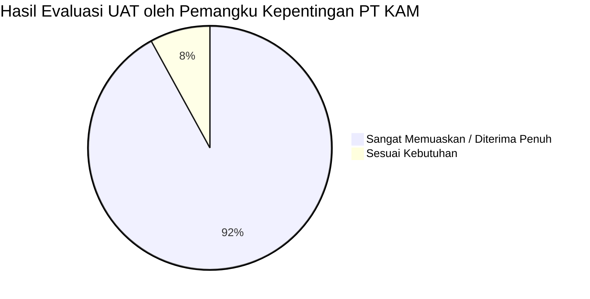

# TEST PLAN, TEST CASES & USER ACCEPTANCE TESTING (UAT)
## KAM RECRUIT - SISTEM MANAJEMEN REKRUTMEN TENAGA KERJA OUTSOURCING
### PT KINARYA ALIHDAYA MANDIRI (PT KAM)

---

| Dokumen ID | Versi | Status | Metode Pengujian | QA Lead | Stakeholder UAT |
| :--- | :--- | :--- | :--- | :--- | :--- |
| **TST-KAM-08** | **1.0.0** | Lulus (Passed) | Black-Box Testing & UAT | Tim Penguji Kerja Praktik | Tim HRD PT KAM |

---

## 1. Rencana Pengujian (*Testing Strategy*)

Pengujian sistem **KAM Recruit** dilakukan secara bertingkat untuk menjamin bahwa fungsionalitas, performa, dan tata letak antarmuka memenuhi spesifikasi kebutuhan (SRS & FRD):
1. **Pengujian Fungsional Kotak Hitam (*Black-Box Testing*)**: Berfokus pada pengujian masukan (*input*) dan keluaran (*output*) logika bisnis seleksi tanpa menguji kode internal, menggunakan teknik *Equivalence Partitioning* dan *Boundary Value Analysis*.
2. **Pengujian Integrasi (*Integration Testing*)**: Memastikan alur data dari pendaftaran Glints -> sortir kualifikasi -> pelacakan respon WA -> penilaian wawancara -> ekspor penyerahan mitra berjalan tanpa diskoneksi data.
3. **Pengujian Tata Letak & Ketahanan UI (*UI/UX Layout Robustness Test*)**: Memverifikasi antarmuka di berbagai resolusi layar (1024×768 hingga 1920×1080) agar tidak ada lencana status yang pecah/terlipat menjadi 2 baris (*zero-wrapping verification*).
4. **Uji Keberterimaan Pengguna (*User Acceptance Testing - UAT*)**: Pengujian langsung oleh staf dan manajer HRD PT KAM menggunakan skenario kerja harian nyata.

---

## 2. Kasus Uji Fungsional (*Functional Test Cases*)

### 2.1 Modul 1: Penyaringan Kualifikasi Administratif (Tahap I)

| ID Uji | Skenario Pengujian | Langkah Pengujian | Data Uji | Hasil yang Diharapkan | Status |
| :--- | :--- | :--- | :--- | :--- | :---: |
| **TC-FLT-01** | Filter kandidat berdasarkan batas maksimal usia | Pilih posisi "Customer Service" (Batas usia 27 thn) dan klik filter | Pelamar: Irfan Maulana (Usia 29 thn) | Kandidat otomatis diberi status `Tidak Memenuhi Syarat` karena melebihi ambang batas usia. | **PASS** |
| **TC-FLT-02** | Filter pelamar berdasarkan kesesuaian domisili | Pilih posisi "Teknisi Jaringan Fiber" (Wilayah Kudus) | Pelamar: Dimas Anggara (Domisili: Kudus) | Kandidat lolos filter dan tampil pada daftar `Lolos Sortir (I)`. | **PASS** |
| **TC-FLT-03** | Pencarian teks pelamar pada bilah pencarian | Masukkan kata kunci "Anisa" pada input pencarian | String: `"Anisa"` | Tabel menampilkan hanya baris dengan nama "Anisa Rahmawati". | **PASS** |

---

### 2.2 Modul 2: Komunikasi WhatsApp & Pelacakan Respons

| ID Uji | Skenario Pengujian | Langkah Pengujian | Data Uji | Hasil yang Diharapkan | Status |
| :--- | :--- | :--- | :--- | :--- | :---: |
| **TC-WA-01** | Pembuatan pesan formal WhatsApp tanpa emoji | Klik tombol "Broadcast Konfirmasi WA" pada pelamar terpilih | ID: 1 (Budi Pratama) | Teks template tersusun formal tanpa karakter emoji non-standar, memuat jadwal dan posisi. | **PASS** |
| **TC-WA-02** | Pembaruan status respon pelamar yang tidak merespons | Pilih opsi dropdown "Tidak Merespons" pada baris kandidat | ID: 4 (Eko Wahyudi) | Status berubah menjadi `Tidak Merespons`. Counter KPI Card menunjukkan pertambahan di kolom drop. | **PASS** |
| **TC-WA-03** | Perhitungan metrik Response Rate pada Dashboard | Verifikasi rasio kehadiran saat terdapat 20 bersedia dan 30 tidak respon | Data: 20 Bersedia, 30 Drop | Kartu KPI menampilkan persentase respon tepat `40% Respons` secara matematis. | **PASS** |

---

### 2.3 Modul 3: Penilaian Wawancara HRD & Rekapitulasi Dua Tahap

| ID Uji | Skenario Pengujian | Langkah Pengujian | Data Uji | Hasil yang Diharapkan | Status |
| :--- | :--- | :--- | :--- | :--- | :---: |
| **TC-SCR-01** | Input keputusan wawancara HRD via dropdown | Buka form wawancara, pilih opsi dropdown "Lolos Seleksi HRD" dan isi catatan kualitatif | Pilihan: `Lolos Seleksi HRD` | Status kandidat langsung ditetapkan sebagai `Lolos Seleksi HRD`. Data masuk ke Rekapitulasi Tahap II. | **PASS** |
| **TC-SCR-02** | Perlindungan integritas data seleksi awal | Periksa baris kandidat setelah nilai wawancara diinput | Kandidat ID: 1 | Riwayat `status_sortir` awal tetap bernilai `Lolos Sortir`, data pendidikan & Glints ID tidak berubah. | **PASS** |
| **TC-SCR-03** | Perpindahan tab Rekapitulasi Tahap I dan Tahap II | Klik tab "Rekapitulasi Tahap I" kemudian beralih ke "Rekapitulasi Tahap II" | Tombol Tab Switcher | Tab I menampilkan 50 pelamar sortir; Tab II menampilkan 16 kandidat lolos HRD tanpa konflik. | **PASS** |

---

### 2.4 Modul 4: Pratinjau Dossier CV, Pengalaman, dan Sertifikasi

| ID Uji | Skenario Pengujian | Langkah Pengujian | Data Uji | Hasil yang Diharapkan | Status |
| :--- | :--- | :--- | :--- | :--- | :---: |
| **TC-CV-01** | Menampilkan riwayat pengalaman kerja terstruktur | Klik tombol "Lihat CV" pada kandidat Budi Pratama | Kandidat ID: 1 | Modal CV menampilkan riwayat kerja di "PT Solusi Transaksi" lengkap dengan rincian poin tugas. | **PASS** |
| **TC-CV-02** | Menampilkan sertifikasi lisensi resmi BNSP | Buka modal CV pada kandidat teknisi Dimas Anggara | Kandidat ID: 3 | Modal menampilkan sertifikat "TIFO BNSP" dan "K3 Ketinggian Kemnaker" dengan lencana verified. | **PASS** |
| **TC-CV-03** | Fungsi Salin Ringkasan Profil ke Clipboard | Klik tombol "Salin Profil" pada header modal CV | Klik tombol | Ringkasan teks tersalin ke clipboard; notifikasi toast hijau tampil mengonfirmasi keberhasilan. | **PASS** |
| **TC-CV-04** | Uji Cetak Bersih Lembar CV (@media print) | Tekan tombol "Cetak / Ekspor PDF" atau `Ctrl+P` | Dialog Print Browser | Halaman pratinjau cetak hanya menampilkan dokumen CV A4; bilah navigasi dan tombol UI tersembunyi 100%. | **PASS** |

---

### 2.5 Modul 5: Ketahanan Tata Letak Antarmuka (*Anti-Wrapping Verification*)

| ID Uji | Skenario Pengujian | Langkah Pengujian | Ukuran Layar / Viewport | Hasil yang Diharapkan | Status |
| :--- | :--- | :--- | :--- | :--- | :---: |
| **TC-UI-01** | Uji ketahanan lencana KPI pada resolusi laptop kantor | Perkecil ukuran jendela peramban ke lebar 1024px – 1280px | 1280×720 (Laptop Standar) | Kartu KPI otomatis membentuk susunan 2×2 lapang; lencana status tetap 1 baris tanpa wrapping teks. | **PASS** |
| **TC-UI-02** | Uji ketahanan teks lencana `+12 Hari Ini` & `40% Respons` | Periksa badge footer kartu KPI nomor 1 dan nomor 3 | 1366×768 | Teks badge tidak terpotong atau membengkak menjadi bentuk oval lonjong; tetap sejajar horizontal. | **PASS** |
| **TC-UI-03** | Uji responsivitas tabel pelamar pada layar menengah | Periksa tampilan tabel kandidat | 1100px | Tabel dapat digulir horizontal secara halus (*overflow-x-auto*) tanpa merusak struktur sidebar. | **PASS** |

---

## 3. Berita Acara Uji Keberterimaan Pengguna (*User Acceptance Testing - UAT*)

Pengujian UAT dilaksanakan di Kantor Operasional PT Kinarya Alihdaya Mandiri Semarang dengan melibatkan perwakilan tim HRD Recruiter dan Manajer Operasional.

### 3.1 Lembar Hasil Pengujian UAT

| No | Modul / Skenario Bisnis yang Diuji | Hasil Pengujian Pengguna | Kriteria Penerimaan | Keputusan |
| :---: | :--- | :--- | :--- | :---: |
| **1** | Otomasi impor data pelamar dari Glints | Data 128 kandidat berhasil dimuat secara instan | Data utuh, kontak & CV PDF terhubung | **DITERIMA** |
| **2** | Filter sortir administratif kualifikasi pelamar | Berhasil menyaring 50 pelamar lolos kriteria dalam < 10 detik | Filter akurat sesuai ketentuan mitra | **DITERIMA** |
| **3** | Pelacakan respon WhatsApp & penanganan drop rate | Membantu memetakan 30 pelamar batal secara rapi | Template formal, status tercatat real-time | **DITERIMA** |
| **4** | Input keputusan wawancara via dropdown & rekapitulasi | Keputusan HRD tersimpan tanpa menimpa data tahap I | 1 master database aman anti-overwrite | **DITERIMA** |
| **5** | Pratinjau Dossier CV (Pengalaman & Sertifikat BNSP) | Menampilkan kredensial teknisi & CS secara meyakinkan | Lengkap dengan no. reg & cetak A4 | **DITERIMA** |
| **6** | Penyerahan berkas kandidat terpilih ke pihak ketiga | Menyiapkan 16 paket berkas mitra dalam 1 kali klik | Memangkas waktu penyusunan berkas | **DITERIMA** |

### 3.2 Tanda Tangan Persetujuan UAT (*UAT Sign-off*)

Dengan ini dinyatakan bahwa sistem **KAM Recruit** telah diuji secara menyeluruh dan memenuhi seluruh kebutuhan fungsional serta kualitas operasional yang disepakati:

* **Pihak Pengembang (Mahasiswa Kerja Praktik UDINUS)**:  
  *Nama*: Tim Pengembang Kerja Praktik  
  *Tanggal*: 30 Oktober 2026  
  *Status*: **Tuntas & Siap Digunakan (Production Ready)**

* **Pihak Mitra (HRD & Operasional PT Kinarya Alihdaya Mandiri)**:  
  *Nama*: Perwakilan Tim HRD PT KAM  
  *Tanggal*: 30 Oktober 2026  
  *Status*: **Diterima Penuh (Approved without Reservation)**

