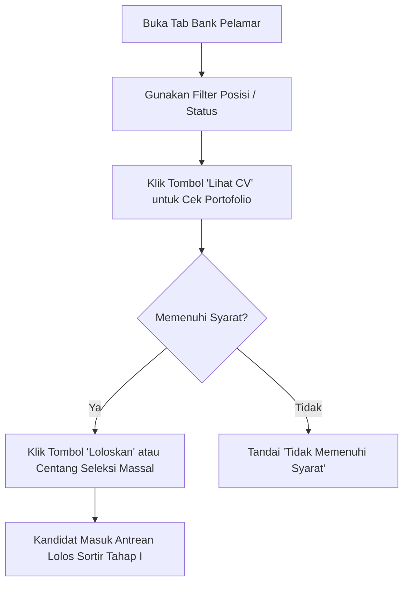

# USER & ADMINISTRATOR MANUAL
## KAM RECRUIT - SISTEM MANAJEMEN REKRUTMEN TENAGA KERJA OUTSOURCING
### PT KINARYA ALIHDAYA MANDIRI (PT KAM)

---

| Dokumen ID | Versi | Status | Sasaran Pembaca | Tanggal Rilis |
| :--- | :--- | :--- | :--- | :--- |
| **MNL-KAM-09** | **1.0.0** | Final Panduan | HRD Recruiter, Manajer, & Admin PT KAM | 30 Oktober 2026 |

---

## 1. Pendahuluan & Akses Sistem

### 1.1 Persyaratan Peramban Web (*Browser Requirements*)
Aplikasi **KAM Recruit** dapat diakses melalui komputer kerja dengan peramban modern terkini:
* Google Chrome versi 100 ke atas (Sangat Disarankan).
* Microsoft Edge versi 100 ke atas.
* Mozilla Firefox versi 100 ke atas.
* Resolusi layar yang disarankan: Minimal 1366 × 768 piksel.

### 1.2 Masuk ke Dalam Sistem (*Login*)
1. Buka peramban dan akses alamat URL internal sistem: `https://recruit.kinarya.co.id` (atau buka file lokal `Laporan/index.html`).
2. Masukkan alamat email resmi kantor (contoh: `recruiter@kinarya.co.id`) dan kata sandi yang telah didaftarkan.
3. Klik tombol **Masuk ke Workspace**.

---

## 2. Navigasi & Memahami Dashboard Utama

Setelah berhasil masuk, Anda akan disambut oleh Dashboard Utama yang terbagi menjadi beberapa area kerja:

```
+=======================================================================================+
| [KAM] KAM RECRUIT                                                    [Iing Ariesta Sari] |
+=======================================================================================+
| [NAVIGASI TAB]                                                                        |
| [1. Dashboard]  [2. Bank Pelamar]  [3. Interview WA]  [4. Rekapitulasi]  [5. Mitra]   |
+---------------------------------------------------------------------------------------+
|  +---------------+  +---------------+  +---------------+  +---------------+           |
|  | TOTAL LAMARAN |  | LOLOS SORTIR  |  | KONFIRMASI WA |  | SIAP KE MITRA |           |
|  | 128 Kandidat  |  | 50 Orang      |  | 20 / 50 Hadir |  | 16 Kandidat   |           |
|  | [+12 Hari Ini]|  | [39% Lolos]   |  | [40% Respons] |  | [Siap Kirim]  |           |
|  +---------------+  +---------------+  +---------------+  +---------------+           |
+=======================================================================================+
```


### 2.1 Akses Langsung Berbasis Rute URL (*Dedicated URL Routes*)
Sistem mendukung perutean URL langsung (*Direct Deep-Link*) sehingga Anda dapat menyimpan pintasan (*bookmark*), membagikan tautan, atau menggunakan tombol *Back/Forward* peramban:

| Alamat URL Peramban | Modul Antarmuka | Fungsi Utama |
| :--- | :--- | :--- |
| `http://localhost:3000/dashboard` | **Dashboard & Funnel** | Metrik analitik rekrutmen & grafik rekapitulasi bulanan riil (Jan–Des) |
| `http://localhost:3000/pelamar` | **Data Pelamar** | Master Data Pelamar, penyortiran administratif otomatis & dossier pelamar |
| `http://localhost:3000/interview` | **Jadwal & Follow-up** | Pelacakan jadwal wawancara HRD & gateway template WhatsApp Web |
| `http://localhost:3000/rekapitulasi` | **Rekapitulasi Dua Tahap** | Matriks evaluasi hasil seleksi Tahap I & Tahap II serta ekspor CSV |
| `http://localhost:3000/mitra` | **Master Mitra & Kirim CV** | Manajemen CRUD permintaan mitra aktif & penyerahan berkas CV |

### 2.2 Makna 4 Kartu Metrik KPI Atas:
1. **Total Lamaran (Glints)**: Jumlah seluruh berkas pendaftaran yang diimpor dari portal lowongan kerja Glints.
2. **Lolos Sortir Kualifikasi (Tahap I)**: Jumlah pelamar yang lolos seleksi administratif awal sesuai kriteria usia, pendidikan, dan domisili.
3. **Konfirmasi Hadir Interview**: Menggambarkan kondisi riil respon pelamar (contoh: 20 bersedia hadir wawancara dari 50 pelamar yang dihubungi, dengan tingkat respon 40%).
4. **Lolos HRD & Siap Serah (Tahap II)**: Jumlah kandidat yang telah menyelesaikan wawancara HRD dengan keputusan lolos seleksi dan siap diserahkan berkas CV-nya ke pihak ketiga.

---

## 3. Panduan Operasional Per Modul

### 3.1 Modul 1: Bank Pelamar Glints (Penyortiran Administratif)
Gunakan modul ini untuk memeriksa dan menyaring kandidat baru dari portal Glints.



* **Langkah Penyortiran Cepat**:
  1. Klik tab **Bank Pelamar Glints**.
  2. Gunakan dropdown filter posisi (contoh: *Customer Service Rep* atau *Teknisi Jaringan Fiber*).
  3. Periksa kolom **Pengalaman & Sertifikat** pada baris kandidat untuk melihat sekilas masa kerja dan sertifikasi lisensi BNSP yang dimiliki.
  4. Klik tombol **Lihat CV** untuk memeriksa riwayat detail di modal dossier.
  5. Jika memenuhi kriteria, klik tombol biru **Loloskan** pada kolom aksi. Sistem akan menampilkan **Modal Konfirmasi Loloskan Pelamar** untuk memverifikasi keputusan Anda. Klik **Ya, Loloskan** untuk mengonfirmasi. Status kandidat akan berubah menjadi `Siap Interview` (Lolos Sortir).
  6. **Membatalkan Status Lolos (*Revert*)**:
     - Jika terdapat kekeliruan atau kandidat perlu ditinjau ulang, klik tombol **Batalkan** di bawah label `Siap Interview`.
     - Konfirmasi pembatalan pada modal dialog. Status kandidat akan dikembalikan ke `Belum Disortir`, jadwal wawancara dibatalkan, dan respon kehadiran di-reset ke `Belum Dihubungi`.
  7. **Penyortiran Massal (*Bulk Action*)**:
     - Centang kotak di sebelah kiri nama pelamar yang ingin diproses secara serentak.
     - Klik tombol **Tandai Lolos Sortir** pada bilah atas tabel untuk meloloskan semua kandidat yang dipilih melalui dialog konfirmasi massal.
     - Klik tombol **Batalkan Sortir** untuk membatalkan status lolos kandidat yang dipilih secara serentak.

---

### 3.2 Modul 2: Pelacakan Komunikasi WhatsApp & Konfirmasi Hadir
Modul ini digunakan untuk menghubungi kandidat via WhatsApp dan mendokumentasikan ketersediaan hadir wawancara.

1. Klik tab **Interview & Follow-up**.
2. Klik tombol **Broadcast Konfirmasi WA** pada pelamar yang lolos sortir.
3. Sistem secara otomatis membuka tautan WhatsApp resmi dengan template pesan bahasa Indonesia formal tanpa emoji:
   > *"Selamat Siang Bpk/Ibu [Nama Pelamar], Kami dari Tim HRD PT Kinarya Alihdaya Mandiri mengundang Anda untuk mengikuti sesi wawancara..."*
4. **Memperbarui Status Respon Pelamar & Jadwal Wawancara**:
   - Jika pelamar membalas dan menyetujui jadwal, pilih status **Bersedia**.
   - Jika pelamar mengonfirmasi mengundurkan diri/bekerja di tempat lain, pilih **Menolak / Batal**.
   - Jika pesan centang dua namun tidak ada balasan setelah 3x follow-up, pilih **Tidak Merespons**.
5. **Pengaturan Tanggal & Waktu Wawancara Presisi (Date & Time Picker)**:
   - Klik tombol **Ubah Jadwal** pada kandidat untuk membuka modal `#modal-schedule`.
   - Pilih tanggal menggunakan kalender (*Date Picker*) dan tentukan jam (*Time Picker*) dalam WIB.
   - Kotak pratinjau format WhatsApp otomatis memperbarui kalimat jadwal secara riil (contoh: *Kamis, 5 November 2026 pukul 09.00 WIB*).
   - **Terapkan Serentak**: Centang opsi *"Terapkan tanggal & jam ini serentak ke semua kandidat"* untuk menyinkronkan seluruh jadwal kandidat wawancara sekaligus tanpa perlu mengedit satu per satu.
   - Recruiter juga dapat mengklik tombol **Atur Jadwal Serentak** pada banner atas modul untuk membuka dialog pengaturan serentak.
6. **Mengubah & Mengkustomisasi Template WhatsApp**:
   - Pada panel sebelah kanan (*Template WhatsApp Otomatis*), klik tombol **Edit Template**.
   - Pilih kategori template yang ingin disesuaikan (*Undangan*, *H-1*, atau *Lolos HRD*).
   - Sunting kata-kata draf pesan sesuai kebutuhan komunikasi. Sisipkan parameter dinamis otomatis dengan mengklik tag variabel: `+ {nama}`, `+ {posisi}`, `+ {mitra}`, atau `+ {jadwal}`.
   - Klik **Simpan Perubahan Template** agar template kustom tersimpan secara permanen di peramban (`localStorage`), atau klik **Kembalikan Standar** untuk kembali ke draf resmi PT KAM.
   - Sebelum mengirim, draf pesan pada kotak pratinjau juga dapat diedit secara langsung (*on-the-fly*) untuk penyesuaian khusus per kandidat.

---

### 3.3 Modul 3: Penilaian Wawancara HRD & Rekapitulasi Dua Tahap
Gunakan modul ini pada saat dan setelah sesi wawancara tatap muka atau Google Meet berlangsung.

1. Buka tab **Interview & Follow-up** atau **Rekapitulasi Seleksi**.
2. Klik tombol **Keputusan Wawancara** pada kandidat yang telah menyelesaikan sesi wawancara.
3. Form modal keputusan wawancara akan muncul:
   - Pada dropdown **Keputusan Hasil Wawancara HRD**, pilih langsung:
     * **`Lolos Seleksi HRD`** (jika kandidat memenuhi standar kompetensi & siap dikirim ke mitra).
     * **`Tidak Lolos`** (jika kandidat tidak memenuhi kriteria wawancara).
   - Tuliskan catatan kualitatif recruiter pada kotak **Catatan Evaluator Wawancara HRD** (observasi sikap, kesiapan kerja shift, dan catatan khusus).
4. Klik **Simpan Keputusan & Perbarui Rekap**:
   - Status kandidat langsung diperbarui tanpa perhitungan rumus angka bobot.
   - Kandidat yang lolos otomatis tercatat pada **Rekapitulasi Tahap II** dan siap diserahkan ke mitra.
   - Data kualifikasi awal (Tahap I) tetap aman dan tidak pernah tertimpa di master database.
5. **Navigasi & Paginasi Tabel Rekapitulasi**:
   - Recruiter dapat beralih antara **Rekapitulasi Tahap I** dan **Rekapitulasi Tahap II** melalui tombol pil navigasi di atas tabel.
   - Tabel dilengkapi kontrol paginasi dengan pilihan baris: **5, 10, 25, atau 50** kandidat per halaman.
   - Nomor urut baris (*No*) secara cerdas menyesuaikan offset halaman yang sedang aktif.

---

### 3.4 Modul 4: Pratinjau Lembar CV Dossier & Pencetakan A4
Modul ini menyajikan lembar CV profesional berstandar Apple HIG lengkap dengan riwayat pengalaman dan sertifikasi.

1. Klik tombol **Lihat CV** di mana pun tombol tersebut berada pada tabel atau kartu.
2. Modal CV Dossier akan menampilkan:
   - Identitas pelamar dan nomor verifikasi Glints ID.
   - Kontak terhubung (WhatsApp dan Email aktif).
   - **Riwayat Pengalaman Kerja**: Menampilkan nama perusahaan, periode masa kerja, dan daftar tanggung jawab terperinci.
   - **Sertifikasi & Lisensi Resmi**: Menampilkan lisensi BNSP/Kemnaker/ETS lengkap dengan nomor registrasi kredensial dan lencana `✓ Glints Verified`.
3. **Mencetak Dokumen CV Bersih**:
   - Klik tombol **Cetak / Ekspor PDF** pada bilah atas modal (atau tekan kombinasi tombol `Ctrl + P`).
   - Jendela cetak peramban akan terbuka.
   - Pastikan tujuan (*Destination*) dipilih **Save as PDF** dengan ukuran kertas **A4**.
   - Perhatikan bahwa seluruh bilah navigasi dan tombol aplikasi otomatis disembunyikan, menghasilkan lembar CV yang bersih dan rapi.
4. **Menyalin Profil Cepat**:
   - Klik tombol **Salin Profil** untuk menyalin seluruh ringkasan CV kandidat ke *clipboard*, siap ditempelkan (*paste*) ke pesan koordinasi tim.
5. **Menutup Modal Dialog Fleksibel (*Non-Strict Dismiss*)**:
   - Seluruh jendela modal dalam sistem (Dossier CV, Keputusan Wawancara, Impor Glints, Tambah Mitra, Jadwal Wawancara, dan Konfirmasi Sortir) dapat ditutup sewaktu-waktu dengan mengklik area gelap latar belakang di luar kotak dialog, menekan tombol **Batal / Tutup**, atau menekan tombol keyboard `Escape`.

---

### 3.5 Modul 5: Master Mitra Rekanan & Penyerahan Berkas CV
Modul ini merupakan pusat kendali terpadu untuk mengelola permintaan kebutuhan tenaga kerja dari perusahaan mitra rekanan (*outsource clients*), pemantauan kuota penempatan, serta paket penyerahan berkas CV kandidat yang telah dinyatakan lolos seleksi HRD.

Akses modul ini melalui URL `http://localhost:3000/mitra` atau klik menu **Master Mitra & Kirim CV** pada bilah navigasi.

#### A. Mengelola Permintaan Mitra Aktif (Sub-Tab "Permintaan Mitra Aktif")
1. **Memantau Indikator Kuota Mitra**:
   - Perhatikan 4 kartu mini metrik di bagian atas: *Total Permintaan Posisi*, *Target Kuota Mitra*, *Kandidat Lolos Seleksi*, dan *Rasio Pemenuhan Kuota (%)*.
2. **Menambahkan Permintaan Mitra Baru (Create)**:
   - Klik tombol biru **+ Tambah Permintaan Mitra** di pojok kanan atas.
   - Jendela formulir modal akan terbuka. Lengkapi data berikut:
     * **Posisi Jabatan / Kebutuhan**: Contoh `Customer Service Rep`, `Staff IT Support`.
     * **Nama Perusahaan Mitra**: Contoh `PT Telkom Akses`, `PT Indonusa Telemedia`.
     * **Kota Penempatan**: Contoh `Semarang`, `Boyolali`.
     * **Target Kuota (Orang)**: Jumlah kebutuhan tenaga kerja (contoh: 15).
     * **Pendidikan Minimal**: Pilih dari opsi `SMA/SMK`, `D3`, `S1`, atau `S2`.
     * **Usia Maksimal (Tahun)**: Batas usia calon pelamar (contoh: 27).
     * **Status Lowongan**: Pilih `Dibuka` (Aktif) atau `Ditutup`.
   - Klik tombol **Simpan Data**. Data akan langsung tersimpan ke basis data MySQL dan tabel terbarui secara *real-time*.
3. **Mencari & Menyaring Data Lowongan**:
   - Ketik kata kunci pada kotak pencarian untuk menyaring posisi atau nama mitra.
   - Gunakan *dropdown* status untuk melihat lowongan `Dibuka`, `Ditutup`, atau `Arsip`.
4. **Mengubah Data Permintaan Mitra (Update)**:
   - Pada baris lowongan yang ingin diubah, klik tombol ikon pensil (**Edit**).
   - Perbarui informasi lowongan pada formulir modal, lalu klik **Simpan Data**.
5. **Mengubah Status Cepat (Toggle Status)**:
   - Klik langsung pada lencana status (misalnya lencana hijau `Dibuka`). Sistem akan langsung mengubah status menjadi `Ditutup` tanpa perlu membuka formulir modal.
6. **Menghapus Permintaan Mitra (Delete)**:
   - Klik tombol ikon tong sampah (**Hapus**) pada baris lowongan.
   - Dialog konfirmasi aman akan muncul. Jika lowongan memiliki kandidat terkait, sistem akan memberikan peringatan integritas data sebelum penghapusan diproses.

#### B. Menyerahkan Berkas CV Kandidat Terpilih (Sub-Tab "Kirim CV ke Mitra")
1. Klik tombol sub-tab **Kirim CV ke Mitra**.
2. Halaman menampilkan **Tabel Daftar Kandidat Terpilih Siap Penyerahan** (`#thirdparty-tbody`) yang menyajikan:
   - **Kandidat**: Avatar inisial, nama lengkap (klik untuk pratinjau detail CV), domisili dan usia.
   - **Posisi & Mitra Rekanan**: Lowongan jabatan dan korporasi mitra penempatan.
   - **Pendidikan**: Tingkat pendidikan dan nama universitas/sekolah.
   - **Pengalaman Kerja**: Pengalaman terakhir terverifikasi Glints atau status *Fresh Graduate*.
   - **Sertifikasi**: Lisensi kompetensi resmi BNSP/sertifikat keahlian.
   - **Status HRD**: Keputusan kelulusan wawancara dan catatan evaluasi recruiter.
   - **Aksi Penyerahan**: Tombol **Lihat CV** dan **Kirim ke Mitra**.
3. **Mengunduh Bundel CV Massal (ZIP)**:
   - Klik tombol merah **Unduh Bundel CV (ZIP)** pada bilah atas halaman.
   - Sistem mengemas seluruh berkas CV kandidat yang lolos seleksi HRD ke dalam 1 file arsip ZIP siap kirim.
4. **Menyerahkan Berkas Per Kandidat**:
   - Klik tombol **Lihat CV** untuk membuka dossier eksekutif pelamar.
   - Klik tombol **Kirim ke Mitra** untuk mencatat status penyerahan resmi berkas ke perusahaan mitra rekanan.

---

### 3.6 Navigasi Paginasi Universal & Pengaturan Ukuran Tampilan Data
Setiap modul tabel data dan kartu kandidat (Master Data Pelamar, Daftar Lowongan Dashboard, Jadwal & Follow-up Wawancara, Permintaan Mitra Aktif, dan Tabel Penyerahan CV ke Mitra) dilengkapi bilah kontrol paginasi universal berstandar Apple HIG:

1. **Mengubah Jumlah Data yang Ditampilkan (*Page Size*)**:
   - Gunakan menu *dropdown* di sisi kanan bawah tabel dengan opsi terstandarisasi: **5, 10, 20, atau 50** data per halaman.
2. **Navigasi Halaman**:
   - Klik tombol nomor halaman (1, 2, 3, dst.) untuk melompat langsung ke halaman yang diinginkan. Halaman yang sedang aktif ditandai warna biru korporat PT KAM (`bg-blue-900 text-white font-bold`).
   - Gunakan tombol **Sebelumnya** dan **Selanjutnya** untuk beralih halaman secara bertahap.
3. **Penyaringan & Pencarian Cerdas**:
   - Saat Anda mengetik di kolom pencarian atau mengubah filter dropdown, sistem secara otomatis mengatur ulang posisi ke halaman pertama (*page 1*) agar seluruh hasil saringan dapat langsung ditinjau.

---

## 4. Panduan Pemecahan Masalah (*Troubleshooting*)

| Masalah yang Sering Dihadapi | Kemungkinan Penyebab | Langkah Solusi |
| :--- | :--- | :--- |
| Teks lencana status tampak terlipat menjadi 2 baris | Menggunakan peramban versi usang atau cache belum dibersihkan | Lakukan *Hard Refresh* pada peramban dengan menekan `Ctrl + F5`. Sistem telah dilengkapi perlindungan `whitespace-nowrap shrink-0`. |
| Tombol WhatsApp Web tidak otomatis terbuka | Fitur *Pop-up Blocker* peramban aktif | Izinkan (*Allow*) pop-up untuk domain `recruit.kinarya.co.id` pada bilah alamat peramban. |
| Cetakan PDF menyertakan latar belakang abu-abu | Opsi *Background Graphics* di jendela print tidak dicentang | Centang opsi **Background graphics** pada menu *More settings* di jendela cetak browser agar warna badge tercetak sempurna. |
| Keputusan tidak tersimpan | Koneksi jaringan terputus saat simpan data | Pastikan koneksi stabil dan pilih opsi dropdown yang tersedia. |

