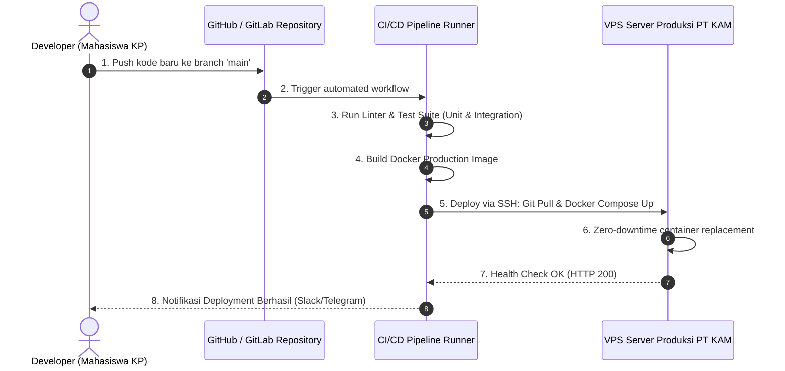

# DEPLOYMENT, DOCKER & CI/CD PIPELINE GUIDE
## KAM RECRUIT - SISTEM MANAJEMEN REKRUTMEN TENAGA KERJA OUTSOURCING
### PT KINARYA ALIHDAYA MANDIRI (PT KAM)

---

| Dokumen ID | Versi | Status | Metode Deployment | DevOps Lead |
| :--- | :--- | :--- | :--- | :--- |
| **DPL-KAM-10** | **1.0.0** | Final Disetujui | Docker Compose / Nginx Reverse Proxy | Tim Pengembang Kerja Praktik |

---

## 1. Ikhtisar Arsitektur Deployment (*Deployment Overview*)

Sistem **KAM Recruit** dikemas dalam arsitektur berbasis kontainer (*Containerized Micro-Services*) menggunakan **Docker** dan **Docker Compose** untuk menjamin konsistensi antara lingkungan pengembangan lokal dan server produksi internal PT KAM.

```mermaid
graph TD
    subgraph Host Server (Ubuntu 22.04 LTS)
        subgraph Docker Network: kam-recruit-net
            NginxContainer["Nginx Container (:80, :443)"]
            AppContainer["Application Backend Container (:3000 / :8000)"]
            DBContainer["Database Container MySQL 8.0 (:3306)"]
            RedisContainer["Redis Cache (:6379)"]
        end
        LocalStorage["Host Volume: /var/kam_storage/cv/"]
        DBVolume["Host Volume: /var/lib/kam_db_data/"]
    end

    InternetPublic["Pengguna Web Browser"] -->|HTTPS :443| NginxContainer
    NginxContainer -->|Proxy Pass| AppContainer
    AppContainer --> DBContainer
    AppContainer --> RedisContainer
    AppContainer --> LocalStorage
    DBContainer --> DBVolume
```

---

## 2. Konfigurasi Variabel Lingkungan (*Environment Variables - .env.example*)

Buat file `.env` pada direktori *root* server produksi dengan menyalin template berikut:

```ini
# ==============================================================================
# APLIKASI UTAMA (KAM RECRUIT)
# ==============================================================================
APP_NAME="KAM Recruit"
APP_ENV=production
APP_KEY=base64:X8wJ2l9PqT5mN4vK1zB7cE0yU3iO6rA9sD2fG5hJ8kL=
APP_DEBUG=false
APP_URL=https://recruit.kinarya.co.id
APP_PORT=3000

# ==============================================================================
# BASIS DATA MASTER (MYSQL 8.0)
# ==============================================================================
DB_CONNECTION=mysql
DB_HOST=db
DB_PORT=3306
DB_DATABASE=kam_recruit_db
DB_USERNAME=kam_admin
DB_PASSWORD=Kary4M4nd1r1_Secur3DB2026!
DB_ROOT_PASSWORD=SuperRoot_KAM_DBPass2026!

# ==============================================================================
# PENYIMPANAN BERKAS & SESI
# ==============================================================================
STORAGE_DRIVER=local
STORAGE_CV_PATH=/var/www/kam_recruit/storage/cv
MAX_UPLOAD_SIZE_MB=10
ALLOWED_FILE_TYPES="pdf,docx"

# ==============================================================================
# KEAMANAN & SESI (JWT & SESSION)
# ==============================================================================
JWT_SECRET=supersecret_jwt_kam_recruit_key_2026_udinus_key!
JWT_EXPIRE_HOURS=8
SESSION_LIFETIME_MINUTES=60
CORS_ALLOWED_ORIGINS="https://recruit.kinarya.co.id"

# ==============================================================================
# REDIS CACHE (OPSIONAL UNTUK RATE LIMITING)
# ==============================================================================
REDIS_HOST=redis
REDIS_PORT=6379
REDIS_PASSWORD=null
```

---

## 3. Konfigurasi Docker (*Dockerfile & docker-compose.yml*)

### 3.1 File: `Dockerfile` (Multi-Stage Build)
```dockerfile
# Stage 1: Build & Dependencies
FROM node:18-alpine AS builder
WORKDIR /app
COPY package*.json ./
RUN npm ci --only=production
COPY . .

# Stage 2: Production Minimal Image
FROM node:18-alpine AS runner
WORKDIR /app
ENV NODE_ENV=production

# Install curl for container health check
RUN apk add --no-cache curl

# Copy runtime files from builder
COPY --from=builder /app/package*.json ./
COPY --from=builder /app/node_modules ./node_modules
COPY --from=builder /app/public ./public
COPY --from=builder /app/src ./src

# Create storage directory for candidate CVs
RUN mkdir -p /app/storage/cv && chown -R node:node /app/storage

USER node
EXPOSE 3000

HEALTHCHECK --interval=30s --timeout=5s --start-period=5s --retries=3 \
  CMD curl -f http://localhost:3000/api/v1/health || exit 1

CMD ["node", "src/server.js"]
```

### 3.2 File: `docker-compose.yml`
```yaml
version: '3.8'

services:
  # 1. Reverse Proxy Nginx & SSL
  nginx:
    image: nginx:alpine
    container_name: kam-recruit-nginx
    restart: always
    ports:
      - "80:80"
      - "443:443"
    volumes:
      - ./docker/nginx/nginx.conf:/etc/nginx/nginx.conf:ro
      - ./docker/nginx/ssl:/etc/nginx/ssl:ro
      - ./public:/var/www/kam_recruit/public:ro
    depends_on:
      - app
    networks:
      - kam-network

  # 2. Application Core (KAM Recruit)
  app:
    build:
      context: .
      dockerfile: Dockerfile
    container_name: kam-recruit-app
    restart: always
    environment:
      - NODE_ENV=production
    env_file:
      - .env
    volumes:
      - cv-storage:/app/storage/cv
    depends_on:
      - db
      - redis
    networks:
      - kam-network

  # 3. Master Database MySQL 8.0
  db:
    image: mysql:8.0
    container_name: kam-recruit-db
    restart: always
    command: --default-authentication-plugin=mysql_native_password
    environment:
      MYSQL_ROOT_PASSWORD: ${DB_ROOT_PASSWORD}
      MYSQL_DATABASE: ${DB_DATABASE}
      MYSQL_USER: ${DB_USERNAME}
      MYSQL_PASSWORD: ${DB_PASSWORD}
    volumes:
      - db-data:/var/lib/mysql
      - ./docker/mysql/init.sql:/docker-entrypoint-initdb.d/init.sql:ro
    networks:
      - kam-network

  # 4. Redis Cache & Session
  redis:
    image: redis:7-alpine
    container_name: kam-recruit-redis
    restart: always
    command: redis-server --save 60 1 --loglevel warning
    volumes:
      - redis-data:/data
    networks:
      - kam-network

networks:
  kam-network:
    driver: bridge

volumes:
  db-data:
    driver: local
  cv-storage:
    driver: local
  redis-data:
    driver: local
```

---

## 4. Konfigurasi Nginx Server Block (*nginx.conf*)

```nginx
user nginx;
worker_processes auto;
error_log /var/log/nginx/error.log warn;
pid /var/run/nginx.pid;

events {
    worker_connections 1024;
}

http {
    include /etc/nginx/mime.types;
    default_type application/octet-stream;
    sendfile on;
    keepalive_timeout 65;
    client_max_body_size 15M; # Batas maksimum unggah berkas CV PDF

    # Gzip Compression untuk percepatan pemuatan
    gzip on;
    gzip_types text/plain text/css application/json application/javascript text/xml application/xml;

    server {
        listen 80;
        server_name recruit.kinarya.co.id;
        return 301 https://$host$request_uri; # Redirect HTTP ke HTTPS otomatis
    }

    server {
        listen 443 ssl http2;
        server_name recruit.kinarya.co.id;

        ssl_certificate /etc/nginx/ssl/kinarya_fullchain.crt;
        ssl_certificate_key /etc/nginx/ssl/kinarya_private.key;
        ssl_protocols TLSv1.2 TLSv1.3;
        ssl_ciphers HIGH:!aNULL:!MD5;

        # Static Assets Caching
        location ~* \.(css|js|png|jpg|jpeg|gif|ico|svg|woff2)$ {
            root /var/www/kam_recruit/public;
            expires 7d;
            add_header Cache-Control "public, no-transform";
        }

        # Reverse Proxy ke App Container
        location / {
            proxy_pass http://app:3000;
            proxy_http_version 1.1;
            proxy_set_header Upgrade $http_upgrade;
            proxy_set_header Connection 'upgrade';
            proxy_set_header Host $host;
            proxy_set_header X-Real-IP $remote_addr;
            proxy_set_header X-Forwarded-For $proxy_add_x_forwarded_for;
            proxy_set_header X-Forwarded-Proto $scheme;
            proxy_cache_bypass $http_upgrade;
        }
    }
}
```

---

## 5. Alur Otomasi CI/CD (*Continuous Integration & Deployment*)



### 5.1 Skrip Alur Kerja GitHub Actions (`.github/workflows/deploy.yml`)
```yaml
name: Deploy KAM Recruit Production

on:
  push:
    branches: [ "main" ]

jobs:
  test-and-deploy:
    runs-on: ubuntu-latest

    steps:
    - name: Checkout Repository
      uses: actions/checkout@v3

    - name: Setup Node.js Environment
      uses: actions/setup-node@v3
      with:
        node-version: '18'
        cache: 'npm'

    - name: Install Dependencies & Run Tests
      run: |
        npm ci
        npm test

    - name: Deploy to PT KAM Production Server via SSH
      uses: appleboy/ssh-action@master
      with:
        host: ${{ secrets.PROD_SERVER_IP }}
        username: ${{ secrets.PROD_SSH_USER }}
        key: ${{ secrets.PROD_SSH_PRIVATE_KEY }}
        script: |
          cd /var/www/kam-recruit
          git pull origin main
          docker compose down
          docker compose up -d --build
          docker system prune -f
```

---

## 6. Prosedur Pencadangan & Pemulihan Bencana (*Backup & Disaster Recovery*)

Untuk menjamin kepatuhan data dan mencegah risiko kegagalan hardware, skrip pencadangan otomatis dijalankan setiap malam pukul **01:00 WIB** menggunakan *cron job*:

```bash
#!/bin/bash
# Skrip Backup Harian Basis Data KAM Recruit: /opt/scripts/backup_db.sh
DATE=$(date +%Y%m%d_%H%M%S)
BACKUP_DIR="/var/backups/kam_recruit"
mkdir -p $BACKUP_DIR

# 1. Dump MySQL Database ke arsip terkompresi
docker exec kam-recruit-db mysqldump -u kam_admin -pKary4M4nd1r1_Secur3DB2026! kam_recruit_db | gzip > $BACKUP_DIR/db_backup_$DATE.sql.gz

# 2. Hapus cadangan lama yang berusia lebih dari 30 hari
find $BACKUP_DIR -type f -name "*.sql.gz" -mtime +30 -exec rm {} \;

echo "[$(date)] Backup basis data KAM Recruit berhasil dibuat: db_backup_$DATE.sql.gz"
```

