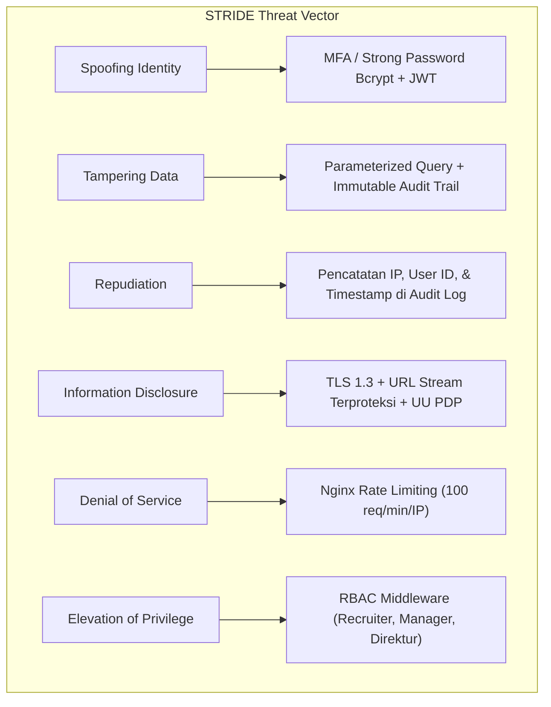
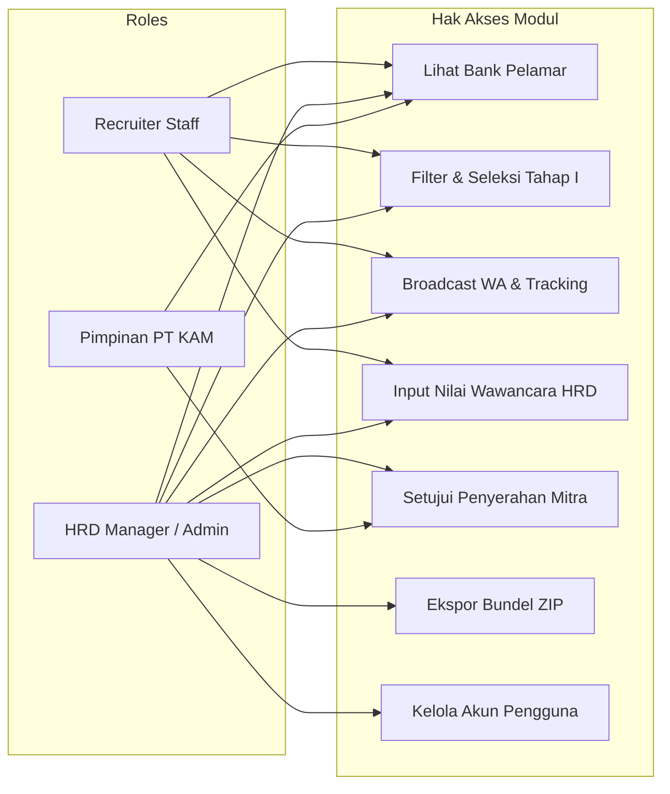

# SECURITY, AUTHENTICATION & DATA PROTECTION (OWASP & UU PDP)
## KAM RECRUIT - SISTEM MANAJEMEN REKRUTMEN TENAGA KERJA OUTSOURCING
### PT KINARYA ALIHDAYA MANDIRI (PT KAM)

---

| Dokumen ID | Versi | Status | Standar Acuan | Information Security Lead |
| :--- | :--- | :--- | :--- | :--- |
| **SEC-KAM-11** | **1.0.0** | Final Disetujui | OWASP Top 10:2021 & UU PDP No. 27/2022 | Tim Pengembang Kerja Praktik |

---

## 1. Prinsip Keamanan & Pemodelan Ancaman (*STRIDE Threat Model*)

Sebagai sistem yang mengelola data pribadi sensitif ratusan pencari kerja (KTP, kontak, riwayat pendidikan, dan berkas CV), **KAM Recruit** dirancang dengan prinsip **Defense-in-Depth** dan **Zero Trust Architecture**.



---

## 2. Kepatuhan Undang-Undang Perlindungan Data Pribadi (UU PDP No. 27 Tahun 2022)

Sistem memenuhi kewajiban hukum sebagai **Pengendali Data Pribadi (*Data Controller*)**:
1. **Prinsip Minimasi Data (*Data Minimization*)**: Hanya data yang relevan dengan kualifikasi kerja alihdaya yang disimpan (nama, usia, pendidikan, pengalaman kerja, nomor WhatsApp).
2. **Pemberian Hak Akses Terbatas (*Need-to-Know Principle*)**: Hanya personel HRD terotentikasi yang dapat melihat nomor kontak lengkap dan mengunduh berkas CV.
3. **Penyimpanan Berkas CV Aman (*Secure File Storage*)**: Berkas PDF pelamar disimpan di luar direktori web publik (`/storage/cv/`). Pengunduhan berkas wajib melalui *controller* yang memvalidasi hak sesi, mencegah celah *Direct Object Reference* (IDOR).
4. **Pemusnahan Data (*Right to Erasure*)**: Sistem menyediakan fitur pembersihan berkas pendaftar yang telah ditolak (*archived/deleted*) setelah masa retensi 1 tahun berakhir.

---

## 3. Matriks Kontrol Akses Berbasis Peran (*Role-Based Access Control - RBAC*)



| Modul / Kemampuan Fungsional | Recruiter Staff | HRD Manager / Admin | Pimpinan PT KAM |
| :--- | :---: | :---: | :---: |
| **Melihat Data Pelamar Glints** | Ya (Read) | Ya (Full Access) | Ya (Read-Only) |
| **Filter & Approve Lolos Sortir (Tahap I)** | Ya | Ya | Tidak |
| **Kirim Tautan Pesan WhatsApp** | Ya | Ya | Tidak |
| **Input Rubrik Nilai Wawancara HRD** | Ya | Ya | Tidak |
| **Melihat Rekapitulasi Tahap I & II** | Ya | Ya | Ya (Read-Only) |
| **Setujui Penyerahan Berkas ke Mitra** | Tidak | **Ya (Approval Authority)** | Ya |
| **Unduh Bundel CV (ZIP) Mitra** | Ya | Ya | Ya |
| **Manajemen Pengguna & Konfigurasi Sistem** | Tidak | **Ya (Superadmin)** | Tidak |
| **Akses Riwayat Audit Log Perubahan** | Tidak | **Ya (Audit Access)** | Ya |

---

## 4. Mitigasi Risiko Keamanan OWASP Top 10:2021

### 4.1 A01: Broken Access Control (Kegagalan Kontrol Akses)
* **Risiko**: Recruiter mengubah keputusan wawancara milik lowongan lain yang bukan wewenangnya.
* **Mitigasi**: Implementasi *Middleware Authorization Policy* pada setiap rute API. Setiap aksi mutasi memverifikasi kepemilikan data kandidat dan level peran:
  ```javascript
  // Middleware Verifikasi Role
  function authorizeRole(allowedRoles) {
    return (req, res, next) => {
      if (!allowedRoles.includes(req.user.role)) {
        return res.status(403).json({ success: false, message: "Akses Ditolak: Wewenang tidak mencukupi" });
      }
      next();
    };
  }
  ```

### 4.2 A02: Cryptographic Failures (Kegagalan Kriptografi)
* **Risiko**: Kebocoran kata sandi recruiter atau intersepsi data pelamar di jaringan Wi-Fi publik.
* **Mitigasi**:
  - Seluruh komunikasi dienkripsi mutlak dengan **TLS 1.3** dengan sertifikat SSL resmi.
  - Header HTTP **HSTS** (*HTTP Strict Transport Security*) dipasang: `Strict-Transport-Security: max-age=31536000; includeSubDomains`.
  - Penyimpanan kata sandi menggunakan fungsi hash **bcrypt** dengan biaya (*salt rounds*) 12.

### 4.3 A03: Injection (Serangan Injeksi SQL & XSS)
* **Risiko**: Pelamar menyisipkan skrip berbahaya pada nama atau input pencarian (SQLi/XSS).
* **Mitigasi**:
  - Kueri basis data menggunakan *Prepared Statements* / ORM (Sequelize/Prisma/Eloquent).
  - Sanitasi karakter HTML pada sisi klien dan server:
  ```javascript
  function sanitizeInput(str) {
    return str.replace(/[&<>"']/g, function(m) {
      return { '&': '&amp;', '<': '&lt;', '>': '&gt;', '"': '&quot;', "'": '&#039;' }[m];
    });
  }
  ```

### 4.4 A05: Security Misconfiguration (Salah Konfigurasi Keamanan)
* **Risiko**: Server menampilkan pesan *stack trace* debug saat terjadi kesalahan kueri.
* **Mitigasi**:
  - `APP_DEBUG=false` terkunci pada lingkungan produksi.
  - Penanganan error terpusat yang selalu mengembalikan pesan kesalahan generik bagi pengguna luar (*Generic Error Envelope*).

### 4.5 A07: Identification and Authentication Failures (Kegagalan Otentikasi)
* **Risiko**: Serangan tebak kata sandi (*Brute-force attack*) pada halaman login recruiter.
* **Mitigasi**:
  - *Rate Limiting* Nginx dan Express: Maksimal 5 kali percobaan login yang salah per alamat IP dalam rentang waktu 15 menit. Percobaan berikutnya diblokir sementara (*HTTP 429 Too Many Requests*).

---

## 5. Mekanisme Audit Trail Tidak Terbantahkan (*Immutable Audit Logging*)

Setiap kali status pelamar berubah (contoh: dari *Belum Disortir* menjadi *Lolos Sortir*, atau *Bersedia* menjadi *Lolos Seleksi HRD*), sistem secara otomatis mencatat jejak audit ke dalam tabel `audit_logs` dengan struktur rekaman:

```json
{
  "timestamp": "2026-10-30T10:45:12.891Z",
  "actor_id": 1,
  "actor_name": "Iing Ariesta Sari",
  "actor_role": "recruiter",
  "action": "INTERVIEW_SCORE_INPUT",
  "candidate_id": 1,
  "candidate_name": "Budi Pratama",
  "mutation": {
    "field": "status_hrd",
    "old_value": "Menunggu Seleksi",
    "new_value": "Lolos Seleksi HRD",
    "decision": "Lolos Seleksi HRD"
  },
  "ip_address": "192.168.10.45",
  "user_agent": "Mozilla/5.0 (Windows NT 10.0; Win64; x64) AppleWebKit/537.36"
}
```
Rekaman audit log ini bersifat *append-only* (tidak dapat diubah atau dihapus oleh siapapun) untuk menjamin akuntabilitas kerja staf rekrutmen.

