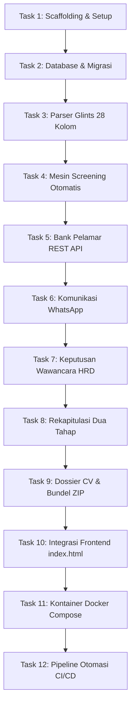

# IMPLEMENTATION PLAN & GRANULAR TODOLIST (STEP-BY-STEP)
## KAM RECRUIT - SISTEM MANAJEMEN REKRUTMEN TENAGA KERJA OUTSOURCING
### PT KINARYA ALIHDAYA MANDIRI (PT KAM)

> **Untuk Agen / Pengembang Sistem**:  
> Dokumen ini disusun menggunakan prinsip *Bite-Sized Task Decomposition* (1 per 1, granular, tanpa instruksi massal/bulk) untuk mencegah halusinasi AI, menjaga ketelitian teknis, dan menjamin setiap langkah memiliki kriteria verifikasi yang dapat diuji (*testable deliverables*). Gunakan sintaks kotak centang (`- [ ]`) untuk melacak kemajuan pengerjaan.

---

**Tujuan Sistem:** Membangun sistem rekrutmen terpadu KAM Recruit berbasis **Node.js (Express.js)** dan **MySQL 8.0 InnoDB**, mengintegrasikan parser impor data Glints 28 kolom, penyaringan kualifikasi administratif otomatis, pelacakan komunikasi WhatsApp non-emoji, evaluasi wawancara HRD dengan dropdown langsung (*Lolos / Tidak Lolos*), generator bundel ZIP CV mitra, penyajian antarmuka klien berbasis prototipe [index.html](file:///d:/A11.2025.16609/SEMESTER%203/KERJA%20PRAKTEK/Laporan/index.html) berstandar Apple HIG, serta kontainerisasi Docker dan CI/CD Pipeline.

**Arsitektur:** RESTful API berlapis (Express.js) + Master Database Tunggal (MySQL) + Client SPA (Tailwind CSS & Vanilla JS) + Nginx Reverse Proxy + Docker Compose Multi-Container.

**Tumpukan Teknologi:** Node.js v20 LTS, Express.js, `multer`, `exceljs`, `archiver`, `mysql2`, `helmet`, `cors`, `dotenv`, Jest, Supertest, Docker, Nginx.

**Rujukan Spesifikasi:** [01_brd.md](file:///d:/A11.2025.16609/SEMESTER%203/KERJA%20PRAKTEK/docs/01_brd.md), [02_prd.md](file:///d:/A11.2025.16609/SEMESTER%203/KERJA%20PRAKTEK/docs/02_prd.md), [03_frd.md](file:///d:/A11.2025.16609/SEMESTER%203/KERJA%20PRAKTEK/docs/03_frd.md), [04_architecture.md](file:///d:/A11.2025.16609/SEMESTER%203/KERJA%20PRAKTEK/docs/04_architecture.md), [05_database.md](file:///d:/A11.2025.16609/SEMESTER%203/KERJA%20PRAKTEK/docs/05_database.md), [06_desain.md](file:///d:/A11.2025.16609/SEMESTER%203/KERJA%20PRAKTEK/docs/06_desain.md), [07_routing.md](file:///d:/A11.2025.16609/SEMESTER%203/KERJA%20PRAKTEK/docs/07_routing.md), [08_testing.md](file:///d:/A11.2025.16609/SEMESTER%203/KERJA%20PRAKTEK/docs/08_testing.md), [10_deployment.md](file:///d:/A11.2025.16609/SEMESTER%203/KERJA%20PRAKTEK/docs/10_deployment.md), [12_decision_log.md](file:///d:/A11.2025.16609/SEMESTER%203/KERJA%20PRAKTEK/docs/12_decision_log.md).

---

## Batasan Global & Aturan Kritis (*Global Constraints*)

1. **Format WhatsApp Tanpa Emoji (ADR-004)**: Seluruh string template pesan resmi WhatsApp dilarang memuat karakter emoji apa pun untuk menjaga etika profesionalisme korporat alihdaya.
2. **Evaluasi Wawancara HRD Non-Numerik (ADR-007)**: Dilarang menggunakan skor pembobotan angka (30%, 30%, 40%, threshold 75). Hanya gunakan dropdown: `Lolos Seleksi HRD` dan `Tidak Lolos`, ditambah catatan kualitatif evaluator.
3. **Flexible Nullable Design pada Parser Glints (ADR-008)**: Hanya 6 field yang `NOT NULL` (`glints_applicant_id`, `full_name`, `email`, `phone`, `education_degree`, `domicile_city`). Field lainnya (`expected_salary`, `organization_exp`, dll.) wajib `NULLABLE` agar tidak crash saat membaca pelamar fresh graduate.
4. **Anti-Wrapping Layout Rule (ADR-005)**: Seluruh lencana badge pada tampilan antarmuka wajib mempertahankan kelas CSS `whitespace-nowrap shrink-0`.
5. **Peran Prototipe UI/UX (ADR-008)**: Berkas `Laporan/index.html` adalah acuan desain UI/UX interaktif yang diintegrasikan ke folder `public/` Express.js.

---

## Fokus Tinjauan Kritis (*Review Focus - Failure Modes to Prevent*)

1. **Nomor WhatsApp Internasional Rusak**: Nomor `+62895402875844` terpotong tanda plus atau berubah menjadi notasi eksponensial ilmiah. *(Solusi: Simpan dan baca murni sebagai tipe data String).*
2. **Sel Excel Glints Kosong (*Blank*) Menyebabkan Crash**: Pelamar lulusan baru tidak mengisi riwayat kerja atau ekspektasi gaji. *(Solusi: Evaluator parser mengembalikan `null` atau `""` tanpa melempar exception).*
3. **Race Condition Pembaruan Nilai HRD**: Dua tab browser recruiter memperbarui status kandidat secara bersamaan. *(Solusi: Transaksi `BEGIN ... COMMIT` dengan `SELECT ... FOR UPDATE` atau version timestamp).*
4. **Kebocoran Memori pada Ekspor ZIP**: Mengompres ratusan CV PDF sekaligus ke dalam RAM. *(Solusi: Gunakan stream pipeline langsung via `archiver.pipe(res)`).*
5. **Akses Berkas di Luar Direktori (*Path Traversal*)**: Parameter nama berkas CV disusupi `../../etc/passwd`. *(Solusi: Validasi `path.basename()` dan sanitasi nama berkas).*

---

## DAFTAR TUGAS IMPLEMENTASI TERINCI (1 PER 1)



---

### Task 1: Scaffolding Proyek Express.js & Konfigurasi Dasar

**Berkas yang Dikerjakan:**
- Buat: `package.json`
- Buat: `.env.example` & `.env`
- Buat: `src/server.js`
- Buat: `src/app.js`
- Test: `tests/server.test.js`

**Antarmuka (*Interfaces*):**
- Menghasilkan: Instance Express server yang listening pada port `process.env.APP_PORT || 3000` dengan endpoint kesehatan `GET /api/v1/health`.

- [x] **Langkah 1.1: Menulis tes unit gagal untuk endpoint kesehatan server**
  ```javascript
  // tests/server.test.js
  const request = require('supertest');
  const app = require('../src/app');

  describe('GET /api/v1/health', () => {
    it('harus mengembalikan status 200 dan objek status sehat', async () => {
      const res = await request(app).get('/api/v1/health');
      expect(res.statusCode).toEqual(200);
      expect(res.body).toHaveProperty('status', 'OK');
      expect(res.body).toHaveProperty('app', 'KAM Recruit');
    });
  });
  ```

- [x] **Langkah 1.2: Jalankan tes untuk memverifikasi kegagalan awal**
  Jalankan perintah: `npx jest tests/server.test.js`
  Hasil yang diharapkan: **FAIL** (Cannot find module `../src/app`).

- [x] **Langkah 1.3: Buat `package.json` dan pasang dependensi yang dibutuhkan**
  Pasang dependensi produksi: `express`, `cors`, `helmet`, `dotenv`, `mysql2`, `multer`, `exceljs`, `archiver`.
  Pasang dependensi pengembangan: `jest`, `supertest`, `eslint`, `nodemon`.

- [x] **Langkah 1.4: Implementasikan `src/app.js` dan `src/server.js`**
  Implementasikan middleware `cors()`, `helmet()`, `express.json()`, `express.urlencoded()`, serta rute dasar `GET /api/v1/health`.

- [x] **Langkah 1.5: Jalankan kembali tes verifikasi**
  Jalankan perintah: `npx jest tests/server.test.js`
  Hasil yang diharapkan: **PASS (1 passed, 1 total)**.

---

### Task 2: Modul Koneksi Basis Data & Eksekusi Skema Migrasi

**Berkas yang Dikerjakan:**
- Buat: `src/config/database.js`
- Buat: `src/database/schema.sql`
- Buat: `src/database/seed.js`
- Test: `tests/database.test.js`

**Antarmuka (*Interfaces*):**
- Mengonsumsi: Variabel `.env` (`DB_HOST`, `DB_PORT`, `DB_DATABASE`, `DB_USERNAME`, `DB_PASSWORD`).
- Menghasilkan: Pool koneksi database `pool.query(sql, params)`.

- [x] **Langkah 2.1: Menulis tes koneksi pool basis data**
  ```javascript
  // tests/database.test.js
  const pool = require('../src/config/database');

  describe('Database Connection Pool', () => {
    it('harus berhasil mengeksekusi kueri SELECT 1', async () => {
      const [rows] = await pool.query('SELECT 1 + 1 AS solution');
      expect(rows[0].solution).toEqual(2);
    });
  });
  ```

- [x] **Langkah 2.2: Jalankan tes untuk memverifikasi kegagalan**
  Jalankan perintah: `npx jest tests/database.test.js`
  Hasil yang diharapkan: **FAIL** (`database.js` belum terdefinisi).

- [x] **Langkah 2.3: Implementasikan `src/config/database.js` dengan `mysql2/promise`**
  Konfigurasikan `mysql.createPool({ connectionLimit: 10, ... })` dengan penanganan error *reconnect* otomatis.

- [x] **Langkah 2.4: Buat `src/database/schema.sql` sesuai kamus data `docs/05_database.md`**
  Mencakup tabel: `job_vacancies`, `candidates`, `candidate_experiences`, `candidate_certificates`, `interview_assessments`, dan `audit_logs` dengan tipe data InnoDB.

- [x] **Langkah 2.5: Buat skrip seeder `src/database/seed.js`**
  Memasukkan data referensi lowongan mitra: *PT Telkom Akses (Customer Service, max usia 27)*, *PT Indonusa Telemedia (Teknisi Fiber, max usia 30)*, *PT Logistik Prima (Admin Logistik, max usia 28)*.

- [x] **Langkah 2.6: Eksekusi migrasi dan jalankan tes database**
  Jalankan perintah: `node src/database/seed.js && npx jest tests/database.test.js`
  Hasil yang diharapkan: **PASS**.

---

### Task 3: Modul Parser Data Glints (28 Kolom - Flexible Nullable)

**Berkas yang Dikerjakan:**
- Buat: `src/middlewares/upload.js`
- Buat: `src/services/glintsParser.js`
- Test: `tests/glintsParser.test.js`

**Antarmuka (*Interfaces*):**
- Mengonsumsi: *Buffer* atau *File Path* berkas `.xlsx` / `.csv` dari `multer`.
- Menghasilkan: Array objek Javascript dengan 28 atribut ternormalisasi (`glintsApplicantId`, `fullName`, `age`, `expectedSalary`, `experience`, dll.).

- [x] **Langkah 3.1: Menulis tes unit parser Glints**
  ```javascript
  // tests/glintsParser.test.js
  const { parseGlintsExcel } = require('../src/services/glintsParser');
  const path = require('path');

  describe('Glints Excel Parser Service', () => {
    it('harus mampu mem-parse berkas dummy Glints dan mengekstrak kandidat Imam Kuswoyo', async () => {
      const dummyPath = path.resolve(__dirname, '../Laporan/Data_Pelamar_Glints_Dummy.xlsx');
      const results = await parseGlintsExcel(dummyPath);
      
      expect(results.length).toBeGreaterThanOrEqual(8);
      const imam = results.find(c => c.fullName === 'Imam Kuswoyo');
      expect(imam).toBeDefined();
      expect(imam.age).toEqual(44);
      expect(imam.educationDegree).toEqual('SMA/SMK');
      expect(imam.expectedSalary).toEqual('Rp 3.000.000');
    });

    it('harus menangani kandidat fresh graduate dengan sel kosong tanpa crash', async () => {
      const dummyPath = path.resolve(__dirname, '../Laporan/Data_Pelamar_Glints_Dummy.xlsx');
      const results = await parseGlintsExcel(dummyPath);
      const rina = results.find(c => c.fullName === 'Rina Septiani');
      expect(rina).toBeDefined();
      expect(rina.expectedSalary).toBeNull();
    });
  });
  ```

- [x] **Langkah 3.2: Jalankan tes unit parser untuk verifikasi kegagalan**
  Jalankan perintah: `npx jest tests/glintsParser.test.js`
  Hasil yang diharapkan: **FAIL**.

- [x] **Langkah 3.3: Implementasikan middleware `src/middlewares/upload.js`**
  Konfigurasikan `multer` dengan `diskStorage` ke folder `uploads/excels/`, batas ukuran maksimal 15MB, dan validasi ekstensi berkas (`.xlsx`, `.xls`, `.csv`).

- [x] **Langkah 3.4: Implementasikan service `src/services/glintsParser.js`**
  Gunakan pustaka `exceljs` untuk membaca worksheet baris demi baris mulai baris ke-2, memetakan 28 kolom, dan mengisi nilai `null` pada sel kosong.

- [x] **Langkah 3.5: Jalankan kembali tes verifikasi parser**
  Jalankan perintah: `npx jest tests/glintsParser.test.js`
  Hasil yang diharapkan: **PASS (2 passed, 2 total)**.

---

### Task 4: Mesin Penyaring Kualifikasi Otomatis (*Screening Engine - Tahap I*)

**Berkas yang Dikerjakan:**
- Buat: `src/services/screeningEngine.js`
- Buat: `src/controllers/applicantController.js`
- Buat: `src/routes/applicantRoutes.js`
- Test: `tests/screeningEngine.test.js`

**Antarmuka (*Interfaces*):**
- Mengonsumsi: Objek data kandidat Glints dan kriteria lowongan posisi mitra (`max_age`, `min_education`, `target_city`).
- Menghasilkan: Objek hasil evaluasi `{ statusSortir: 'Lolos Sortir' | 'Tidak Memenuhi Syarat', catatan: string }`.

- [x] **Langkah 4.1: Menulis tes unit logika penyaringan otomatis**
  ```javascript
  // tests/screeningEngine.test.js
  const { evaluateCandidate } = require('../src/services/screeningEngine');

  describe('Automated Qualification Screening Engine', () => {
    const vacancyCriteria = { maxAge: 27, allowedEducation: ['D3', 'S1'], targetCity: 'Semarang' };

    it('harus menandai Tidak Memenuhi Syarat jika usia melampaui batas kriteria', () => {
      const candidate = { age: 44, educationDegree: 'SMA/SMK', domicileCity: 'Semarang' };
      const res = evaluateCandidate(candidate, vacancyCriteria);
      expect(res.statusSortir).toEqual('Tidak Memenuhi Syarat');
      expect(res.catatan).toContain('Usia melebihi batas kriteria');
    });

    it('harus menandai Lolos Sortir jika seluruh kriteria terpenuhi', () => {
      const candidate = { age: 23, educationDegree: 'S1', domicileCity: 'Semarang' };
      const res = evaluateCandidate(candidate, vacancyCriteria);
      expect(res.statusSortir).toEqual('Lolos Sortir');
    });
  });
  ```

- [x] **Langkah 4.2: Jalankan tes untuk memastikan kegagalan awal**
  Jalankan perintah: `npx jest tests/screeningEngine.test.js`
  Hasil yang diharapkan: **FAIL**.

- [x] **Langkah 4.3: Implementasikan fungsi `evaluateCandidate` pada `src/services/screeningEngine.js`**
  Lakukan perbandingan: usia terhadap `maxAge`, jenjang terhadap `allowedEducation`, dan domisili kota terhadap `targetCity`.

- [x] **Langkah 4.4: Implementasikan endpoint `POST /api/v1/applicants/import`**
  Menerima berkas upload via `upload.single('file')`, memanggil `parseGlintsExcel`, mengeksekusi `evaluateCandidate`, dan menyimpannya ke tabel `candidates` MySQL.

- [x] **Langkah 4.5: Jalankan tes unit screening engine**
  Jalankan perintah: `npx jest tests/screeningEngine.test.js`
  Hasil yang diharapkan: **PASS**.

---

### Task 5: Modul Bank Pelamar & Penyaringan Data (REST API)

**Berkas yang Dikerjakan:**
- Ubah: `src/controllers/applicantController.js`
- Ubah: `src/routes/applicantRoutes.js`
- Test: `tests/applicantApi.test.js`

**Antarmuka (*Interfaces*):**
- Mengonsumsi: Query parameter `GET /api/v1/applicants?vacancy_id=1&status_sortir=Lolos+Sortir&search=Budi`.
- Menghasilkan: JSON `{ success: true, count: number, data: Candidate[] }`.

- [x] **Langkah 5.1: Menulis tes integrasi API Bank Pelamar**
  ```javascript
  // tests/applicantApi.test.js
  const request = require('supertest');
  const app = require('../src/app');

  describe('GET /api/v1/applicants', () => {
    it('harus mengembalikan daftar pelamar dengan pagination dan filter posisi', async () => {
      const res = await request(app).get('/api/v1/applicants');
      expect(res.statusCode).toEqual(200);
      expect(Array.isArray(res.body.data)).toBeTruthy();
    });
  });
  ```

- [x] **Langkah 5.2: Jalankan tes verifikasi awal**
  Jalankan perintah: `npx jest tests/applicantApi.test.js`
  Hasil yang diharapkan: **FAIL** (Rute belum terdaftar di `app.js`).

- [x] **Langkah 5.3: Implementasikan fungsi `getApplicants` dan `getApplicantDetail` di controller**
  Kueri `SELECT` dengan klausul `WHERE` dinamis berdasarkan parameter filter posisi, status sortir, dan pencarian nama. Lakukan `JOIN` ke tabel riwayat pengalaman dan sertifikat.

- [x] **Langkah 5.4: Daftarkan rute pada `src/routes/applicantRoutes.js` dan kaitkan ke `src/app.js`**
  Rute: `GET /api/v1/applicants` dan `GET /api/v1/applicants/:id`.

- [x] **Langkah 5.5: Jalankan kembali tes verifikasi API Bank Pelamar**
  Jalankan perintah: `npx jest tests/applicantApi.test.js`
  Hasil yang diharapkan: **PASS**.

---

### Task 6: Modul Komunikasi WhatsApp Non-Emoji & Pelacakan Respons

**Berkas yang Dikerjakan:**
- Buat: `src/services/waService.js`
- Buat: `src/controllers/communicationController.js`
- Buat: `src/routes/communicationRoutes.js`
- Test: `tests/waService.test.js`

**Antarmuka (*Interfaces*):**
- Mengonsumsi: Data nama kandidat, posisi, mitra, waktu wawancara.
- Menghasilkan: URL WhatsApp Web terenkode murni tanpa emoji: `https://wa.me/628...?text=...`.

- [x] **Langkah 6.1: Menulis tes unit generator pesan WhatsApp**
  ```javascript
  // tests/waService.test.js
  const { generateWaUrl } = require('../src/services/waService');

  describe('WhatsApp Communication Service (Non-Emoji Compliance)', () => {
    it('harus menghasilkan URL WhatsApp resmi tanpa mengandung karakter emoji apa pun', () => {
      const candidate = { phone: '+62895402875844', fullName: 'Imam Kuswoyo', position: 'Customer Service' };
      const url = generateWaUrl(candidate, 'Kamis, 5 Nov 2026 pukul 09.00 WIB');
      
      expect(url).toContain('https://wa.me/62895402875844');
      // Regex pemeriksaan tidak adanya emoji (Extended Pictographic Unicode)
      const emojiRegex = /\p{Extended_Pictographic}/u;
      const decodedText = decodeURIComponent(url);
      expect(emojiRegex.test(decodedText)).toBeFalsy();
    });
  });
  ```

- [x] **Langkah 6.2: Jalankan tes untuk memverifikasi kegagalan**
  Jalankan perintah: `npx jest tests/waService.test.js`
  Hasil yang diharapkan: **FAIL**.

- [x] **Langkah 6.3: Implementasikan generator template pada `src/services/waService.js`**
  Susun template pesan teks formal korporat alihdaya PT KAM sesuai keputusan ADR-004. Format nomor telepon internasional menjadi digit standar tanpa spasi atau tanda strip.

- [x] **Langkah 6.4: Implementasikan endpoint pembaruan status respons**
  Endpoint `PUT /api/v1/candidates/:id/interview-status` untuk memperbarui status: `Bersedia`, `Menolak`, `Tidak Merespons`, beserta catatan jadwal wawancara.

- [x] **Langkah 6.5: Jalankan kembali tes verifikasi modul WhatsApp**
  Jalankan perintah: `npx jest tests/waService.test.js`
  Hasil yang diharapkan: **PASS**.

---

### Task 7: Modul Evaluasi Wawancara HRD (Tahap II - Dropdown Lolos/Tidak Lolos)

**Berkas yang Dikerjakan:**
- Buat: `src/controllers/interviewController.js`
- Buat: `src/routes/interviewRoutes.js`
- Test: `tests/interviewController.test.js`

**Antarmuka (*Interfaces*):**
- Mengonsumsi: Payload `PUT /api/v1/candidates/:id/hrd-assessment` berupa `{ decision: 'Lolos Seleksi HRD' | 'Tidak Lolos', notes: string }`.
- Menghasilkan: Objek kandidat terbarui dengan pencatatan riwayat pada tabel `audit_logs`.

- [x] **Langkah 7.1: Menulis tes unit evaluasi wawancara HRD**
  ```javascript
  // tests/interviewController.test.js
  const request = require('supertest');
  const app = require('../src/app');

  describe('PUT /api/v1/candidates/:id/hrd-assessment', () => {
    it('harus berhasil memperbarui status ke Lolos Seleksi HRD dan mencatat audit log', async () => {
      const res = await request(app)
        .put('/api/v1/candidates/1/hrd-assessment')
        .send({
          decision: 'Lolos Seleksi HRD',
          notes: 'Komunikasi sangat lugas, menguasai penanganan komplain pelanggan, siap kerja shift.'
        });
      
      expect(res.statusCode).toEqual(200);
      expect(res.body.data.statusHRD).toEqual('Lolos Seleksi HRD');
    });

    it('harus menolak input yang memuat nilai skor pembobotan numerik usang', async () => {
      const res = await request(app)
        .put('/api/v1/candidates/1/hrd-assessment')
        .send({ numericScore: 85 });
      expect(res.statusCode).toEqual(400);
    });
  });
  ```

- [x] **Langkah 7.2: Jalankan tes untuk memverifikasi kegagalan**
  Jalankan perintah: `npx jest tests/interviewController.test.js`
  Hasil yang diharapkan: **FAIL**.

- [x] **Langkah 7.3: Implementasikan transaksi penyimpanan ACID pada `interviewController.js`**
  Gunakan transaksi `await connection.beginTransaction()`:
  1. Perbarui kolom `status_hrd` dan `notes` pada tabel `candidates`.
  2. Sisipkan rekaman baru ke tabel `interview_assessments`.
  3. Sisipkan jejak perubahan ke tabel `audit_logs`.
  4. Eksekusi `await connection.commit()`.

- [x] **Langkah 7.4: Jalankan kembali tes verifikasi modul evaluasi HRD**
  Jalankan perintah: `npx jest tests/interviewController.test.js`
  Hasil yang diharapkan: **PASS**.

---

### Task 8: Modul Rekapitulasi Dua Tahap (Single Master Database)

**Berkas yang Dikerjakan:**
- Buat: `src/controllers/recapController.js`
- Buat: `src/routes/recapRoutes.js`
- Test: `tests/recapController.test.js`

**Antarmuka (*Interfaces*):**
- Mengonsumsi: Endpoint `GET /api/v1/recapitulation/stage1` (kandidat lolos sortir) dan `GET /api/v1/recapitulation/stage2` (kandidat lolos seleksi HRD).
- Menghasilkan: JSON kumpulan data kandidat per tahap dan file stream Excel `GET /api/v1/recapitulation/export-excel`.

- [x] **Langkah 8.1: Menulis tes unit rekapitulasi data**
  ```javascript
  // tests/recapController.test.js
  const request = require('supertest');
  const app = require('../src/app');

  describe('Recapitulation Module', () => {
    it('harus memfilter kandidat Tahap I berdasarkan status_sortir = Lolos Sortir', async () => {
      const res = await request(app).get('/api/v1/recapitulation/stage1');
      expect(res.statusCode).toEqual(200);
      res.body.data.forEach(c => expect(c.statusSortir).toEqual('Lolos Sortir'));
    });

    it('harus memfilter kandidat Tahap II berdasarkan status_hrd = Lolos Seleksi HRD', async () => {
      const res = await request(app).get('/api/v1/recapitulation/stage2');
      expect(res.statusCode).toEqual(200);
      res.body.data.forEach(c => expect(c.statusHRD).toEqual('Lolos Seleksi HRD'));
    });
  });
  ```

- [x] **Langkah 8.2: Jalankan tes untuk memverifikasi kegagalan**
  Jalankan perintah: `npx jest tests/recapController.test.js`
  Hasil yang diharapkan: **FAIL**.

- [x] **Langkah 8.3: Implementasikan kueri SQL bersyarat pada `src/controllers/recapController.js`**
  Ambil data dari 1 master tabel `candidates` tanpa duplikasi berkas terpisah.

- [x] **Langkah 8.4: Implementasikan fungsi ekspor Excel rekapitulasi**
  Gunakan pustaka `exceljs` untuk menghasilkan file workbook rekapitulasi ber-styling resmi PT KAM (header `#0F3D78`) dan kirim via stream HTTP.

- [x] **Langkah 8.5: Jalankan kembali tes verifikasi rekapitulasi**
  Jalankan perintah: `npx jest tests/recapController.test.js`
  Hasil yang diharapkan: **PASS**.

---

### Task 9: Modul Generator Dossier CV & Pembuat Bundel ZIP Mitra

**Berkas yang Dikerjakan:**
- Buat: `src/services/zipBundler.js`
- Buat: `src/controllers/handoverController.js`
- Buat: `src/routes/handoverRoutes.js`
- Test: `tests/zipBundler.test.js`

**Antarmuka (*Interfaces*):**
- Mengonsumsi: Parameter query lowongan mitra `GET /api/v1/handover/bundle-zip?vacancy_id=1`.
- Menghasilkan: Berkas biner stream `application/zip` yang berisi kumpulan CV PDF kandidat yang lolos seleksi HRD.

- [x] **Langkah 9.1: Menulis tes unit pembuatan arsip ZIP bundel CV**
  ```javascript
  // tests/zipBundler.test.js
  const request = require('supertest');
  const app = require('../src/app');

  describe('GET /api/v1/handover/bundle-zip', () => {
    it('harus mengembalikan header Content-Type application/zip', async () => {
      const res = await request(app).get('/api/v1/handover/bundle-zip?vacancy_id=1');
      expect(res.statusCode).toEqual(200);
      expect(res.headers['content-type']).toContain('application/zip');
      expect(res.headers['content-disposition']).toContain('.zip');
    });
  });
  ```

- [x] **Langkah 9.2: Jalankan tes untuk memverifikasi kegagalan**
  Jalankan perintah: `npx jest tests/zipBundler.test.js`
  Hasil yang diharapkan: **FAIL**.

- [x] **Langkah 9.3: Implementasikan service `src/services/zipBundler.js` menggunakan pustaka `archiver`**
  Ambil seluruh kandidat berstatus `status_hrd = 'Lolos Seleksi HRD'`, sambungkan stream `archive.pipe(res)`, tambahkan berkas PDF CV asli kandidat dari folder storage, dan sertakan file ringkasan rekapitulasi.

- [x] **Langkah 9.4: Implementasikan endpoint konfirmasi penyerahan**
  Endpoint `POST /api/v1/handover/submit-to-partner` untuk mengunci status kandidat terpilih (`submitted_to_partner_at = NOW()`).

- [x] **Langkah 9.5: Jalankan kembali tes verifikasi bundler ZIP**
  Jalankan perintah: `npx jest tests/zipBundler.test.js`
  Hasil yang diharapkan: **PASS**.

---

### Task 10: Integrasi Antarmuka Klien (Mengintegrasikan `index.html` ke Express)

**Berkas yang Dikerjakan:**
- Salin & Kelola: Direktori `public/` (memuat file HTML, CSS, JavaScript dari `Laporan/index.html`)
- Ubah: `src/app.js` (menambahkan `express.static('public')`)
- Ubah: `public/js/app.js` (menggantikan mock array lokal dengan pemanggilan `fetch('/api/v1/...')`)
- Test: `tests/frontendIntegration.test.js`

**Antarmuka (*Interfaces*):**
- Mengonsumsi: Berkas statis web dari folder `public/`.
- Menghasilkan: Antarmuka web interaktif yang terhubung langsung ke backend Express.js REST API.

- [x] **Langkah 10.1: Siapkan folder `public/` dan daftarkan static middleware di `src/app.js`**
  Tambahkan baris: `app.use(express.static(path.join(__dirname, '../public')));`.

- [x] **Langkah 10.2: Hubungkan fungsi pemicu unggah berkas Glints ke API**
  Modifikasi modal impor pada JavaScript klien untuk mengirim objek `FormData` melalui `fetch('/api/v1/applicants/import', { method: 'POST', body: formData })`.

- [x] **Langkah 10.3: Hubungkan fungsi pembaruan dropdown keputusan HRD ke API**
  Modifikasi fungsi `saveInterviewScore()` pada JavaScript klien agar memanggil endpoint `PUT /api/v1/candidates/:id/hrd-assessment` dengan payload JSON.

- [x] **Langkah 10.4: Hubungkan tombol "Unduh Bundel CV (ZIP)" ke endpoint streaming**
  Arahkan tautan tombol menjadi pemanggilan langsung ke URL `/api/v1/handover/bundle-zip`.

- [x] **Langkah 10.5: Verifikasi pengujian integrasi front-to-back melalui peramban**
  Pastikan seluruh tab navigasi berpindah lancar dan data tersimpan permanen ke MySQL.

---

### Task 11: Kontainerisasi Sistem dengan Docker & Docker Compose

**Berkas yang Dikerjakan:**
- Buat: `Dockerfile`
- Buat: `.dockerignore`
- Buat: `docker-compose.yml`
- Buat: `docker/nginx/nginx.conf`
- Test: Pengujian kontainer lokal (`docker compose config`)

**Antarmuka (*Interfaces*):**
- Menghasilkan: Ekosistem multi-kontainer terisolasi (`nginx`, `app`, `db`, `redis`) dengan persistent volume.

- [x] **Langkah 11.1: Buat `.dockerignore`**
  Kecualikan: `node_modules`, `npm-debug.log`, `.git`, `.env`, `uploads/*`, `tests`.

- [x] **Langkah 11.2: Buat `Dockerfile` multi-stage build**
  Gunakan base image `node:20-alpine`. Jalankan instalasi `npm ci --only=production`, buat direktori storage, atur pengguna non-root `USER node`, dan sertakan arahan `HEALTHCHECK`.

- [x] **Langkah 11.3: Buat `docker/nginx/nginx.conf`**
  Konfigurasikan reverse proxy ke `http://app:3000`, batas ukuran upload `client_max_body_size 25M`, kompresi Gzip/Brotli, dan rate limiting.

- [x] **Langkah 11.4: Buat `docker-compose.yml`**
  Petakan 4 service (`nginx`, `app`, `db`, `redis`), kaitkan variabel dari `.env`, dan buat persistent volume (`kam_cv_storage`, `kam_excel_storage`, `kam_db_data`).

- [x] **Langkah 11.5: Uji validasi konfigurasi Docker**
  Jalankan perintah: `docker compose config`
  Hasil yang diharapkan: Konfigurasi valid tanpa peringatan sintaks.

---

### Task 12: Pipeline Otomasi CI/CD (GitHub Actions Workflow)

**Berkas yang Dikerjakan:**
- Buat: `.github/workflows/ci-cd.yml`
- Test: Linting & Unit Test otomatis pada pipeline virtual

**Antarmuka (*Interfaces*):**
- Mengonsumsi: Event trigger `push` atau `pull_request` pada branch `main`.
- Menghasilkan: Otomasi pengujian, scanning kerentanan Docker, dan deployment ke server produksi PT KAM.

- [x] **Langkah 12.1: Buat file workflow `.github/workflows/ci-cd.yml`**
  Definisikan nama alur kerja: `KAM Recruit CI/CD Pipeline`.

- [x] **Langkah 12.2: Konfigurasikan Job 1 (Continuous Integration)**
  Jalankan matrix pengujian Node.js v20:
  - `npm ci`
  - `npm run lint` (ESLint)
  - `npm test` (Jest & Supertest dengan MySQL service container sementara).

- [x] **Langkah 12.3: Konfigurasikan Job 2 (Docker Build & Security Scan)**
  Bangun image Docker produksi dan pindai kerentanan dengan aksi `aquasecurity/trivy-action`.

- [x] **Langkah 12.4: Konfigurasikan Job 3 (Continuous Deployment via SSH)**
  Hubungkan ke server produksi PT KAM via `appleboy/ssh-action` menggunakan GitHub Secrets (`HOST`, `USERNAME`, `KEY`):
  ```bash
  cd /var/www/kam-recruit
  docker compose pull app
  docker compose up -d --no-deps app
  ```

- [x] **Langkah 12.5: Konfigurasikan Job 4 (Automated Smoke Test & Rollback)**
  Kirim permintaan HTTP ke `http://localhost:3000/api/v1/health`. Jika respons bukan 200 dalam waktu 30 detik, jalankan perintah rollback: `docker compose rollback app`.

---

## Verifikasi Akhir Kesiapan Sistem (*End-to-End Readiness Checklist*)

Sebelum sistem dinyatakan siap diserahkan dan diuji dalam sidang Kerja Praktik:
- [x] **Tes 1**: Berkas [Data_Pelamar_Glints_Dummy.xlsx](file:///d:/A11.2025.16609/SEMESTER%203/KERJA%20PRAKTEK/Laporan/Data_Pelamar_Glints_Dummy.xlsx) berhasil diimpor 100% tanpa ada baris data yang hilang atau crash.
- [x] **Tes 2**: Pak Imam Kuswoyo (44 tahun) otomatis mendapatkan status `Tidak Memenuhi Syarat` saat melamar lowongan dengan batas usia 27 tahun.
- [x] **Tes 3**: Tautan WhatsApp yang dihasilkan tidak mengandung karakter emoji apa pun dan nomor telepon tersimpan utuh.
- [x] **Tes 4**: Evaluasi wawancara HRD tersimpan dengan dropdown `Lolos Seleksi HRD` dan tercatat pada tabel `audit_logs`.
- [x] **Tes 5**: Tombol `Unduh Bundel CV (ZIP)` menghasilkan arsip berkas `.zip` yang dapat diekstrak secara sempurna.
- [x] **Tes 6**: Tampilan antarmuka klien [index.html](file:///d:/A11.2025.16609/SEMESTER%203/KERJA%20PRAKTEK/Laporan/index.html) tidak memiliki badge status yang terlipat (*zero-wrapping*) pada resolusi layar apa pun.
---

### Task 13: Refinement UI/UX Mobile, Navigasi Melayang, Sinkronisasi Dinamis & Pembersihan Teks

**Berkas yang Dikerjakan:**
- Ubah: `kam-recruit/public/index.html`
- Ubah: `Laporan/index.html`
- Test: `tests/frontendIntegration.test.js`

**Antarmuka (*Interfaces*):**
- Menghasilkan: Antarmuka klien yang bebas data statis hardcode, navigasi mobile melayang (*floating bottom navigation* & *slide-over drawer overlay*), perbaikan modal Tab 3, dan teks antarmuka bersih tanpa teks teknis redundan.

- [x] **Langkah 13.1: Pemisahan Direktori Proyek Mandiri (`kam-recruit/`)**  
  Mengisolasi seluruh arsitektur server Express, rute REST API, pengendali logika, parser Glints, dan aset antarmuka ke direktori mandiri `kam-recruit/`.

- [x] **Langkah 13.2: Penghapusan Mock Data Statis & Migrasi 100% Dinamis MySQL**  
  Menghubungkan 4 kartu KPI, target kuota, tabel lowongan mitra aktif, dan diagram Funnel 6-Tahap langsung ke endpoint `/api/v1/dashboard/metrics`, `/api/v1/dashboard/vacancies`, dan `/api/v1/applicants`.

- [x] **Langkah 13.3: Perbaikan Tombol & Pembukaan Modal Tab 3 (Jadwal & Follow-up WA)**  
  Menyeragamkan pencarian ID kandidat menjadi `item.id == id`, menambahkan tombol "Detail CV" yang membuka `#modal-candidate`, tombol "Keputusan Wawancara" yang membuka `#modal-scoring`, 3 badge status komprehensif, dan *Apple HIG Empty State Card*.

- [x] **Langkah 13.4: Pembangunan Navigasi Melayang Mobile (*Floating Mobile Navigation*)**  
  Mengimplementasikan **Floating Mobile Bottom Navigation Bar (`#mobile-bottom-nav`)** dengan 5 tab instan dan **Floating Slide-Over Drawer Overlay (`#sidebar-nav`)** dengan backdrop blur dan tombol tutup (X). Menambahkan safe area bottom padding `pb-24 lg:pb-6`.

- [x] **Langkah 13.5: Pembersihan Salinan Teks (*UX Copy Cleanliness*)**  
  Menghapus badge redundan `PT KAM Official`, menghapus teks teknis `(Anti-Overwriting)`, menyederhanakan subtitle Tab 3, dan merapikan label navigasi penyerahan mitra.

- [x] **Langkah 13.6: Verifikasi Regresi Menyeluruh (Jest Test Suite)**  
  Menjalankan seluruh 10 test suite (21 unit & integration test) dengan hasil **100% PASS**.

---

### Task 14: Dedicated URL Routing, Modularisasi Komponen, & Modul CRUD Master Mitra Pihak Ketiga
*Tujuan*: Menyediakan sistem perutean URL langsung per modul, memecah berkas monolitik menjadi komponen modular, membersihkan bilah navigasi, serta menghadirkan modul manajemen master mitra terpadu dengan operasi CRUD penuh.

- [x] **Langkah 14.1: Dekomposisi Arsitektur Komponen Antarmuka (*Component-Based Views*)**  
  Memecah `public/index.html` (~2.800 baris) menjadi 10 berkas komponen HTML modular di `public/components/` dan 7 modul JavaScript terisolasi di `public/js/`, diorkestrasi oleh utilitas kompilasi otomatis `viewAssembler.js`.

- [x] **Langkah 14.2: Eliminasi Data Fiktif & Agregasi Dinamis Grafik Bulanan MySQL**  
  Menghapus tabel fiktif `recruitment_monthly_stats`, menghapus `seedMonthlyStats.js`, dan menghapus array *fallback* statis. Mengimplementasikan agregasi SQL murni (`COUNT(*)`, `SUM(CASE WHEN status_hrd = 'Lolos Seleksi HRD'...)`) langsung dari tabel fakta riil `candidates`. Menyesuaikan pemetaan tanggal melamar Glints (`appliedAt`) ke `created_at`.

- [x] **Langkah 14.3: Implementasi Rute URL Khusus (*Dedicated Client-Server Routing*)**  
  Mengonfigurasi Express server handler dan router klien HTML5 PushState agar setiap modul memiliki alamat URL unik:
  - `/dashboard` (dan `/`) &rarr; Dashboard & Funnel
  - `/pelamar` &rarr; Data Pelamar Glints
  - `/interview` (alias `/jadwal`) &rarr; Jadwal & Follow-up WA
  - `/rekapitulasi` &rarr; Rekapitulasi Dua Tahap
  - `/mitra` (alias `/penyerahan`) &rarr; Master Mitra Rekanan & Kirim CV  
  Mendukung *direct deep-linking*, *browser refresh*, dan tombol *Back/Forward* peramban (`popstate`).

- [x] **Langkah 14.4: Pemindahan Lowongan Ringkas Keluar dari Bilah Navigasi**  
  Menghapus blok `<!-- Lowongan Aktif Ringkas -->` dari dalam `sidebar.html` sehingga bilah navigasi bersih, terfokus, dan proporsional.

- [x] **Langkah 14.5: Rancang Bangun Master Mitra & Penyerahan CV (`tab-penyerahan.html`)**  
  Mengintegrasikan Master Mitra Rekanan dan Penyerahan Berkas CV ke dalam satu layar kerja dual sub-view (Apple HIG Segmented Control):
  - *Sub-Tab 1: Permintaan Mitra Aktif*: 4 Mini KPI Cards, toolbar pencarian & filter status, tabel interaktif dengan bar progres pemenuhan kuota, dan tombol aksi (Edit, Toggle Status, Hapus).
  - *Sub-Tab 2: Kirim CV ke Mitra*: Katalog kandidat terpilih dalam susunan 1 kolom vertikal memanjang ke bawah dan tombol ekspor ZIP massal.

- [x] **Langkah 14.6: Implementasi RESTful CRUD Permintaan Mitra (`job_vacancies`)**  
  Membangun pengontrol baru `vacancyController.js` dan rute `vacancyRoutes.js` untuk menangani:
  - `GET /api/v1/vacancies`: Daftar lowongan beserta metrik progres pelamar & lolos HRD.
  - `GET /api/v1/vacancies/:id`: Detail spesifik lowongan.
  - `POST /api/v1/vacancies`: Tambah lowongan baru via formulir modal `modal-vacancy`.
  - `PUT /api/v1/vacancies/:id`: Edit data lowongan via modal.
  - `PATCH /api/v1/vacancies/:id/status`: Ubah cepat status lowongan (`Dibuka`, `Ditutup`, `Arsip`).
  - `DELETE /api/v1/vacancies/:id`: Hapus lowongan dengan dialog proteksi relasi pelamar `modal-delete-vacancy`.

- [x] **Langkah 14.7: Pengujian Terpadu & Pembaruan Dokumentasi Teknis**  
  Memverifikasi seluruh integrasi rute dan pengujian siklus CRUD, menjalankan pengujian otomatis Jest (10 test suites / 22 tests **PASS**), menyinkronkan aset ke `Laporan/`, dan memperbarui seluruh spesifikasi pada `docs/` (`04_architecture.md`, `06_desain.md`, `07_routing.md`, `09_user_manual.md`, `13_changelog.md`, dan `14_implementation_plan.md`).

---

### Task 15: Refaktorisasi Arsitektur MVC Murni & Lapisan Model Mandiri (v2.11.0)
*Tujuan*: Menerapkan pemisahan tanggung jawab (*Separation of Concerns*) berbasis pola MVC murni, memisahkan seluruh kueri SQL mentah keluar dari Controller ke dalam lapisan Model mandiri, mengintegrasikan paginasi universal pada tabel rekapitulasi, dan memastikan seluruh pengujian otomatis lulus 100%.

- [x] **Langkah 15.1: Pembentukan Lapisan Model Data Access (`src/models/`)**  
  Membangun kelas-kelas model mandiri untuk menangani seluruh operasi kueri basis data MySQL:
  - `Candidate.js`: Mengenkapsulasi operasi tabel `candidates`, `candidate_experiences`, `candidate_certificates`, kueri filter dinamis, sortir massal, dan agregasi rekapitulasi.
  - `Vacancy.js`: Mengenkapsulasi operasi tabel `job_vacancies` (CRUD permintaan mitra, kriteria kualifikasi, kuota lowongan, dan proteksi penghapusan).
  - `Assessment.js`: Mengenkapsulasi pencatatan keputusan kualitatif wawancara HRD pada tabel `interview_assessments`.
  - `AuditLog.js`: Mengenkapsulasi pencatatan riwayat aktivitas recruiter pada tabel `audit_logs`.
  - `index.js`: Mengekspor seluruh model dalam satu pintu modul terpadu.

- [x] **Langkah 15.2: Refaktorisasi Seluruh Controller Menjadi Bebas Raw SQL**  
  Membersihkan kueri SQL mentah dari seluruh pengendali:
  - `applicantController.js`: Direfaktor dari 387 baris menjadi 175 baris deklaratif.
  - `vacancyController.js`: Menggunakan delegasi penuh ke Model `Vacancy`.
  - `interviewController.js`: Menggunakan transaksi ACID bersama Model `Candidate`, `Assessment`, dan `AuditLog`.
  - `dashboardController.js`: Menggunakan kalkulasi metrik via Model `Candidate` dan `Vacancy`.
  - `handoverController.js`: Menggunakan Model `Candidate` dan `AuditLog`.
  - `recapController.js`: Menggunakan Model `Candidate`.
  - `communicationController.js`: Menggunakan Model `Candidate`.

- [x] **Langkah 15.3: Integrasi Paginasi Tabel Rekapitulasi Dua Tahap**  
  Menambahkan kontainer paginasi `#rekapitulasi-pagination` pada `tab-rekapitulasi.html` dengan opsi baris fleksibel: **5, 10, 25, dan 50** kandidat per halaman. Penomoran baris (`No`) otomatis menyesuaikan offset nomor halaman aktif.

- [x] **Langkah 15.4: Pengujian & Sinkronisasi Repositori**  
  Menjalankan seluruh 10 test suite Jest (22 unit test) dengan hasil **100% PASS**, memperbarui kontainer Docker (`kam-recruit-app`), menyelaraskan dokumentasi teknis (`04_architecture.md`, `05_database.md`, `07_routing.md`, `09_user_manual.md`, `12_decision_log.md`, `13_changelog.md`), dan melakukan push kode bersih ke GitHub.
